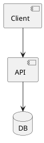
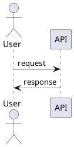

# DP-{NN}: {Design Point 이름}

> 이 파일은 단일 Design Point 의 상세 결정 기록입니다. 상위 index: [../design-decisions.md](../design-decisions.md)

## 1. Design Objective

(이 DP 가 해결하려는 핵심 설계 목표를 2~3 줄로 명시. 어떤 Driver / QA 로부터 파생되었는지 함께 기록)

- **관련 Driver/Requirement**: {Driver-KEY 목록}
- **designLevel**: `Architectural` | `Detailed`

---

## 2. QA 가중치

이 DP 의 선정 근거는 아래 QA 가중치에 따른 가중 평균으로 계산됩니다.

| QA | Weight | 선정 근거 |
|---|---|---|
| {QA 이름 예: Performance} | 0.5 | (이 DP 에서 Performance 를 강조하는 이유 — 예: "사용자 대기 시간이 이탈률에 직접 영향") |
| {QA 이름 예: Security} | 0.3 | ... |
| {QA 이름 예: Maintainability} | 0.2 | ... |
| **합계** | **1.00** | |

> 가중치 합은 1.0. DP 별로 다른 가중치 적용 가능 — 프로젝트 기본 가중치와 다르게 가중하는 경우 근거 명시 필수.

---

## 3. 후보 대안 비교

### 3.1 Candidate A: {후보 이름}

- **ADSN 이슈 키**: {생성 후 Step 5.3 에서 치환, 초안에는 `{A_KEY}`}
- **mode**: `create` / `reuse` (existingKey) / `modify` / `delete_mark`

**Structural View (정적 관점)**

**Dynamic View (동적 관점)**

**Pros**
- ...
- ...

**Cons**
- ...
- ...

**QA 평가**

| QA | Score (1-5) | Weighted | 근거 |
|---|---|---|---|
| {QA1} | 4 | 2.0 | 이 대안이 {QA1} 에 {4점} 인 구체 이유 |
| {QA2} | 3 | 0.9 | ... |
| {QA3} | 5 | 1.0 | ... |
| **총점** | | **3.9** | |

### 3.2 Candidate B: {후보 이름}

(동일 구조 반복)

### 3.3 Candidate C: {후보 이름} (있는 경우)

(동일 구조 반복)

---

## 4. 최종 선정

**선정안**: {단독 선택 시: "Candidate B" / 혼합 시: "Mix of A + C"}
**채택 ADSN**: {선택된 ADSN 이슈 키 목록}

**선정 근거**:
- 총점 기준 Candidate B 가 최고점 (3.9)
- Driver {X} ({QA/CNST 이름}) 에 대해 {이 대안이 만족시키는 방식}
- Driver {Y} 추적성: ...

**(혼합 채택 시 혼합 방식)**:
- Candidate A 의 {X 부분}: ...
- Candidate C 의 {Y 부분}: ...
- 통합 시 고려사항: ...

---

## 5. 트레이드오프 & 리스크

**기각된 대안의 트레이드오프**:
- Candidate A: {기각 이유, 어떤 조건에선 나을지}
- Candidate C: ...

**채택안의 리스크** (SATAM 에서 구조화):
- ...

**민감도 (Sensitivity)**:
- {어떤 조건 변화 시 재검토 필요한지}
