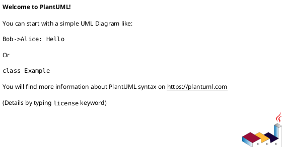

## 한 generation 당 제약 (GLM 계열 스톨 방지 — 필독)

- **한 generation 에서 Step 두 개 이상 처리 금지**. 각 Step 종료는 Bash tool call 로 마무리해 generation 경계 형성
- **PlantUML 격리 (Option C)**: Step 1 에서는 plantuml **생성 금지**. Step 1.5 에서만 후보별 `structuralDiagram` / `dynamicDiagram` 을 생성해 draft merge
- reasoning 은 각 Step 당 3~5 줄 이내. 표 기반 간결 기술
- Step 1, 1.5, 3 종료마다 **반드시 `draft-io.sh save`** 호출해 generation 종료
- Step 2 자가검증은 **반드시 `validate-design-decisions.py` 호출** — 에이전트 직접 계산 금지
- assistant 출력에는 draft JSON / 문서 본문 재노출 금지. "저장 완료 / critical N건" 한두 줄

## 진행 상태 가시화 — `todowrite` (OpenCode 한정, 선택)

이 스킬 Step 체크리스트:
```
# Todos
[ ] Step 0 — 데이터 수집 (Drivers + archSettings)
[ ] Step 1 — DP + 후보안 엔티티 + QA 점수 초안 (plantuml 없음)
[ ] Step 1.5 — 후보별 Structural/Dynamic PlantUML 추가
[ ] Step 2 — 자가검증 (validate-design-decisions.py)
[ ] Step 3 — critical 수정 (반복, 최대 iter 3)
[ ] Step 5 — ADSN 이슈 생성 + 링크 + index/DP 문서 영속화
[ ] Step 6 — 최종 보고
```

## 환경

- `PLATFORM_API` 기본값: `http://localhost:9000/api/v2`
- `GOJIRA_API` 기본값: `http://localhost:9001/api/v2`
- 임시 파일: `/tmp/${CODE}-dd-{draft|validation}.json`

## 인자 추출

- `CODE` — projectCode
- `USER` — user

```bash
export CODE="GOJIRA3"
export USER="batman"
```

## 역할

경험 많은 소프트웨어 아키텍트. 각 Design Point 마다 **복수 후보를 QA 가중 점수로 비교**해 근거 있는 최종 선정을 내린다. 모든 Driver 는 최소 1 DP 로 추적되어야 한다.

---

## Step 0 — 데이터 수집

```bash
PLATFORM_API="${PLATFORM_API:-http://localhost:9000/api/v2}"
GOJIRA_API="${GOJIRA_API:-http://localhost:9001/api/v2}"

# 프로젝트 archSettings (chosenStyles, normalizedAttributes, qaWeights)
echo "=== archSettings ==="
curl -s "${GOJIRA_API}/Project" -H "XBody: {\"jiraCode\":\"${CODE}\"}" -H "X-User-Id: ${USER}" \
  | jq '.[0].archSettings // {}'

# Architecture Drivers
echo; echo "=== Drivers ==="
curl -s "${GOJIRA_API}/Issue" -H "XBody: {\"prjID\":\"${CODE}\",\"infoType\":\"\"}" -H "X-User-Id: ${USER}" \
  | jq '[.[] | select(.issueType=="Requirement" and .driverSelected==true) | {key,subkey,summary,reqtype,qa,qad,qai,priority}]'

# 전체 Requirement (hallucination 방지용 실존 key 풀)
echo; echo "=== Requirement 전체 ==="
curl -s "${GOJIRA_API}/Issue" -H "XBody: {\"prjID\":\"${CODE}\",\"infoType\":\"\"}" -H "X-User-Id: ${USER}" \
  | jq '[.[] | select(.issueType=="Requirement") | {key,subkey,summary,reqtype,qa}]'

# 기존 ADSN/DDSN (스타일 ADSN 포함)
echo; echo "=== 기존 설계 이슈 ==="
curl -s "${GOJIRA_API}/Issue" -H "XBody: {\"prjID\":\"${CODE}\",\"infoType\":\"\"}" -H "X-User-Id: ${USER}" \
  | jq '[.[] | select(.issueType=="Architectural Design" or .issueType=="Detailed Design") | {key,subkey,issueType,summary,designPoint,designLevel}]'
```

선행 부족 (drivers 0건 / chosenStyles 비어있음 / normalizedAttributes 없음) → **중단** 하고 `style_define2` 먼저 실행 권고.

---

## Step 1 — 초안 생성 (iter 1, PlantUML 없음)

### 1.1 Design Point 식별

Driver / 선정 스타일 / 품질속성에서 설계 결정이 필요한 관심사 도출. 예:
- 데이터 일관성 전략 (strong/eventual, 분산 트랜잭션)
- 통신 패턴 (sync REST vs async event)
- 모듈 경계, 인증/인가, 장애 처리, 관측성, 배포 전략, 데이터 저장 선택

**모든 Driver 는 최소 1 DP 로 다뤄져야 한다.**

### 1.1a 스케일 가이드 (Step 1 batch 경계)

Step 1 은 모든 DP 의 후보 텍스트를 한 draft 로 flush (PlantUML 은 Step 1.5 에서 별도). 실측 기준:

| DP × 후보 총합 | Step 1 단일 generation 예상 | 권장 조치 |
|---|---|---|
| ≤ 10 | ~15K output / 350s 이내 | 현상 유지 (단일 batch) |
| 11~14 | ~20K output / 500s | 경고 — 단일 batch 허용하나 stall-watch 필수 |
| ≥ 15 | ~25K+ / 700s+ | **분할 권장** — DP 를 5~6 개씩 chunk 로 쪼개 여러 턴에 걸쳐 draft 에 append (`draft-io.sh save` 사이에 일부 DP 만 생성하고 다음 generation 에서 나머지 이어쓰기) |

2026-04-24 실측: DP 5 × 후보 2 = 10 일 때 output 13,493 / 353s (OK). DP 수나 후보 수가 이 범위를 넘으면 Step 1 을 chunk 로 분할해 stall 리스크 회피.

### 1.2 DP 별 필드 구성

각 DP 에 다음을 채운다:
- `docId` — `DP-N` (1부터)
- `designPoint` — 주제명 (예: "데이터 일관성 전략")
- `designLevel` — `Architectural` 또는 `Detailed`
- `objectives` — 이 DP 가 해결하려는 **Design Objective** (2~3 문장)
- `dmodel` — 적용 도메인/시스템 영역 (optional)
- `qaWeights` — 이 DP 에 한정되는 QA 가중치 (근거 포함, 합=1.0)
- `approaches` — 후보 대안 배열 (2개 이상 필수)
- `decisionSummary` — 최종 선정 요약 (단독 or "Mix of A+C")
- `decisionRationale` — Driver 역추적 가능한 선정 근거
- `relatedRequirements` — Driver/Requirement 이슈 key 배열
- `mode` — `create` / `reuse` / `modify` / `delete_mark`

### 1.3 후보(approach) 구조

각 후보는 다음 필드를 갖는다 (plantuml 은 Step 1.5 에서 추가):
- `candidateId` — DP 내에서 A/B/C... (유일)
- `name` — 대안 이름
- `pros` / `cons`
- `qaScores` — DP 의 qaWeights 키와 동일한 QA 에 대해 1~5 정수
- `weightedScore` — Σ(score × weight), 소수 둘째자리
- `eval` — QA 별 점수 근거 (짧은 문단)
- `chosen` — bool. 최종 선정 후보만 true
- `decisionNote` — `chosen=true` 일 때 필수. "단독 채택" / "Mix with {다른 candidateId}: {부분}" 같은 선정 근거 한두 줄
- **주의**: `structuralDiagram` / `dynamicDiagram` 은 **Step 1.5 에서 채움. 여기서는 쓰지 말 것**

### 1.4 선정 규칙

- 총점 최고 1개 단독 채택 → 그 후보만 `chosen=true`
- 최고점 근소(0.3 이하) 또는 상호 보완적 → 혼합 채택 가능. 관련 후보 모두 `chosen=true`, `decisionNote` 에 혼합 방식 기록
- 기존 후보 어느것도 그대로 쓰기 곤란 → **신규 "합성" 후보 추가** (candidateId 를 새로 부여하고 이것만 `chosen=true`). 원래 후보들은 `chosen=false` 유지. 이 경우 DP 내 candidate 개수가 N+1

### 1.5 QA 가중치 원칙

- 프로젝트 전역 기본값이 `archSettings.qaWeights` 에 있으면 그 값을 starting point 로
- 이 DP 에서 다른 강조가 필요하면 override (근거 필수 기록)
- weights 합 = 1.00 (±0.02 허용)

### 1.6 Requirement 매핑 (링크 타이트하게)

`relatedRequirements` 에 FR/NFR/CNST 실존 JIRA key 배열. **링크 기준 엄격 적용**:

- **DP 의 `objectives` 또는 `decisionRationale` 에서 명시적으로 이 Requirement 를 언급·근거로 사용한 경우에만** 링크
- 간접 영향 / 일반적 관련성 / "이 스타일이 전체에 영향" 류 논리는 **제외** (과도 링크 방지)
- 기준선: 한 DP 당 **2~4개** 링크. 5개 이상이면 "너무 많은 QA 에 근거 대는 중" 의 신호 → 링크 재검토
- 모든 Driver 는 최소 1 DP 에 등장해야 함 (커버리지). 단, 이 커버리지는 **모든 DP 가 모든 Driver 를 링크** 라는 뜻이 **아님** — **전체 DP 집합 기준으로 모든 Driver 가 최소 1번**이면 충분
- FR 은 해당 DP 의 후보안이 구현적으로 실현해야 하는 경우에만 링크 (구현 판정 기준). 일반 "관련 있음" 은 제외

### 1.7 문서 작성

Step 1 에서 index + 각 DP 파일 **뼈대**를 작성한다. 후보별 plantuml 블록 자리는 placeholder 로 비워두고 Step 1.5 에서 채운다:

````md
**Structural View**

````

섹션 필수:
- index (`design-decisions.md`): 1. Design Point 목록 / 2. Driver 추적성 / 3. QA 가중치 요약 / 4. 리스크 요약
- DP 파일 (`design-decisions/DP-NN-*.md`): 1. Design Objective / 2. QA 가중치 / 3. 후보 대안 / 4. 최종 선정 / 5. 트레이드오프

템플릿 참조:
```bash
cat "${PROJECT_ROOT}/.claude/skills/design-decide2/templates/design-decisions.md"  # index
cat "${PROJECT_ROOT}/.claude/skills/design-decide2/templates/dp.md"                # DP 파일
```

### Step 1 종료 — draft flush (필수)

**JSON 필드명은 스키마 그대로 사용**. validator 는 아래 키만 인식 — `point` / `alternatives` / `rationale` / `goal` 등 변형 금지. `approaches[]` 필수 필드: `candidateId, name, pros, cons, qaScores, weightedScore, eval, chosen`. `chosen=true` 인 후보는 `decisionNote` 필수.

```bash
cat > /tmp/${CODE}-dd-draft-input.json <<'JSON'
{
  "driverKeys": ["GOJIRA3-11","GOJIRA3-13"],
  "requirementKeys": ["GOJIRA3-11","GOJIRA3-12","GOJIRA3-13"],
  "designs": [
    {
      "docId":"DP-1",
      "designPoint":"데이터 일관성 전략",
      "designLevel":"Architectural",
      "objectives":"분산 트랜잭션 하의 데이터 무결성 확보와 응답성 균형",
      "dmodel":"주문 처리 서비스",
      "qaWeights":{
        "Performance":{"weight":0.5,"rationale":"응답 지연이 사용자 이탈에 직접 영향"},
        "Security":{"weight":0.3,"rationale":"결제 정보 일관성이 규제 요구"},
        "Maintainability":{"weight":0.2,"rationale":"장기 유지보수 대응"}
      },
      "approaches":[
        {
          "candidateId":"A",
          "name":"2PC (Strong consistency)",
          "pros":"원자성 보장, 데이터 정합성 강력",
          "cons":"동기 대기 오버헤드, 가용성 저하",
          "qaScores":{"Performance":3,"Security":5,"Maintainability":3},
          "weightedScore":3.6,
          "eval":"Performance: 2PC 대기 오버헤드로 3점. Security: 원자성 보장으로 5점. Maintainability: 표준 RDBMS 지원 3점.",
          "chosen":false,
          "decisionNote":""
        },
        {
          "candidateId":"B",
          "name":"Saga + Outbox",
          "pros":"비동기로 가용성·응답성 우수, 결합도 낮음",
          "cons":"최종 일관성, 보상 트랜잭션 복잡도",
          "qaScores":{"Performance":5,"Security":4,"Maintainability":4},
          "weightedScore":4.5,
          "eval":"Performance: 비동기로 5점. Security: 이벤트 순서 보장으로 4점. Maintainability: 패턴 성숙도 4점.",
          "chosen":true,
          "decisionNote":"단독 채택 — 총점 4.5 로 최고, Performance 강조 가중치에 부합"
        }
      ],
      "decisionSummary":"Candidate B (Saga + Outbox) 단독 채택",
      "decisionRationale":"Driver GOJIRA3-11 (응답 지연 < 500ms) 과 GOJIRA3-13 (서비스 가용성 99.9%) 을 동시 충족. Security 는 4점이지만 가중치 0.3 이므로 총점 우위가 결정적",
      "tradeoffs":"A 는 Security 최고점이지만 Performance 가중치가 높아 기각. Performance 요구가 완화되면 A 재검토",
      "relatedRequirements":["GOJIRA3-11","GOJIRA3-13"],
      "mode":"create",
      "existingKey":""
    }
  ],
  "document":{
    "index":"...design-decisions.md 마크다운 전체 (후보 plantuml 은 @startuml\\n' TBD\\n@enduml 로 placeholder)",
    "dpFiles":{
      "DP-1":"...DP-1-data-consistency.md 마크다운 전체 (plantuml placeholder)"
    }
  }
}
JSON

bash "${PROJECT_ROOT}/.claude/skills/_scripts/draft-io.sh" save "${CODE}" "dd" "draft" \
  < /tmp/${CODE}-dd-draft-input.json
```

출력 한 줄만 assistant 메시지에. JSON 재출력 금지.

---

## Step 1.5 — PlantUML 격리 단계 (신규, 필수)

Step 1 draft 를 로드하고 **각 후보에 structuralDiagram / dynamicDiagram 을 채워** 재저장. 이 단계는 generation 분리를 위해 따로 존재한다 (GLM 다이어그램 스톨 방지).

작성 규칙:
- **Structural View**: PlantUML **component 다이어그램** — 컴포넌트/레이어/데이터흐름 표현 (`component`, `database`, `[Name]`, `package` 등)
- **Dynamic View**: PlantUML **sequence 다이어그램** — 주요 시나리오의 시간 흐름 (`participant` + 화살표. 공백 있는 이름은 따옴표 또는 `as` 별칭 필수)
- 각 다이어그램은 ` ```plantuml ` / ` ``` ` 블록으로 감싸고 **반드시 `@startuml` / `@enduml` 쌍** 포함
- 같은 DP 안의 후보들은 **같은 문제를 다르게 푸는** 것이므로 공통 입력/출력을 표시해 비교 가시성 확보
- document.dpFiles[DP-N] 의 plantuml placeholder 도 함께 실제 내용으로 교체

작업 예:
```bash
# draft 로드 후 python 으로 후보별 plantuml 병합
bash "${PROJECT_ROOT}/.claude/skills/_scripts/draft-io.sh" load "${CODE}" "dd" "draft" > /tmp/${CODE}-dd-draft.json

python3 <<'PY'
import json, os
p = "/tmp/%s-dd-draft.json" % os.environ["CODE"]
d = json.load(open(p))

# 각 DP/후보에 structuralDiagram, dynamicDiagram 값을 채우기# (에이전트가 이 generation 에서 생성한 plantuml 내용을 여기 반영)
for design in d["designs"]:
    dp_id = design["docId"]
    for a in design["approaches"]:
        # 아래 두 문자열을 실제 plantuml 로 대체
        a["structuralDiagram"] = a.get("structuralDiagram") or "```plantuml\n@startuml\ncomponent Client\ncomponent API\ndatabase DB\nClient --> API\nAPI --> DB\n@enduml\n```"
        a["dynamicDiagram"]   = a.get("dynamicDiagram")   or "```plantuml\n@startuml\nactor User as U\nparticipant API as A\nU -> A: request\nA --> U: response\n@enduml\n```"

    # DP 파일 본문의 plantuml placeholder 를 실제 블록으로 교체
    body = d["document"]["dpFiles"].get(dp_id, "")
    # 에이전트가 placeholder → 실제 plantuml 치환 로직 작성 (단순 replace 가능)
    # ...

open(p, "w").write(json.dumps(d, ensure_ascii=False, indent=2))
PY

cat /tmp/${CODE}-dd-draft.json \
  | bash "${PROJECT_ROOT}/.claude/skills/_scripts/draft-io.sh" save "${CODE}" "dd" "draft"
```

출력 한 줄만. plantuml 원문 재출력 금지.

---

## Step 2 — 자가검증 (스크립트 기반)

**반드시 `validate-design-decisions.py` 호출**. 에이전트가 직접 계산 금지.

```bash
bash "${PROJECT_ROOT}/.claude/skills/_scripts/draft-io.sh" load "${CODE}" "dd" "draft" \
  | python3 "${PROJECT_ROOT}/.claude/skills/_scripts/validate-design-decisions.py" \
  > /tmp/${CODE}-dd-validation.json
cat /tmp/${CODE}-dd-validation.json
```

출력 스키마:
```json
{
  "pass": bool,
  "score": 0.0~1.0,
  "score_effective": number,
  "critical": [{"type":"...","docId":"DP-N","detail":"..."}],
  "suggestions": [...],
  "stats": {"designs":N,"architectural":A,"detailed":D,
            "driverCoverage":"C/T","approachAvg":F,
            "totalCandidates":TC,"chosenCandidates":CC,"dpFilesProvided":P}
}
```

스크립트가 잡는 critical (주요):
- `missing_field` / `empty_objectives` / `empty_rationale` / `empty_decisionSummary`
- `insufficient_approaches` — 후보 < 2
- `bad_qaWeights` / `qaWeights_sum_not_one` — 가중치 합 ≠ 1.0 (±0.02)
- `bad_qaScores` / `qaScore_out_of_range` / `qaScore_missing_qa` — 점수 1~5 범위, QA 매칭
- `bad_weightedScore_type` / `bad_chosen_type`
- `no_chosen_candidate` — chosen=true 후보 0건
- `chosen_without_note` — chosen=true 인데 decisionNote 비어있음
- `duplicate_candidateId`
- `missing_diagram` — Step 1.5 미수행 (structuralDiagram / dynamicDiagram 에 plantuml 블록 없음)
- `plantuml_missing_pair` — plantuml 블록에 `@startuml` / `@enduml` 쌍 누락
- `driver_uncovered` / `relatedRequirements_hallucination` / `no_requirement_link`
- `bad_designLevel` / `bad_docId_format` / `duplicate_docId`
- `index_missing_section` / `dp_file_missing` / `dp_file_missing_section`

### 통과 기준
- `pass == true` → Step 5 진입
- `pass == false` → Step 3 수정

---

## Step 3 — 수정 (pass=false)

critical 만 **국소 수정** 후 draft 재저장 (JSON 재구성 금지 — 이슈된 필드만 건드림):

```bash
# 예: python 으로 국소 수정
python3 <<'PY'
import json, os
p = "/tmp/%s-dd-draft.json" % os.environ["CODE"]
d = json.load(open(p))
# critical 유형별 수정 로직
open(p, "w").write(json.dumps(d, ensure_ascii=False, indent=2))
PY

cat /tmp/${CODE}-dd-draft.json \
  | bash "${PROJECT_ROOT}/.claude/skills/_scripts/draft-io.sh" save "${CODE}" "dd" "draft"
```

이 tool call 로 generation 종료. 다음 generation 에서 validate 재실행.

---

## Step 4 — 종료 조건

1. pass=true
2. iter 3 완료
3. 같은 critical 2회 연속 재발
4. 새 수정이 이전 best 보다 낮은 score_effective → 포기

**best-so-far**: `(designs, document, score_effective)` 기록. 종료 시 최댓값 iter 를 selected.

---

## Step 5 — 이슈 생성 + 링크 + 문서 영속화

### 5.1 ADSN 이슈 일괄 생성 (후보 단위)

**각 DP 의 각 후보 를 개별 ADSN/DDSN 이슈로 생성**. designLevel 에 따라 issueType 이 달라진다:
- `Architectural` → issueType `"Architectural Design"` (subkey `ADSN_NNN`)
- `Detailed` → issueType `"Detailed Design"` (subkey `DDSN_NNN`)

한 DP 에 N 후보가 있으면 N 이슈 생성. `chosen=true` 인 후보(들) 에만 `decision` 필드를 채운다. 나머지는 decision 빈 문자열.

```bash
# draft 에서 후보를 평탄화해 items 배열 구성
python3 <<'PY'
import json, os
d = json.load(open("/tmp/%s-dd-draft.json" % os.environ["CODE"]))

items = []
for design in d["designs"]:
    dp_id = design["docId"]
    issue_type = "Architectural Design" if design["designLevel"] == "Architectural" else "Detailed Design"
    approaches_json = json.dumps([
        {"candidateId": a["candidateId"], "name": a["name"]}
        for a in design["approaches"]
    ], ensure_ascii=False)

    for a in design["approaches"]:
        item = {
            "issueType":         issue_type,
            "summary":           f"{design['designPoint']}: {a['name']}",
            "desc":              f"{dp_id} 후보 {a['candidateId']}. {a.get('eval','')}",
            "designLevel":       design["designLevel"],
            "designPoint":       design["designPoint"],
            "objectives":        design["objectives"],
            "dmodel":            design.get("dmodel", ""),
            "approaches":        approaches_json,
            "pros":              a["pros"],
            "cons":              a["cons"],
            "score":             str(a["weightedScore"]),
            "eval":              a["eval"],
            "adiagram":          a.get("structuralDiagram", ""),
            "bdiagram":          a.get("dynamicDiagram", ""),
        }
        if a.get("chosen"):
            item["decision"]          = a.get("decisionNote", "")
            item["decisionRationale"] = design["decisionRationale"]
            item["tradeoffs"]         = design.get("tradeoffs", "")
        items.append(item)

open("/tmp/dd_items.json","w").write(json.dumps(items, ensure_ascii=False, indent=2))
print(f"{len(items)}건 준비")
PY

bash "${PROJECT_ROOT}/.claude/skills/_scripts/issue-batch-create.sh" "${CODE}" "${USER}" < /tmp/dd_items.json \
  > /tmp/dd_result.json
cat /tmp/dd_result.json
```

`issue-batch-create.sh` 가 POST 후 PUT 으로 ADSN/DDSN 필드 (designLevel / designPoint / objectives / approaches / decision / decisionRationale / pros / cons / score / eval / adiagram / bdiagram / tradeoffs) 를 자동 반영한다.

### 5.2 Requirement → 후보 ADSN Contains 링크

각 DP 의 `relatedRequirements` 는 **그 DP 의 모든 후보 ADSN** 에 동일하게 연결 (candidate 하나씩 개별 이슈이므로).

> **중복 제거 필수** — `POST /Issue/link` idempotent 아님. Step 0 수집한 issueLinks 와 차집합 POST.

```bash
# 각 DP 의 관련 Requirement × 생성된 모든 후보 ADSN 키 를 조합
python3 <<'PY'
import json, os
items = json.load(open("/tmp/dd_items.json"))
result = json.load(open("/tmp/dd_result.json"))
keys = result.get("keys", [])
assert len(keys) == len(items), f"key 개수 불일치: {len(keys)} vs {len(items)}"

# items 에서 DP 별 Requirement 키 복원이 어려우니 원본 draft 를 다시 읽음
d = json.load(open("/tmp/%s-dd-draft.json" % os.environ["CODE"]))

links = []
idx = 0
for design in d["designs"]:
    for a in design["approaches"]:
        candidate_key = keys[idx]
        idx += 1
        for req_key in design.get("relatedRequirements", []):
            links.append({
                "inwardKey":  req_key,
                "outwardKey": candidate_key,
                "linkType":   "Contains(WBSGantt)"
            })

open("/tmp/dd_links.json","w").write(json.dumps(links, ensure_ascii=False))
print(f"{len(links)}건 링크 예정")
PY

bash "${PROJECT_ROOT}/.claude/skills/_scripts/issue-batch-link.sh" "${CODE}" "${USER}" < /tmp/dd_links.json \
  > /tmp/dd_link_result.json
cat /tmp/dd_link_result.json
```

링크 실패는 silent drop 금지 — 보고에 건수 명시.

### 5.3 docId → subkey 치환 + DP 파일 저장

각 DP 의 후보별 ADSN 이슈 키가 확정됐으므로, document 본문의 candidate placeholder (`{A_KEY}` 등) 를 실제 이슈 키로 치환한 뒤 저장.

```bash
python3 <<'PY'
import json, os, subprocess, re, urllib.parse
d = json.load(open("/tmp/%s-dd-draft.json" % os.environ["CODE"]))
result = json.load(open("/tmp/dd_result.json"))
keys = result.get("keys", [])

# DP 순서대로 후보 key 매핑
idx = 0
dp_file_bodies = dict(d["document"].get("dpFiles", {}))
for design in d["designs"]:
    dp_id = design["docId"]
    body = dp_file_bodies.get(dp_id, "")
    for a in design["approaches"]:
        candidate_key = keys[idx]; idx += 1
        # placeholder {A_KEY} / {B_KEY} / {C_KEY} 형식을 실제 key 로 치환
        body = body.replace("{" + a["candidateId"] + "_KEY}", candidate_key)
    dp_file_bodies[dp_id] = body

# 파일 저장
def slugify(name):
    s = re.sub(r"[^0-9A-Za-z가-힣-]+", "-", name).strip("-").lower()
    return s[:50] if s else "dp"

user = os.environ["USER"]
code = os.environ["CODE"]
script = os.environ["PROJECT_ROOT"] + "/.claude/skills/_scripts/doc-save.sh"

# DP 별 파일
for design in d["designs"]:
    dp_id = design["docId"]
    num = dp_id.split("-")[1].zfill(2)
    slug = slugify(design["designPoint"])
    path = f"architecture/design-decisions/DP-{num}-{slug}.md"
    body = dp_file_bodies.get(dp_id, "")
    p = subprocess.run(["bash", script, code, user, path], input=body, text=True, capture_output=True)
    print(f"  {path}: {p.stdout.strip()}")

# index 파일
index_body = d["document"]["index"]
# index 내부의 {dp-link-DP-1} placeholder 를 실제 상대경로로 치환 (있는 경우)
p = subprocess.run(["bash", script, code, user, "architecture/design-decisions.md"],
                   input=index_body, text=True, capture_output=True)
print(f"  architecture/design-decisions.md: {p.stdout.strip()}")
PY
```

---

## Step 6 — 최종 보고

```
## 설계 결정 완료 (v2 Claude Code)

- Design Point: N개 (DP-01 ~ DP-NN)
- ADSN/DDSN 생성: 총 K건 (채택 C건 / 미채택 K-C건)
  - Architectural: A건 / Detailed: D건
- Requirement-Design 링크: L건
- 문서:
  - architecture/design-decisions.md (상위 index)
  - architecture/design-decisions/DP-01-*.md ~ DP-NN-*.md

### Driver 커버리지 매트릭스
| Driver | 담당 DP | 선정안 |
|---|---|---|
| GOJIRA3-11 (QA_001) | DP-01, DP-03 | Saga+Outbox / Microservices |
| GOJIRA3-13 (QA_002) | DP-01 | Saga+Outbox |

### 선정 결과 요약
| DP | 주제 | 후보 수 | 선정안 |
|---|---|---|---|
| DP-01 | 데이터 일관성 | 2 | Candidate B 단독 |
| DP-02 | 통신 패턴 | 3 | Mix of A+C |

### Self-loop
- iter N회 / selected=iter X (score_eff Y) / stop=pass|max_iter|...
- unresolvedCritical: [...]
```

---

## 주의

- 모든 curl 에 `X-User-Id: ${USER}` 필수
- `issueType` 은 정확히 `Architectural Design` / `Detailed Design` (공백 포함)
- 링크 linkType 은 정확히 `Contains(WBSGantt)` — Requirement 가 inward, ADSN 이 outward
- `qaWeights` 합 = 1.0 ±0.02 / `qaScores` 는 1~5 정수 / `weightedScore` 는 Σ(score×weight)
- `chosen=true` 후보는 반드시 `decisionNote` 기록. 혼합 채택은 여러 후보를 `chosen=true` 로 동시에
- **Step 1 에서 plantuml 쓰지 말 것** (Step 1.5 에서만). Step 1 에서 plantuml 생성하면 스톨 리스크
- `relatedRequirements` hallucination 금지 — Step 0 에서 수집한 실존 key 만
- Step 0, 1, 1.5, 2, 3, 5 만 실제 Bash 호출, Step 4 는 내부 판단
