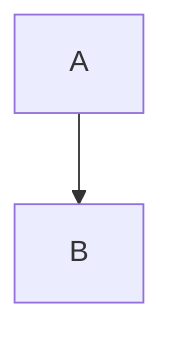

# 설계 결정 (Architectural & Detailed Design)

## 1. Design Point 요약

| Design Point | 결정 | 대안 | 관련 Driver | 이슈 ID |
|---|---|---|---|---|
| {design point 이름} | {선정 approach 이름} | {대안1}, {대안2} | {Driver-KEY1}, {Driver-KEY2} | ADSN-1 |
| {design point 이름} | {선정 approach 이름} | {대안1}, {대안2} | {Driver-KEY1} | DDSN-1 |
| ... | ... | ... | ... | ... |

- **Design Point**: 설계 관심사 이름 (예: "인증 방식", "이벤트 전송 방식")
- **대안**: 비교된 모든 approach (2 개 이상 필수)
- **관련 Driver**: normalizedAttributes 의 속성 또는 Requirement key
- **이슈 ID**: Step 5 에서 `ADSN_NNN` / `DDSN_NNN` 로 치환 (생성 전에는 docId `ADSN-N` / `DDSN-N`)

---

## 2. 설계 결정 상세

### ADSN-1: {Design Point 이름}

- **관련 Driver / Requirement**: {ID 목록}
- **검토된 대안**:
  - (A) {approach A 이름}
    - **pros**: ...
    - **cons**: ...
  - (B) {approach B 이름}
    - **pros**: ...
    - **cons**: ...
  - (C) {approach C 이름} (해당 시)
    - **pros**: ...
    - **cons**: ...
- **선정**: (A)
- **결정 근거**: Driver {X}(속성={level}) / NFR {Y}(measure={value}) 에 부합하고 ...
- **트레이드오프**: (B) 는 ... 유리하나 ... 이유로 기각
- **리스크**: ...
- **민감도**: ...
- **구조 다이어그램 (선택)**:

(Design Point 수준에서 구조가 설명되는 경우 — 예: 레이어 구성, 컴포넌트 배치)

---

### DDSN-1: {Design Point 이름}

- **관련 Driver / Requirement**: {ID 목록}
- **검토된 대안**: (2개 이상)
- **선정**: ...
- **결정 근거**: ...
- **트레이드오프**: ...
- **리스크**: ...
- **민감도**: ...

(ADSN / DDSN 구분:
- **ADSN (Architectural)**: 시스템 전체 영향, 변경 비용 큼 — 아키텍처 스타일 수준
- **DDSN (Detailed)**: 특정 컴포넌트/모듈 수준 결정, 국소적 영향)

---

## 3. Driver 추적성 매트릭스

| Driver | 담당 설계 이슈 |
|--------|----------------|
| {Driver-KEY1} | ADSN_001, DDSN_003 |
| {Driver-KEY2} | ADSN_002 |
| ... | ... |

⚠️ **모든 Driver 는 최소 1개 설계 결정과 연결되어야 함**. 미커버 Driver 있으면 critical.

---

## 4. 설계 결정의 리스크 요약

| 설계 ID | 리스크 요약 | 영향 QA |
|---------|-------------|---------|
| ADSN_001 | ... | Performance, Availability |
| DDSN_001 | ... | Security |
| ... | ... | ... |

(다음 SATAM 단계에서 각 ADSN 의 risk/sensitivity/mitigation 원문이 구조화됨)
