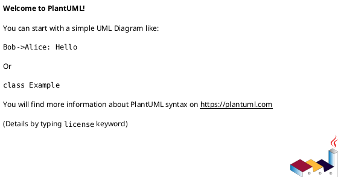

# {View 이름}

> 이 파일은 architecture-integrated 의 단일 view 본문입니다. 상위 index: [../architecture-integrated.md](../architecture-integrated.md)
>
> 4 view: [logical](logical.md) · [process](process.md) · [deployment](deployment.md) · [development](development.md)

## 1. 개요

(이 view 가 다루는 관점을 1~2 단락으로 명시. **첫 단락은 index 머리말로도 그대로 인용되므로** 단독으로 읽혀도 의미가 통하도록 작성. 어떤 결정/스타일이 이 view 에서 가시화되는지 짧게 언급.)

---

## 2. 핵심 entity

이 view 에 등장하는 entity. 식별자(id)는 **다른 view 와 동일** 하게 사용 — 동일 컴포넌트가 view 마다 다른 이름으로 등장하면 critical.

| ID | 이름 | 종류 | 설명 |
|---|---|---|---|
| {ID} | {표시명} | component / process / node / package | (한 줄 설명) |
| ... | ... | ... | ... |

> 4 view 전체 entity 표는 index 의 §2 Cross-View Entity Dictionary 에 자동 통합됨.

---

## 3. 다이어그램

이 view 의 추천 PlantUML 종류:
- **logical** → component 다이어그램 (`component`, `database`, `[Name]` + 화살표)
- **process** → sequence 또는 activity 다이어그램 (`participant`, `actor`, `:label;`)
- **deployment** → deployment 다이어그램 (`node`, `artifact`, `cloud`, `database`, `frame`)
- **development** → package 또는 component 다이어그램 (`package "이름" { [Component] }` 중첩 + 의존 화살표)

각 view 당 PlantUML **1~2 블록** 권장. 모든 블록은 ` ```plantuml ... ``` ` 코드펜스 + `@startuml` / `@enduml` 쌍 필수.



(필요 시 두 번째 블록)


---

## 4. 흐름 / 상호작용 (선택)

이 view 의 다이어그램이 표현하는 핵심 흐름·상호작용을 글로 보충. 다이어그램만으로 의미가 충분하면 생략 가능.

- 시나리오 1: ...
- 시나리오 2: ...

---

## 5. 트레이드오프 / 결정 근거

이 view 에서 드러나는 핵심 결정과 트레이드오프. 어느 ADSN/DDSN 의 선정안이 이 view 에 반영되는지 명시.

- 결정: ...
- 트레이드오프: ...
- 대안 대비 이 구조를 택한 이유: ...

---

## 6. 참조

| 참조 | 종류 | 비고 |
|---|---|---|
| ADSN_NNN | Architectural Design | (이 view 에서 어떻게 반영되는지) |
| DDSN_NNN | Detailed Design | ... |
| {Driver-KEY} | Driver/Requirement | ... |
| {Style ID/이름} | Style | ... |
