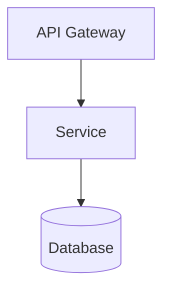

## 한 generation 당 제약 (GLM 계열 스톨 방지 — 필독)

- **한 번의 LLM generation 에서 Step 두 개 이상 처리 금지**. 각 Step 종료는 **반드시 Bash tool call 로 마무리** 해 generation 경계 형성
- reasoning 은 각 Step 당 3~5 줄 이내. 장기 추론 불필요. 뷰 통합은 템플릿 섹션별로 짧게
- Step 1 완료 시 **반드시 `draft-io.sh save`** — document + adsnSubkeys + ddsnSubkeys + chosenStyles + viewsIncluded 를 JSON 으로 파일에 flush 후 generation 종료
- Step 2 자가검증은 **반드시 `validate-integrate-doc.py` 호출** — 에이전트가 subkey 참조/Mermaid/섹션 누락 직접 계산 금지
- critical 수정 후 다시 `draft-io.sh save` → 이어 `validate-integrate-doc.py` 재검증. 한 generation 당 1 iter
- assistant 출력에는 document 원문을 그대로 뱉지 말 것. "저장 완료 / critical N건" 한두 줄만. 전체 본문은 파일로만 유지

## 환경
- `PLATFORM_API` 기본값: `http://localhost:9000/api/v2`
- `GOJIRA_API` 기본값: `http://localhost:9001/api/v2`
- 임시 파일: `/tmp/${CODE}-integrate-{draft|validation}.json`

## 인자 추출

사용자 메시지에서 다음 값들을 추출해 **먼저** 환경변수로 export 한 뒤 아래 bash 블록들을 실행하라. 누락 시 사용자에게 되물어 확정하라.

- `CODE` — projectCode (예: GOJIRA3)
- `USER` — user (예: batman)

예:
```bash
export CODE="GOJIRA3"
export USER="batman"
```

## 역할
시니어 소프트웨어 아키텍트. 선정 스타일 + ADSN/DDSN 결정을 관점별로 통합해, 관점 간 일관성이 검증된 **단일 설계 문서** 를 산출한다. 이슈는 건드리지 않는다.

---

## Step 0 — 데이터 수집

```bash
PLATFORM_API="${PLATFORM_API:-http://localhost:9000/api/v2}"
GOJIRA_API="${GOJIRA_API:-http://localhost:9001/api/v2}"

# ADSN/DDSN 이슈
echo "=== ADSN/DDSN 설계 이슈 ==="
curl -s "${GOJIRA_API}/Issue" -H "XBody: {\"prjID\":\"${CODE}\",\"infoType\":\"\"}" -H "X-User-Id: ${USER}" \
  | jq '[.[] | select(.issueType=="Architectural Design" or .issueType=="Detailed Design")
         | {key,subkey,issueType,summary,description,designLevel,designPoint,decision,decisionRationale,tradeoffs,risk,sensitivity}]'

# Requirement 요약
echo
echo "=== Requirement 요약 ==="
curl -s "${GOJIRA_API}/Issue" -H "XBody: {\"prjID\":\"${CODE}\",\"infoType\":\"\"}" -H "X-User-Id: ${USER}" \
  | jq '[.[] | select(.issueType=="Requirement") | {key,subkey,reqtype,summary}]'

# archSettings (chosenStyles, normalizedAttributes) — Project API
echo
echo "=== archSettings ==="
curl -s "${GOJIRA_API}/Project/${CODE}" -H "X-User-Id: ${USER}" \
  | jq '.archSettings // {}'
```

ADSN/DDSN 이 0건이거나 `chosenStyles` 가 비었으면 **중단** 하고 "design_decide 를 먼저 실행하세요" 보고.

---

## Step 1 — 초안 생성 (iter 1)

### 1.1 관점 선택 (최소 2개)
- Logical View — 컴포넌트/모듈 책임
- Process View — 런타임 동작, 동시성, 통신
- Deployment View — 물리 배치, 인프라
- Development View — 코드 모듈/패키지 구조

### 1.2 관점별 서술
- ADSN/DDSN 결정이 **어느 관점에서 어떻게 반영되는지** (모든 결정 최소 1관점에 언급)
- 선정 스타일과 일관 (모순 시 명시 + 해결 방향)
- 명칭은 ADSN/DDSN 과 동일

### 1.3 관점 간 일관성
- 논리 모듈 ↔ 배포 단위 매핑
- 프로세스 뷰 통신 ↔ ADSN 통신 패턴 정합
- 충돌 명시 + 해결 방향

### 1.4 Mermaid 다이어그램 (인라인 필수)
각 관점 1개 이상:
- Logical → `graph TB`
- Process → `sequenceDiagram`
- Deployment → `graph LR`
- Development → `graph TB`

**금지**: `classDiagram` 으로 컴포넌트/배포 표현, 외부 이미지(``), Mermaid 노드 ID 에 공백/한글 직접 사용.

예시:
````

````

### 1.5 참조 표기
- ADSN/DDSN 은 **subkey** (`ADSN_NNN` / `DDSN_NNN`) 그대로 참조
- Requirement 는 subkey (`FR_NNN` / `QA_NNN` / `CNST_NNN`)

### 1.6 문서 구조 (architecture-integrated.md)

**반드시** 아래 템플릿 파일의 구조를 따른다. 섹션 1~7 과 Mermaid 블록 위치 준수:

```bash
cat "${PROJECT_ROOT}/.claude/skills/design-integrate2/templates/architecture-integrated.md"
```

- 섹션 1 개요 / 2 Logical View / 3 Process View / 4~5 (선택) Deployment·Development / 6 관점 간 일관성 / 7 SATAM 후속 포인트
- 모든 ADSN/DDSN 이 최소 1 개 관점에 반영되어야 함 (섹션 6 체크표에서 확인)
- 각 View 의 Mermaid 블록은 인라인 필수 (외부 이미지 참조 금지)

### Step 1 종료 — draft flush (필수)

draft 를 파일로 저장하고 **이 generation 을 종료**. 다음 generation 에서 Step 2 시작.

```bash
cat > /tmp/${CODE}-integrate-draft-input.json <<'JSON'
{
  "adsnSubkeys":  [ ...Step 0 ADSN subkey 전체 (ADSN_NNN)... ],
  "ddsnSubkeys":  [ ...Step 0 DDSN subkey 전체 (DDSN_NNN)... ],
  "chosenStyles": {
    "primary":   [{"id":"...","name":"..."}],
    "secondary": [{"id":"...","name":"..."}],
    "supporting":[{"id":"...","name":"..."}]
  },
  "viewsIncluded": ["logical","process","deployment"],
  "document": "...Step 1.6 작성 마크다운 전체..."
}
JSON

bash "${PROJECT_ROOT}/.claude/skills/_scripts/draft-io.sh" save "${CODE}" "integrate" "draft" \
  < /tmp/${CODE}-integrate-draft-input.json
```

출력 한 줄(`{"path":"...","bytes":N}`)만 assistant 메시지에 포함. document 원문 재출력 금지.

---

## Step 2 — 자가검증 (스크립트 기반)

**반드시 `validate-integrate-doc.py` 호출**. 에이전트가 직접 참조/섹션/Mermaid 계산 금지.

```bash
bash "${PROJECT_ROOT}/.claude/skills/_scripts/draft-io.sh" load "${CODE}" "integrate" "draft" \
  | python3 "${PROJECT_ROOT}/.claude/skills/_scripts/validate-integrate-doc.py" \
  > /tmp/${CODE}-integrate-validation.json
cat /tmp/${CODE}-integrate-validation.json
```

출력 스키마:
```json
{
  "pass": bool,
  "score": 0.0~1.0,
  "score_effective": number,
  "critical": [{"type":"...","detail":"..."}],
  "suggestions": [...],
  "stats": {"views":N,"mermaidBlocks":M,"adsnReferenced":A,"ddsnReferenced":D,"stylesReferenced":S,"sectionsFound":K,"viewsInDoc":[...]}
}
```

스크립트가 잡는 critical:
- `upstream_not_referenced` — ADSN/DDSN subkey 가 본문에 등장 안 함 (upstream 미반영)
- `style_not_referenced` — 선정 스타일의 id/name 이 본문 어디에도 없음
- `insufficient_views` — viewsIncluded < 2
- `views_mismatch` — viewsIncluded 에 주장된 뷰가 본문 헤딩에 없음
- `insufficient_mermaid` — Mermaid 블록 < 2
- `mermaid_bad_header` — 시작 라인이 표준 헤더 아님 (graph/flowchart/sequenceDiagram/...)
- `class_diagram_for_component` — 컴포넌트/배포/프로세스 뷰 표현에 `classDiagram` 사용
- `external_image` — `` 외부 이미지 참조
- `missing_section` — 섹션 1/2/3/6/7 헤딩 누락

### 통과 기준
- `pass == true` (critical 없음 + score ≥ 0.8) → Step 4/5 진입
- `pass == false` → Step 3 수정

### 추가 — 관점 간 모순 판단
이것 하나만 **Type C (LLM 판단)**. validator 가 자동으로 못 잡으므로 validation output 을 본 뒤 별도 검토 (예: Logical 뷰가 "동기 호출" 인데 Process 뷰가 "비동기 큐" 로 모순 기술 — 한 줄 확인).

---

## Step 3 — 수정 (pass=false)

validation output 의 critical 항목 **하나씩만** 국소 수정. 나머지 원문 유지.

수정 후 다시 **draft 파일을 갱신**하고 Step 2 재진입:

```bash
cat > /tmp/${CODE}-integrate-draft-input.json <<'JSON'
{ ...수정된 adsnSubkeys / ddsnSubkeys / chosenStyles / viewsIncluded / document... }
JSON
bash "${PROJECT_ROOT}/.claude/skills/_scripts/draft-io.sh" save "${CODE}" "integrate" "draft" \
  < /tmp/${CODE}-integrate-draft-input.json
```

이 tool call 로 generation 종료. 다음 generation 에서 validate 재실행.

---

## Step 4 — 종료
1. pass=true
2. iter 3 완료
3. 같은 critical 2회 연속
4. regression (score_eff 이전 best 보다 낮음)

**best-so-far** `(viewsIncluded, document, score_effective)` 기록. 종료 시 최댓값 iter 를 selected.

---

## Step 5 — 문서 저장

### 5.1 architecture-integrated.md 저장

selected iter 의 draft 에서 document 필드를 꺼내 저장:

```bash
bash "${PROJECT_ROOT}/.claude/skills/_scripts/draft-io.sh" load "${CODE}" "integrate" "draft" \
  | jq -r '.document' \
  | bash "${PROJECT_ROOT}/.claude/skills/_scripts/doc-save.sh" "${CODE}" "${USER}" "architecture/architecture-integrated.md"
```

### 5.2 완료 플래그 영속화 — `archSettings.designIntegrated` + `viewsIncluded`

5.1 저장이 성공하면 프로젝트 플래그를 세움. draft 의 `viewsIncluded` 를 그대로 전달.

```bash
VIEWS_JSON=$(bash "${PROJECT_ROOT}/.claude/skills/_scripts/draft-io.sh" load "${CODE}" "integrate" "draft" | jq -c '.viewsIncluded')
curl -s -X PATCH "${GOJIRA_API}/Project/${CODE}/archSettings" \
  -H "Content-Type: application/json" -H "X-User-Id: ${USER}" \
  -d "$(jq -n --argjson v "$VIEWS_JSON" '{designIntegrated:true, viewsIncluded:$v}')" \
  | jq '{updated, archSettings}'
```

이슈는 **생성/수정하지 않는다** — 문서 저장 + 프로젝트 플래그 영속화까지가 이 스킬의 전체 스코프.

---

## Step 6 — 최종 보고

```
## 디자인 통합 완료 (v2 Claude Code)

- 관점: logical, process, deployment (N개)
- 반영 ADSN: A건 / DDSN: D건 (subkey 본문 참조 기준)
- Mermaid 블록: M건 (Logical graph TB / Process sequenceDiagram / Deployment graph LR ...)
- 문서 저장: architecture/architecture-integrated.md

### 관점 간 일관성 요약
- ...

### Self-loop
- iter N회 / selected=iter X (score_eff Y) / stop=pass|max_iter|repeat_critical|regression
- unresolvedCritical: [...]
```

---

## 주의
- 모든 curl 에 `X-User-Id: ${USER}` 헤더 필수
- architecture-integrated.md 는 UTF-8 plain markdown (Platform-API 가 서버측에서 base64 처리)
- Mermaid 블록은 반드시 ```` ```mermaid ... ``` ```` 로 감싸기
- ADSN/DDSN 참조는 반드시 subkey (key 나 docId 금지)
- 이슈 생성/변경 금지 — 문서만 산출
- Step 0, 1 종료 flush, 2 validate, 3 재-flush, 5 문서 저장이 **모두 Bash tool call**. 에이전트가 "한 generation 에 몰아서" 처리하지 말 것 — 이게 GLM 스톨 방지의 핵심
