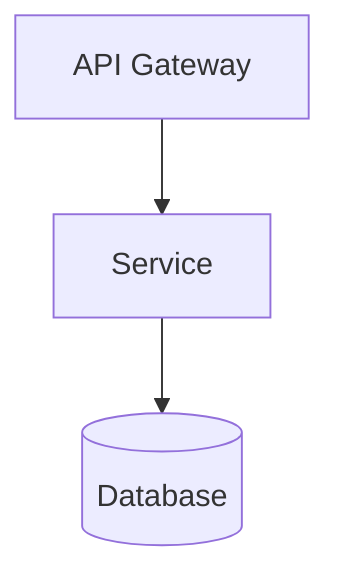

## 환경
- `PLATFORM_API` 기본값: `http://localhost:9000/api/v2`
- `GOJIRA_API` 기본값: `http://localhost:9001/api/v2`

## 인자 추출

사용자 메시지에서 다음 값들을 추출해 **먼저** 환경변수로 export 한 뒤 아래 bash 블록들을 실행하라. 누락 시 사용자에게 되물어 확정하라.

- `CODE` — projectCode (예: GOJIRA3)
- `USER` — user (예: batman)

예:
```bash
export CODE="GOJIRA3"
export USER="batman"
```

## 역할
시니어 소프트웨어 아키텍트. 선정 스타일 + ADSN/DDSN 결정을 관점별로 통합해, 관점 간 일관성이 검증된 **단일 설계 문서** 를 산출한다. 이슈는 건드리지 않는다.

---

## Step 0 — 데이터 수집

```bash
PLATFORM_API="${PLATFORM_API:-http://localhost:9000/api/v2}"
GOJIRA_API="${GOJIRA_API:-http://localhost:9001/api/v2}"

# ADSN/DDSN 이슈
echo "=== ADSN/DDSN 설계 이슈 ==="
curl -s "${GOJIRA_API}/Issue" -H "XBody: {\"prjID\":\"${CODE}\",\"infoType\":\"\"}" -H "X-User-Id: ${USER}" \
  | jq '[.[] | select(.issueType=="Architectural Design" or .issueType=="Detailed Design")
         | {key,subkey,issueType,summary,description,designLevel,designPoint,decision,decisionRationale,tradeoffs,risk,sensitivity}]'

# Requirement 요약
echo
echo "=== Requirement 요약 ==="
curl -s "${GOJIRA_API}/Issue" -H "XBody: {\"prjID\":\"${CODE}\",\"infoType\":\"\"}" -H "X-User-Id: ${USER}" \
  | jq '[.[] | select(.issueType=="Requirement") | {key,subkey,reqtype,summary}]'

# archSettings (chosenStyles, normalizedAttributes) — Project API
echo
echo "=== archSettings ==="
curl -s "${GOJIRA_API}/Project/${CODE}" -H "X-User-Id: ${USER}" \
  | jq '.archSettings // {}'
```

ADSN/DDSN 이 0건이거나 `chosenStyles` 가 비었으면 **중단** 하고 "design_decide 를 먼저 실행하세요" 보고.

---

## Step 1 — 초안 생성 (iter 1)

### 1.1 관점 선택 (최소 2개)
- Logical View — 컴포넌트/모듈 책임
- Process View — 런타임 동작, 동시성, 통신
- Deployment View — 물리 배치, 인프라
- Development View — 코드 모듈/패키지 구조

### 1.2 관점별 서술
- ADSN/DDSN 결정이 **어느 관점에서 어떻게 반영되는지** (모든 결정 최소 1관점에 언급)
- 선정 스타일과 일관 (모순 시 명시 + 해결 방향)
- 명칭은 ADSN/DDSN 과 동일

### 1.3 관점 간 일관성
- 논리 모듈 ↔ 배포 단위 매핑
- 프로세스 뷰 통신 ↔ ADSN 통신 패턴 정합
- 충돌 명시 + 해결 방향

### 1.4 Mermaid 다이어그램 (인라인 필수)
각 관점 1개 이상:
- Logical → `graph TB`
- Process → `sequenceDiagram`
- Deployment → `graph LR`
- Development → `graph TB`

**금지**: `classDiagram` 으로 컴포넌트/배포 표현, 외부 이미지(``), Mermaid 노드 ID 에 공백/한글 직접 사용.

예시:
````

````

### 1.5 참조 표기
- ADSN/DDSN 은 **subkey** (`ADSN_NNN` / `DDSN_NNN`) 그대로 참조
- Requirement 는 subkey (`FR_NNN` / `QA_NNN` / `CNST_NNN`)

### 1.6 문서 구조 (architecture-integrated.md)

```
# 통합 설계 뷰 (Integrated Design Views)

## 1. 개요
- 시스템 스타일 요약
- 주요 설계 결정 요약 (ADSN_NNN — 한 줄)

## 2. Logical View
### 2.1 주요 컴포넌트와 책임
### 2.2 의존 관계 (Mermaid graph TB)
### 2.3 반영된 ADSN/DDSN

## 3. Process View
### 3.1 런타임 상호작용 (sequenceDiagram)
### 3.2 비동기/이벤트 흐름
### 3.3 반영된 ADSN/DDSN

## 4. (선택) Deployment View / Development View

## 5. 관점 간 일관성 점검

## 6. 후속 단계 포인트 (SATAM 집중 점검 후보)
```

---

## Step 2 — 자가검증

### critical 기준
- ADSN/DDSN 중 **단 1건이라도** 본문에서 subkey 로 참조되지 않음 (upstream 미반영)
- 선정 스타일 중 본문 언급 0 인 항목
- 정규화 속성과 본문 설계 방향 모순
- 관점이 1개 이하
- Mermaid 다이어그램 전 관점 합쳐 1개 이하
- Mermaid 구문 오류 / 시작 라인 비표준
- 컴포넌트/배포 뷰에 `classDiagram` 사용
- 외부 이미지 참조
- §5 관점 간 일관성 섹션 부재
- `viewsIncluded` 가 본문 실제 뷰와 불일치

### 점수
- `score`: 0.0~1.0
- `score_effective = score - 0.5 × |critical|`
- `pass = score_effective >= 0.8`

---

## Step 3 — 수정 (pass=false)

critical + suggestions 만 **국소 수정**. 나머지 원문 유지. 수정 후 Step 2 로.

---

## Step 4 — 종료
1. pass=true
2. iter 3 완료
3. 같은 critical 2회 연속
4. regression (score_eff 이전 best 보다 낮음)

**best-so-far** `(viewsIncluded, document, score_effective)` 기록. 종료 시 최댓값 iter 를 selected.

---

## Step 5 — 문서 저장

```bash
echo "$DOCUMENT" | bash "${PROJECT_ROOT}/.claude/skills/_scripts/doc-save.sh" "${CODE}" "${USER}" "architecture/architecture-integrated.md"
```

이슈는 **생성/수정하지 않는다**. `archSettings.designIntegrated=true` 플래그 설정은 서버 측에서 별도 처리 (native 스킬은 문서 저장까지만).

---

## Step 6 — 최종 보고

```
## 디자인 통합 완료 (v2 Claude Code)

- 관점: logical, process, deployment (N개)
- 반영 ADSN/DDSN: M건 (subkey 리스트)
- 문서 저장: architecture/architecture-integrated.md
- Mermaid: Logical(graph TB) / Process(sequenceDiagram) / Deployment(graph LR)

### 관점 간 일관성 요약
- ...

### Self-loop
- iter N회 / selected=iter X (score_eff Y) / stop=pass|max_iter|...
- unresolvedCritical: [...]
```

---

## 주의
- 모든 curl 에 `X-User-Id: ${USER}` 헤더 필수
- architecture-integrated.md 는 UTF-8 plain markdown (Platform-API 가 서버측에서 base64 처리)
- Mermaid 블록은 반드시 ```` ```mermaid ... ``` ```` 로 감싸기
- ADSN/DDSN 참조는 반드시 subkey (key 나 docId 금지)
- 이슈 생성/변경 금지 — 문서만 산출
