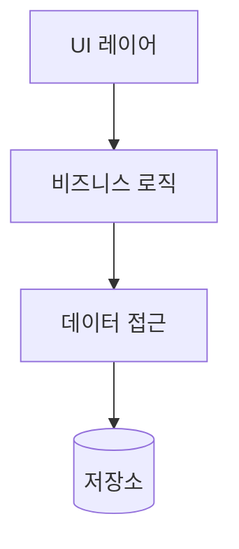
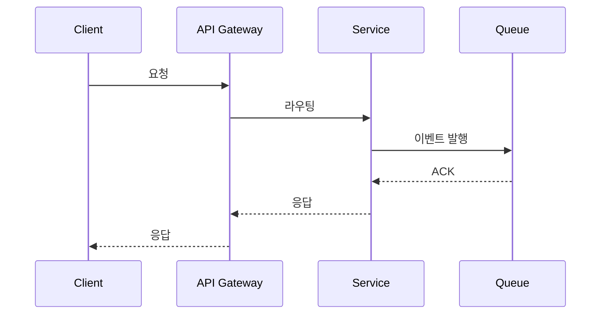
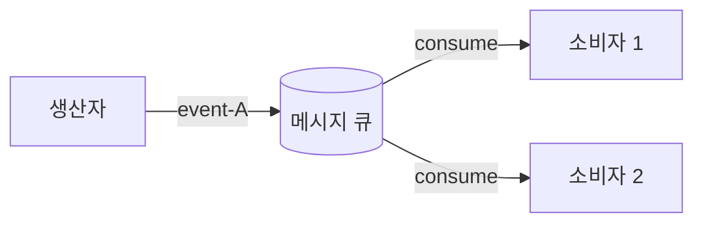
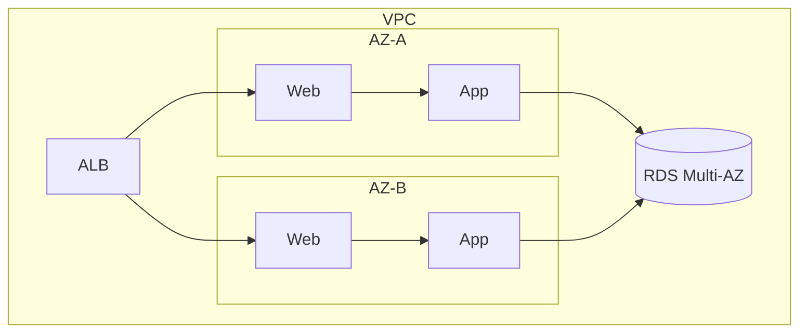

# 통합 설계 뷰 (Integrated Design Views)

## 1. 개요

본 문서는 {프로젝트명} 의 ADSN/DDSN 결정을 **Logical / Process / Deployment / Development** 4가지 관점(Architectural Views)으로 통합해 아키텍처 전체를 서술한다.

- **선정 스타일**: {Primary} / {Secondary} / {Supporting}
- **주요 ADSN 수**: {N}
- **주요 DDSN 수**: {M}

---

## 2. Logical View

**관심**: 시스템이 제공하는 기능적 구성 요소와 그들 사이의 책임 분담

### 2.1 주요 컴포넌트와 책임

| 컴포넌트 | 책임 | 관련 ADSN/DDSN |
|----------|------|----------------|
| {컴포넌트명} | ... | ADSN_001 |
| {컴포넌트명} | ... | ADSN_002, DDSN_001 |
| ... | ... | ... |

### 2.2 의존 관계



### 2.3 반영된 ADSN/DDSN

- `ADSN_001`: {Design Point} — ...
- `DDSN_001`: {Design Point} — ...

---

## 3. Process View

**관심**: 런타임 동작 / 프로세스 간 상호작용 / 동시성

### 3.1 런타임 상호작용



### 3.2 비동기 / 이벤트 흐름



### 3.3 반영된 ADSN/DDSN

- `ADSN_XXX`: ...

---

## 4. (선택) Deployment View

**관심**: 물리적 배포 / 네트워크 토폴로지 / 인프라



- **반영 ADSN/DDSN**: ...

---

## 5. (선택) Development View

**관심**: 코드 구조 / 모듈 패키징 / 빌드 파이프라인

```
src/
  api/          # REST / RPC 엔드포인트
  domain/       # 도메인 모델
  infra/        # DB / 외부 서비스 어댑터
  app/          # 유스케이스 서비스
test/
docs/
```

- **반영 ADSN/DDSN**: ...

---

## 6. 관점 간 일관성 점검

| 체크 항목 | 결과 | 비고 |
|-----------|------|------|
| Logical 의 컴포넌트가 Process sequence 에 등장하는가 | ✓ | |
| Logical 의 모듈이 Development 패키지 구조에 반영되는가 | ✓ | |
| Process 의 요소가 Deployment 토폴로지에 배치 가능한가 | ✓ | |
| 모든 ADSN/DDSN 이 최소 1 개 관점에 반영되었는가 | ✓ | |

⚠️ 하나라도 불일치 있으면 Step 3 critical.

---

## 7. 후속 단계 포인트 (SATAM 집중 점검 후보)

- `ADSN_XXX` — Risk {요약}, 영향 QA: Performance, Availability
- `ADSN_YYY` — Risk {요약}, 영향 QA: Security
- ...

(다음 단계 `satam-analyze2` 에서 각 ADSN 의 risk/sensitivity/mitigation 원문이 구조화됨)
