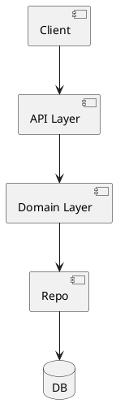
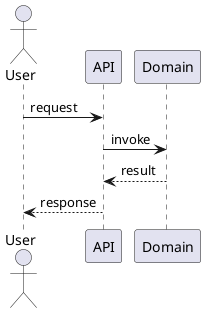

# ADSN_{NNN}: {조합 이름}

> 이 파일은 통합 스타일 후보 하나의 상세입니다. 상위 index: [../architecture-style.md](../architecture-style.md)
> 파일명 및 제목의 `ADSN_{NNN}` 은 실제 JIRA ADSN 이슈의 subkey 와 동일합니다.

## 1. 조합 구성

| 역할 | 스타일 이름 | 스타일 ID | 조합 내 역할 |
|---|---|---|---|
| Primary | {이름} | {id} | {이 조합에서의 책임 — 예: 전체 모듈 경계 제공} |
| Secondary | {이름} | {id} | {이 조합에서의 책임} |
| Supporting | {이름} | {id} | {이 조합에서의 책임} |
| Supporting | {이름} | {id} | ... |

- **Primary**: 주된 결정 계층을 지배하는 스타일 (scope 당 1개)
- **Secondary**: Primary 를 보완하거나 직교 관심사를 다루는 스타일
- **Supporting**: 선택적으로 결합된 보조 스타일 (0~N개)

---

## 2. Design Objective

이 조합이 해결하려는 핵심 아키텍처 목표 2~3 줄.
- **관련 Driver/Requirement**: {Driver-KEY 목록}

---

## 3. Structural View (정적)

이 조합이 구성하는 전체 시스템의 **정적 구조** — 컴포넌트/모듈/레이어 배치.

---

## 4. Dynamic View (동적)

이 조합이 런타임에 **어떻게 동작** 하는지 — 주요 시나리오의 시간 순 흐름.

---

## 5. Pros / Cons

**Pros**
- ...
- ...

**Cons**
- ...
- ...

---

## 6. QA 평가 (1-5 점)

index 의 QA 가중치를 적용해 산출. 각 점수 옆에 근거 표기.

| QA | Score (1-5) | Weighted | 근거 |
|---|---|---|---|
| {QA1} | 4 | 2.00 | {이 조합이 QA1 에 {4점} 인 구체 이유} |
| {QA2} | 3 | 0.90 | ... |
| {QA3} | 5 | 1.00 | ... |
| **총점** | | **X.XX** | |

---

## 7. 트레이드오프

- Primary 스타일의 단점이 이 조합에서 어떻게 완화 or 허용되는지
- 대안 대비 희생되는 측면
- 재검토 트리거: 어떤 조건이 바뀌면 이 조합을 재평가해야 하는지

---

## 8. 선정 여부

**chosen**: ✓ / —
**선정 근거 (선정된 경우)**:
- ...

**(미채택인 경우 기각 이유 요약)**:
- ...
