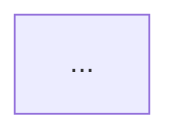

## 환경
- `PLATFORM_API` 기본값: `http://localhost:9000/api/v2`
- `GOJIRA_API` 기본값: `http://localhost:9001/api/v2`

## 인자 추출

사용자 메시지에서 다음 값들을 추출해 **먼저** 환경변수로 export 한 뒤 아래 bash 블록들을 실행하라. 누락 시 사용자에게 되물어 확정하라.

- `CODE` — projectCode (예: GOJIRA3)
- `USER` — user (예: batman)

예:
```bash
export CODE="GOJIRA3"
export USER="batman"
```

## 역할
아키텍트. Architecture Driver(정규화 속성)를 근거로 시스템 스타일 카탈로그에서 적합 스타일을 선정한다.
**모든 선정은 Driver 로 역추적 가능해야 함 (driver coverage)**.

---

## Step 0 — 선행 데이터 수집

### 0.1 normalizedAttributes 확보
프로젝트의 `archSettings.normalizedAttributes` 조회. 없으면 **중단** → "driver_select 를 먼저 실행하세요".

```bash
PLATFORM_API="${PLATFORM_API:-http://localhost:9000/api/v2}"
GOJIRA_API="${GOJIRA_API:-http://localhost:9001/api/v2}"

curl -s "${GOJIRA_API}/Project" \
  -H "XBody: {\"jiraCode\":\"${CODE}\"}" -H "X-User-Id: ${USER}" \
  | jq '.[0].archSettings.normalizedAttributes // {}'
```

결과가 빈 객체면 중단.

### 0.2 카탈로그 읽기
카탈로그는 `knowledge/arch-styles/` 하위에 `index.yaml` + `styles/*.yaml` 구조.

```bash
KN="$(git rev-parse --show-toplevel)/Agent-Service/knowledge/arch-styles"
# index 파악
cat "${KN}/index.yaml"
# 스타일 id 목록
ls "${KN}/styles/"
# 개별 스타일 파일은 필요 시 Read 로 확인
```

각 스타일 파일은 다음 필드를 가진다:
- `id`, `name`, `scope` (system_structure / data / integration / module_boundary / infrastructure)
- `summary`, `fit_signals` (dict of attr→expected_level)
- `avoid_signals`, `quality_attributes` (list of {attribute, effect, strength})
- `prerequisites.{technical|design|organizational}`, `decision_rules` (if/then)
- `combines_well_with`, `conflicts_with`, `tradeoffs.pros/cons`

---

## Step 1 — 점수 계산 (에이전트가 규칙 적용)

`index.yaml` 의 `weights` 값을 그대로 적용해 스타일별 점수를 계산한다.
(Python 엔진 `engine.py` 와 동일 규칙 — 에이전트가 추론으로 수행.)

### 매치 함수 (암산 기준)
- `actual == expected` → exact
- `expected == "medium_or_higher"` 이고 actual rank ≥ medium → partial
- `expected == "medium_or_lower"` 이고 actual rank ≤ medium → partial
- `expected == "required"` 이고 actual ∈ {high, required} → exact/partial
- 레벨 서열: `{low:1, medium:2, high:3, required:4}`, `{small:1, medium:2, large:3}`, `{eventual:1, strong:3, required:4}`

### 스타일 1건 점수 계산 절차
1. `fit_signals` 순회: 각 attr 매치 → exact 이면 `+weights.fit_signal_match` (기본 +10), partial 이면 `+weights.fit_signal_partial` (기본 +5)
2. `avoid_signals` 매치 시 `+weights.avoid_signal_match` (기본 -20)
3. `quality_attributes` 각 항목에 대해 요구치 actual ∈ req 일 때:
   - factor = {low:0.33, medium:0.5, high:1.0, required:1.0}[actual]
   - positive → `+qa_positive_strength[strength] × factor`, negative → `+qa_negative_strength[strength] × factor`
4. `decision_rules`: `if` 모든 조건 매치되면 `+then.score` 가산 (reason 기록)
5. `prerequisites.organizational` 미충족 시 `-15` (기본)

### 조합 가감산 (top_n 이후)
상위 top_n (index.yaml `engine.top_n`, 기본 5) 후보끼리:
- 서로 `combines_well_with` 에 있으면 `+weights.combines_bonus` (기본 +5)
- 서로 `conflicts_with` 에 있으면 `+weights.conflict_penalty` (기본 -25)

### Primary / Secondary / Supporting 분류
- 최고 점수 기준 tie 범위(`engine.tie_threshold`, 기본 3) 내 후보 중 **scope 당 1개씩** → Primary
- Primary 외 top_n 에서 양의 점수 → Secondary
- Primary/Secondary 아닌 top_n 중 scope ∈ {module_boundary, infrastructure} 이고 양수 → Supporting

---

## Step 2 — 초안 문서 작성 (iter 1)

`architecture/architecture-style.md` 본문 작성:

```
# 시스템 아키텍처 스타일

## 1. 추천 요약
| 구분 | 스타일 | Scope | 점수 | 핵심 근거(Driver) |
| Primary | ... | system_structure | ... | scalability=high, ... |

## 2. 정규화된 시스템 속성
| 속성 | 값 | 비고(Driver 근거) |

## 3. 스타일별 선정 근거
### 3.1 {Primary A}
#### 구조 (정적 관점)

(스타일의 컴포넌트/레이어 배치를 다이어그램으로 설명 — ADSN adiagram에 해당)

#### 동작 (동적 관점, 생략 가능)
```mermaid
sequenceDiagram
    ...
```
(스타일 고유의 런타임 흐름이 있는 경우 — ADSN bdiagram에 해당. 세부 설계에서 구체화되는 스타일은 생략)

#### 선정 근거
- 적합 신호(fit_signals)
- 품질속성 영향(positive/negative)
- 트레이드오프(pros/cons)
- 전제조건(technical/design/organizational)
- 연결된 Driver: [속성=레벨, ...]

## 4. 조합 설계
#### 통합 구조 (정적 관점)

(선정된 스타일들이 시스템 내에서 어떻게 조합·배치되는지 전체 구조 다이어그램)

#### 통합 동작 (동적 관점)
```mermaid
sequenceDiagram
    ...
```
(조합된 스타일 간 런타임 상호작용 흐름)

#### 조합 근거
- Primary 간 조합 관계 / Primary+Supporting 역할 분담 / 제외 스타일 이유

## 5. 설계 결정에 미치는 영향
```

---

## Step 3 — 자가검증

### critical 기준
- 선정 스타일이 **카탈로그에 없음** (styles/ 디렉토리 id 외)
- 각 선정 스타일에 rationale 누락 (fit_signals/품질속성/트레이드오프 중 최소 1개 없음)
- **Driver coverage gap**: normalizedAttributes 중 어느 하나도 선정 근거에 등장하지 않음
- 엔진 규칙으로 확연한 Primary 후보를 정당한 사유 없이 무시
- 필수 섹션 1~5 누락
- 동일 scope 에 Primary 2개 이상

### 점수
- `score`: 0.0~1.0
- `score_effective = score - 0.5 × |critical|`
- `pass`: `score_effective >= 0.8`

---

## Step 4 — 수정/종료

critical + suggestions 만 **국소 수정**. 점수 계산 결과(순위) 는 변경 금지. 수정 후 Step 3.

종료 조건:
1. pass=true
2. iter 3 완료
3. 같은 critical 2회 연속 재발
4. 새 수정이 이전 best 보다 낮은 score_effective → 포기

**best-so-far**: `(chosen, document, score_effective)` 기록 → 종료 시 최댓값 iter 채택.

---

## Step 5 — 문서 저장 + chosenStyles 영속화 + ADSN 생성

### 5.1 architecture/architecture-style.md 저장
```bash
echo "$DOCUMENT" | bash "${PROJECT_ROOT}/.claude/skills/_scripts/doc-save.sh" "${CODE}" "${USER}" "architecture/architecture-style.md"
```

### 5.2 projects.archSettings.chosenStyles 업데이트
```bash
# 현재 직접 HTTP 저장 API 없음 — GoJIRA-API 의 PUT /Project 는 archSettings 를 인식 안 하고
# 다른 필드를 덮어쓸 위험이 있어 호출하지 않는다. 결과는 화면에만 출력.
# 영속화는 Agent-Service executor 의 MongoDB 직접 업데이트 경로를 통해 수행 (향후 Platform-API 엔드포인트 추가 예정).
echo "chosenStyles = $(echo $CHOSEN_JSON | jq .)"
```
(`$CHOSEN_JSON` = `{"primary":[...],"secondary":[...],"supporting":[...]}`)

### 5.3 검토된 모든 스타일을 ADSN 이슈로 생성

top_n 이내 검토된 **모든** 스타일(Primary/Secondary/Supporting)에 대해 각각 ADSN(Architectural Design) 이슈를 생성한다.

```bash
cat > /tmp/style_adsn_items.json <<'JSON'
[
  {"issueType":"Architectural Design","summary":"시스템 스타일: {style_name}","desc":"..."},
  ...
]
JSON

bash "${PROJECT_ROOT}/.claude/skills/_scripts/issue-batch-create.sh" "${CODE}" "${USER}" < /tmp/style_adsn_items.json \
  > /tmp/style_adsn_result.json
cat /tmp/style_adsn_result.json
```

생성된 ADSN 이슈의 도메인 필드를 업데이트:
```bash
curl -s -X PUT "${GOJIRA_API}/Issue" \
  -H "Content-Type: application/json" -H "X-User-Id: ${USER}" \
  -d "$(jq -n --arg p "$CODE" --arg k "$KEY" --arg u "$USER" \
    --arg dp "$STYLE_NAME" --argjson ap "$ALTERNATIVES_JSON" \
    --arg dc "$DECISION" --arg dr "$RATIONALE" --arg tr "$TRADEOFFS" \
    --arg rk "$RISK" --arg se "$SENS" --arg dl "Architectural" \
    --arg obj "$OBJECTIVES" --arg pr "$PROS" --arg cn "$CONS" \
    --arg sc "$SCORE" --arg ev "$EVAL" \
    --arg ad "$ADIAGRAM" --arg bd "$BDIAGRAM" \
    '{prjID:$p, key:$k, user:$u, data:{designPoint:$dp, approaches:($ap|tostring), decision:$dc, decisionRationale:$dr, tradeoffs:$tr, risk:$rk, sensitivity:$se, designLevel:$dl, objectives:$obj, pros:$pr, cons:$cn, score:$sc, eval:$ev, adiagram:$ad, bdiagram:$bd}}')"
```

**ADSN 필드 매핑**:
| ADSN 필드 | 값 |
|---|---|
| `designPoint` | 스타일명 (예: "Event-Driven Architecture") |
| `approaches` | 동일 scope 내 검토된 대안 스타일 목록과 비교 |
| `decision` | 최종 선정 → **"최종선택"** (단독) / **"최종안 통합"** (복수 통합) / 미선정 → **"검토완료(미채택)"** |
| `decisionRationale` | fit_signals 매치, 품질속성 영향, Driver 근거 요약 |
| `objectives` | 해당 스타일의 주요 목표/역할 |
| `pros` | 카탈로그 pros + fit_signals 기반 장점 |
| `cons` | 카탈로그 cons + avoid_signals 기반 단점 |
| `score` | 엔진 점수 (Step 1 결과) |
| `eval` | Primary/Secondary/Supporting 분류 및 평가 요약 |
| `tradeoffs` | 카탈로그의 tradeoffs 기반 |
| `risk` | avoid_signals 매치 항목, 전제조건 미충족 위험 |
| `sensitivity` | 해당 스타일 변경 시 영향받는 Driver/속성 범위 |
| `adiagram` | Mermaid 구조 다이어그램 — 스타일의 정적 구조(컴포넌트/레이어 배치)를 `graph TB` 또는 `graph LR`로 표현. 필수 |
| `bdiagram` | Mermaid 동작 다이어그램 — 스타일의 런타임 동작을 `sequenceDiagram` 또는 `graph LR`로 표현. 스타일 수준에서 동적 상호작용이 고유하게 정의되는 경우(예: Event-Driven의 이벤트 흐름, CQRS의 읽기/쓰기 분리 흐름) 작성. 동적 관점이 세부 설계 결정(DDSN)에 의해 구체화되는 스타일(예: Client-Server, Layered)은 생략 가능 |
| `designLevel` | `"Architectural"` |

---

## Step 6 — 최종 보고

```
## 시스템 스타일 정의 완료 (v2 Claude Code)

- Primary:    [..]
- Secondary:  [..]
- Supporting: [..]
- 문서 저장: architecture/architecture-style.md

### Driver 커버리지
| Driver | 대응 스타일 |

### Self-loop
- iter N회 / selected=iter X (score_eff Y) / stop=pass|max_iter|...
- unresolvedCritical: [...]
```

---

## 주의
- 모든 curl 에 `X-User-Id: ${USER}` 헤더 필수
- Platform-API 응답 content 는 base64 → `base64 -d`
- 카탈로그 외 id 는 **절대 출력 금지** — styles/ 디렉토리 파일명(.yaml 확장자 제외) 만 valid
- Primary 는 scope 당 1개 원칙 (동일 scope 중복 금지)
- 점수 엔진의 순위는 LLM 이 뒤집지 말 것 — 근거 서술과 조합 해석만 조정
- 엔진 규칙(Step 1) 을 정확히 따를 수 없는 복잡도면 Agent-Service 의 `style_define` 스킬 호출을 권장 (Python 엔진이 결정적 계산 수행)
