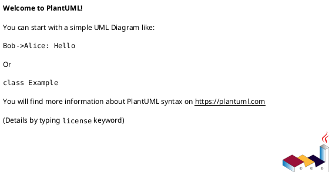

## 한 generation 당 제약 (GLM 계열 스톨 방지 — 필독)

- **한 generation 에서 Step 두 개 이상 처리 금지**. 각 Step 종료는 Bash tool call 로 마무리해 generation 경계 형성
- **PlantUML 격리 (Option C)**: Step 1 에서는 plantuml **생성 금지**. Step 1.5 에서만 후보별 `structuralDiagram` / `dynamicDiagram` 을 생성해 draft merge
- reasoning 은 각 Step 당 3~5 줄 이내. 엔진 점수/규칙 적용은 `style-score.py` 담당
- Step 1 / 1.5 / 3 종료마다 **반드시 `draft-io.sh save`** — draft JSON 전체 flush 후 generation 종료
- Step 2 자가검증은 **반드시 `validate-style-doc.py` 호출** — 에이전트가 직접 필드/섹션 계산 금지
- assistant 출력에는 draft JSON / 문서 본문 재노출 금지. "저장 완료 / critical N건" 한두 줄

## 진행 상태 가시화 — `todowrite` (OpenCode 한정, 선택)

이 스킬 Step 체크리스트:
```
# Todos
[ ] Step 0 — 진입 점검 (drift-check + 분기) + 데이터 수집 + 엔진 점수 (참고용)
[ ] Step 1 — 통합 스타일 조합 후보 2~3개 + QA 가중 평가 (plantuml 없음)
[ ] Step 1.5 — 후보별 Structural/Dynamic PlantUML 추가
[ ] Step 2 — 자가검증 (validate-style-doc.py)
[ ] Step 3 — critical 수정 (반복, 최대 iter 3)
[ ] Step 5 — 후보 ADSN 생성 + index/후보파일 저장 + archSettings.chosenStyles 업데이트
[ ] Step 6 — 최종 보고 + baseline 갱신
```

## 환경

- `PLATFORM_API` 기본값: `http://localhost:9000/api/v2`
- `GOJIRA_API` 기본값: `http://localhost:9001/api/v2`
- 임시 파일: `/tmp/${CODE}-styledef-{norm|engine|draft|validation}.json`

## 인자 추출

- `CODE` — projectCode
- `USER` — user

```bash
export CODE="GOJIRA3"
export USER="batman"
```

## 역할

아키텍트. Architecture Driver 와 엔진 점수를 근거로 **시너지 있는 스타일 조합 2~3개** 를 설계하고, QA(NFR) 가중 평가로 최종안을 선정한다. 개별 스타일 랭킹이 아니라 **조합 단위** 가 의사결정 대상.

---

## Step 0 — 진입 점검 (drift-check) + 데이터 수집

### 0.1 drift-check (이슈 변동 여부 확인 — 필수)

본 스킬의 책임 단계는 **`style`** (workflow-graph.json). Step 0 진입 즉시 drift-check 를 호출해 **이슈 변동 여부 + 상위(`driver`) 변동 여부**를 확인하고, 그 결과로 진행 방식을 결정한다.

```bash
python3 "${PROJECT_ROOT}/.claude/skills/_scripts/drift-check.py" "${CODE}" "${USER}" check
```

### 0.2 drift-check 결과별 분기 (A/B/C 모델)

| drift-check 결과 | 흐름 | 동작 |
|---|---|---|
| `style` **NO-BASELINE** | 첫 실행 | Step 0.3 데이터 수집 → MODE=full |
| `style` **DRIFT** (이슈 변동 감지) | **B** | 본 단계 변경 영향 분석 + 부분 업데이트 (현재 미구현, MODE=full 로 임시 진행) |
| `style` **CLEAN** + 상위(`driver`) **DRIFT** | **C** | 사용자 선택: ① 본 stage 재정립 / ② mark-deferred 보류 |
| **모두 CLEAN** | **A** | 0.2.1 의 3 메뉴 — 절대 자동 진행 금지 |

### 0.2.1 변경 없음 처리 메뉴 (A 흐름)

drift 모두 CLEAN 인 경우 **반드시 사용자에게 다음 3 옵션을 명시적으로 제시**. 추측 / 자동 선택 절대 금지.

```
변경된 이슈 / 산출물이 없습니다. 어떻게 처리할까요?
  [1] 종료 (default — 가장 안전, 아무것도 안 함)
  [2] 문서만 재생성 (이슈/archSettings 보존, LLM 0회 결정적 조립)
  [3] 처음부터 다시 만들기 ⚠️ DESTRUCTIVE (시스템 스타일 ADSN 모두 삭제 후 LLM 재도출)
```

### 선택별 동작

- **[1] 종료** — 즉시 Step 6 보고만 출력 (baseline 갱신 없음) → 종료
- **[2] 문서만 재생성** — `FAST_PATH=true` 설정 후 Step 1~1.5 모두 스킵, Step 5.3 결정적 조립만. **이슈/archSettings 절대 변경 안 함** (chosenStyles 등 그대로)
- **[3] 처음부터 다시** — ⚠️ **이 SKILL 자체에서는 진행 금지**. 사용자에게 안내:
  > "destructive 작업입니다. 별도로 `reset-project` 스킬을 먼저 호출하시고 (CONFIRM=true 필요), 그 후 본 스킬을 다시 호출해주세요."

### ⚠️ 절대 금지 (LLM 행동 가드)

다음 중 어느 것도 LLM 자율 판단으로 호출 금지:
- `DELETE /Issue` (ADSN 삭제 — Step 5 batch 외 절대 금지)
- `PUT /Issue` (ADSN 수정 — Step 5.1 batch 외 금지)
- `archSettings` `$unset` 또는 chosenStyles 변경

**FAST_PATH=true 진입 시**: 이슈/archSettings 변경 모두 금지. 오직 doc 재생성만. 위 호출이 필요해 보이면 즉시 SKILL 중단 + 사용자에게 보고.

진행 결정 후 Step 0.3 (데이터 수집) 으로 이동. [1] 종료면 Step 6 보고만 출력하고 baseline 갱신 없이 끝낸다.

### 0.3 데이터 수집 + 엔진 점수

#### 0.3.1 normalizedAttributes 확보

```bash
PLATFORM_API="${PLATFORM_API:-http://localhost:9000/api/v2}"
GOJIRA_API="${GOJIRA_API:-http://localhost:9001/api/v2}"

NORM=$(curl -s "${GOJIRA_API}/Project" \
  -H "XBody: {\"jiraCode\":\"${CODE}\"}" -H "X-User-Id: ${USER}" \
  | jq '.[0].archSettings.normalizedAttributes // {}')

# Fallback 1: driver-select2 가 같은 세션에서 flush 해둔 /tmp 파일
if [[ "$NORM" == "{}" ]] && [[ -f "/tmp/${CODE}-drivers-normalized.json" ]]; then
  NORM=$(cat "/tmp/${CODE}-drivers-normalized.json")
fi

# Fallback 2: docs/{user}/architecture/drivers.md 의 "3. 정규화된 시스템 속성" 표 파싱
if [[ "$NORM" == "{}" ]]; then
  DMD=$(bash "${PROJECT_ROOT}/.claude/skills/_scripts/doc-read.sh" "${CODE}" "${USER}" "architecture/drivers.md" 2>/dev/null || true)
  if [[ -n "$DMD" ]]; then
    NORM=$(echo "$DMD" | python3 -c '
import sys, re, json
text = sys.stdin.read()
m = re.search(r"^##?#?\s*3\.[^\n]*\n(.*?)(?=^##? |\Z)", text, re.MULTILINE | re.DOTALL)
if not m:
    print("{}"); sys.exit(0)
attrs = {}
for line in m.group(1).splitlines():
    parts = [c.strip() for c in line.split("|")]
    if len(parts) < 3: continue
    key = parts[1] if len(parts) > 1 else ""
    val = parts[2] if len(parts) > 2 else ""
    if not key or key in ("속성",) or set(key) <= {"-"}: continue
    if not val or val in ("값",) or set(val) <= {"-"}: continue
    attrs[key] = val
print(json.dumps(attrs, ensure_ascii=False))
')
  fi
fi

echo "$NORM" > "/tmp/${CODE}-styledef-norm.json"
echo "$NORM"
```

`NORM` 이 `{}` 이면 **중단** → "먼저 driver-select2 를 실행하거나 normalizedAttributes JSON 을 제공하세요" 보고.

#### 0.3.2 카탈로그 읽기

```bash
KN="$(git rev-parse --show-toplevel)/Agent-Service/knowledge/arch-styles"
cat "${KN}/index.yaml"
ls "${KN}/styles/"
```

각 스타일 파일은 `id / name / scope / summary / fit_signals / avoid_signals / quality_attributes / prerequisites / combines_well_with / conflicts_with / tradeoffs` 를 담는다.

#### 0.3.3 엔진 점수 계산 (참고용)

**엔진은 개별 스타일 랭킹 도구로만 활용**. 최종 Primary/Secondary/Supporting 선정은 이번 스킬에서는 LLM 의 조합 설계가 담당 — 엔진 분류 그대로 쓰지 않는다.

```bash
REQ_JSON=$(cat "/tmp/${CODE}-styledef-norm.json")

jq -n --argjson r "$REQ_JSON" '{req:$r}' \
  | python3 "${PROJECT_ROOT}/.claude/skills/_scripts/style-score.py" \
  > "/tmp/${CODE}-styledef-engine.json"

cat "/tmp/${CODE}-styledef-engine.json" | jq '{top10:[.scored[:10][]|{id,score}], primary, secondary, supporting}'
```

산출:
- `scored` — 모든 스타일의 점수 랭킹 (조합 후보 구성의 **참조자료**)
- `primary/secondary/supporting` — 엔진 자동 분류 (참조만, 뒤집어도 무방)
- `catalog_summary` — 이후 validator 에 `styleCatalogIds` 로 전달하거나 조합 시 스타일 id 확인에 사용

#### 0.3.4 기존 ADSN 스캔 (선택)

동일 프로젝트에 기존 스타일 ADSN 이 있으면 참고용으로 파악. 현재 `create` 중심 모드만 지원 — 기존 ADSN 재사용·수정 로직은 design-decide2 와 같은 패턴으로 후속 확장 가능.

```bash
curl -s "${GOJIRA_API}/Issue" -H "XBody: {\"prjID\":\"${CODE}\",\"infoType\":\"\"}" -H "X-User-Id: ${USER}" \
  | jq '[.[] | select(.issueType=="Architectural Design" and (.designPoint // "") == "시스템 스타일 결정") | {key,subkey,summary,decision}]'
```

기존 조합 ADSN 이 있으면 사용자에게 "재작성 / 덮어쓰기 / 기존 유지" 확인 권고.

---

## Step 1 — 조합 후보 초안 (iter 1, PlantUML 없음)

### Fast path 분기 (Step 0.2.1 결과 적용)

`FAST_PATH=true` 면 **Step 1~Step 1.5 전부 스킵**, 바로 Step 5.3 (결정적 조립) 으로 점프.

```bash
if [ "${FAST_PATH:-false}" = "true" ]; then
  echo "fast path — Step 1~1.5 스킵"
  # 다음 generation 에서 Step 5.3 으로 이동
fi
```

### 1.1 조합 후보 설계

엔진 랭킹의 상위권과 카탈로그의 `combines_well_with` / `conflicts_with` 를 참고해 **정말로 검토할 가치 있는** 조합 **2~3개** 를 구성. 각 조합은 Primary/Secondary/Supporting 역할을 가진 스타일 세트:

- **Primary** (scope 당 1개) — 전체 결정 계층을 지배하는 스타일 (예: Modular Monolith, Microservices, Layered)
- **Secondary** — Primary 를 보완하거나 직교 관심사를 다루는 스타일
- **Supporting** (0~N개) — 선택적으로 결합되는 보조 스타일

후보 수량 가이드: **2개가 기본. 3개는 "정말 검토 가치 있다"** 고 판단될 때만.
- 후보가 서로 비슷하면 불필요한 노이즈 → 통합하거나 줄임
- `conflicts_with` 관계인 스타일을 한 조합에 섞지 말 것

### 1.2 QA 가중치 정의

이 결정 전반에 적용될 가중치. 합 = 1.00 (±0.02). 각 QA 마다 근거 기록 필수.

```json
"qaWeights": {
  "Performance":     {"weight": 0.40, "rationale": "응답 지연이 사용자 이탈에 직결"},
  "Maintainability": {"weight": 0.35, "rationale": "장기 운영, 소규모 팀"},
  "Security":        {"weight": 0.25, "rationale": "사내망 SSO 기반이라 상대적 비중 낮음"}
}
```

### 1.3 후보별 QA 평가 (1-5) + 가중합

각 조합 후보에 대해:
- `qaScores`: qaWeights 의 각 QA 에 1~5 정수 할당
- `weightedScore` = Σ(score × weight), 소수 둘째자리
- `eval`: QA별 점수 근거 짧은 문단

### 1.4 선정

- 총점 최고 1개 단독 채택 → 해당 후보만 `chosen=true`
- 최고점 근소(0.3 이하) / 상호 보완적 → **혼합 채택**: 관련 후보 모두 `chosen=true`, `decisionNote` 에 혼합 방식 기록
- 엔진 점수와 가중합이 반대 방향이면 `eval` 에 그 불일치를 명시적으로 짚기

### 1.5 조합(approach) 구조

각 후보는 다음 필드를 갖는다:
- `candidateId` — A/B/C... (유일)
- `docId` — `ADSN-1` / `ADSN-2` ... (유일)
- `name` — 조합 이름 (예: "Modular Monolith + Layered + Event-Driven")
- `composition.primary/secondary/supporting` — `{id, name, role}` 배열
  - `id` 는 카탈로그의 **실존 스타일 id** (validator 가 체크)
  - `role` 은 이 조합에서의 책임 설명 (예: "전체 모듈 경계 제공")
- `objectives` — 이 조합이 해결하려는 핵심 아키텍처 목표 2~3 줄
- `pros` / `cons`
- `qaScores` / `weightedScore` / `eval`
- `chosen` (bool) / `decisionNote` (chosen=true 일 때 필수)
- **주의**: `structuralDiagram` / `dynamicDiagram` 은 **Step 1.5 에서 채움. 여기서는 쓰지 말 것**

### 1.6 문서 뼈대

Step 1 에서 index + 각 후보 파일 **뼈대** 작성. plantuml 자리는 placeholder:

````md
**Structural View**

````

템플릿 참조:
```bash
cat "${PROJECT_ROOT}/.claude/skills/style-define2/templates/architecture-style.md"  # index
cat "${PROJECT_ROOT}/.claude/skills/style-define2/templates/style-candidate.md"      # 후보 파일
```

index (`architecture-style.md`) 필수 섹션: 1 후보 조합 스타일 / 2 QA 가중치 / 3 최종 선정 / (4 Driver 추적성 / 5 트레이드오프)
후보 파일 필수 섹션: 1 조합 구성 / 2 Design Objective / 3 Structural View / 4 Dynamic View / 5 Pros/Cons / 6 QA 평가 / 7 트레이드오프 / 8 선정 여부

### Step 1 종료 — draft flush (필수)

**JSON 필드명은 스키마 그대로 사용**. validator 는 아래 키만 인식 — `point` / `alternatives` / `composition` 아닌 다른 이름 금지. `composition` 은 반드시 `primary/secondary/supporting` 3키 dict.

```bash
cat > /tmp/${CODE}-styledef-draft-input.json <<'JSON'
{
  "driverKeys": ["GOJIRA3-11","GOJIRA3-13"],
  "styleCatalogIds": ["modular-monolith","layered","event-driven","microservices","space-based","..."],
  "qaWeights": {
    "Performance":     {"weight": 0.40, "rationale": "..."},
    "Maintainability": {"weight": 0.35, "rationale": "..."},
    "Security":        {"weight": 0.25, "rationale": "..."}
  },
  "candidates": [
    {
      "candidateId":"A",
      "docId":"ADSN-1",
      "name":"Modular Monolith + Layered + Event-Driven",
      "composition": {
        "primary":    [{"id":"modular-monolith","name":"Modular Monolith","role":"전체 모듈 경계"}],
        "secondary":  [{"id":"layered","name":"Layered","role":"계층 분리"}],
        "supporting": [{"id":"event-driven","name":"Event-Driven","role":"비동기 이벤트"}]
      },
      "objectives":"단일 배포의 운영 단순성을 유지하면서 모듈 간 결합도 최소화",
      "pros":"운영 단순, 학습 곡선 낮음, 모듈 분리 명확",
      "cons":"확장성 한계, 단일 장애점 가능",
      "qaScores":{"Performance":4,"Maintainability":5,"Security":4},
      "weightedScore":4.35,
      "eval":"Performance: 단일 프로세스 내 호출로 4점. Maintainability: 모듈 경계 + 단순 배포 5점. Security: 표준 프레임워크 4점.",
      "chosen":true,
      "decisionNote":"단독 채택 — 총점 4.35 로 최고, 소규모 팀 운영 복잡도 최소화"
    },
    {
      "candidateId":"B",
      "docId":"ADSN-2",
      "name":"Microservices + Event-Driven + CQRS",
      "composition": {
        "primary":    [{"id":"microservices","name":"Microservices","role":"독립 배포 단위"}],
        "secondary":  [{"id":"event-driven","name":"Event-Driven","role":"서비스 간 비동기"}],
        "supporting": [{"id":"cqrs","name":"CQRS","role":"읽기/쓰기 분리"}]
      },
      "objectives":"대규모 트래픽·독립 배포에 최적화",
      "pros":"스케일링 독립성, 장애 격리",
      "cons":"운영 복잡도, 분산 트랜잭션 난이도",
      "qaScores":{"Performance":5,"Maintainability":3,"Security":4},
      "weightedScore":4.05,
      "eval":"Performance: 독립 스케일링으로 5점. Maintainability: 운영 오버헤드로 3점. Security: 경계 명확 4점.",
      "chosen":false,
      "decisionNote":""
    }
  ],
  "decisionSummary":"Candidate A (Modular Monolith + Layered + Event-Driven) 단독 채택",
  "decisionRationale":"Driver GOJIRA3-11 (응답 < 500ms) 과 GOJIRA3-13 (소규모 팀 운영 가능) 을 동시 충족. 총점 4.35 로 최고이며 Maintainability 가중치 0.35 에서 우위가 결정적",
  "tradeoffs":"B 는 Performance 최고점이나 운영 복잡도 페널티로 기각. 트래픽이 현 규모의 10배 초과 시 B 재검토",
  "relatedDrivers":["GOJIRA3-11","GOJIRA3-13"],
  "document":{
    "index":"...architecture-style.md 마크다운 전체 (plantuml placeholder)",
    "candidateFiles":{
      "ADSN-1":"...ADSN-1-modular-monolith.md 마크다운 전체 (plantuml placeholder) — 저장 시 실제 subkey ADSN_NNN 으로 파일명 치환",
      "ADSN-2":"...ADSN-2-microservices.md 마크다운 전체 (plantuml placeholder)"
    }
  }
}
JSON

bash "${PROJECT_ROOT}/.claude/skills/_scripts/draft-io.sh" save "${CODE}" "styledef" "draft" \
  < /tmp/${CODE}-styledef-draft-input.json
```

출력 한 줄(`{"path":"...","bytes":N}`)만. JSON 재출력 금지.

---

## Step 1.5 — PlantUML 격리 단계 (신규, 필수)

Step 1 draft 를 로드하고 **각 후보에 structuralDiagram / dynamicDiagram 을 채워** 재저장. 이 단계는 generation 분리를 위해 존재 (GLM 다이어그램 스톨 방지).

작성 규칙:
- **Structural View**: PlantUML **component 다이어그램** — 조합이 구성하는 시스템의 컴포넌트/레이어/데이터 흐름 (`component`, `database`, `[Name]`, `package` 등)
- **Dynamic View**: PlantUML **sequence 다이어그램** — 주요 시나리오의 시간 순 상호작용 (`participant` + 화살표. 공백 있는 이름은 따옴표 또는 `as` 별칭 필수)
- 각 다이어그램은 ` ```plantuml ` / ` ``` ` 블록으로 감싸고 **반드시 `@startuml` / `@enduml` 쌍** 포함
- 같은 주제를 다르게 푸는 조합들이니 **공통 입력/출력을 동일하게 표현** 해 비교 가시성 확보
- document.candidateFiles[ADSN-N] 의 plantuml placeholder 도 실제 내용으로 교체

작업 예:
```bash
bash "${PROJECT_ROOT}/.claude/skills/_scripts/draft-io.sh" load "${CODE}" "styledef" "draft" > /tmp/${CODE}-styledef-draft.json

python3 <<'PY'
import json, os
p = "/tmp/%s-styledef-draft.json" % os.environ["CODE"]
d = json.load(open(p))

for c in d["candidates"]:
    # 각 후보별로 에이전트가 이 generation 에서 생성한 plantuml 을 채움
    c["structuralDiagram"] = c.get("structuralDiagram") or "```plantuml\n@startuml\ncomponent Client\ncomponent API\ndatabase DB\nClient --> API\nAPI --> DB\n@enduml\n```"
    c["dynamicDiagram"]   = c.get("dynamicDiagram")   or "```plantuml\n@startuml\nactor User as U\nparticipant API as A\nU -> A: request\nA --> U: response\n@enduml\n```"

    # document.candidateFiles[ADSN-N] 본문의 placeholder 를 실제 블록으로 교체
    did = c["docId"]
    body = d["document"]["candidateFiles"].get(did, "")
    # 에이전트가 placeholder → 실제 plantuml 치환 로직 작성 (단순 replace 가능)
    d["document"]["candidateFiles"][did] = body

open(p, "w").write(json.dumps(d, ensure_ascii=False, indent=2))
PY

cat /tmp/${CODE}-styledef-draft.json \
  | bash "${PROJECT_ROOT}/.claude/skills/_scripts/draft-io.sh" save "${CODE}" "styledef" "draft"
```

출력 한 줄만. plantuml 원문 재출력 금지.

---

## Step 2 — 자가검증 (스크립트 기반)

**반드시 `validate-style-doc.py` 호출**. 에이전트가 직접 계산 금지.

```bash
bash "${PROJECT_ROOT}/.claude/skills/_scripts/draft-io.sh" load "${CODE}" "styledef" "draft" \
  | python3 "${PROJECT_ROOT}/.claude/skills/_scripts/validate-style-doc.py" \
  > /tmp/${CODE}-styledef-validation.json
cat /tmp/${CODE}-styledef-validation.json
```

출력 스키마:
```json
{
  "pass": bool,
  "score": 0.0~1.0,
  "score_effective": number,
  "critical": [{"type":"...","docId":"ADSN-N","detail":"..."}],
  "suggestions": [...],
  "stats": {"candidates":N,"chosen":C,"selectedDocIds":[...],
            "qaWeightsTotal":T,"candidateFilesProvided":P,"indexProvided":bool}
}
```

스크립트가 잡는 critical (주요):
- `bad_qaWeights` / `qaWeights_sum_not_one` — 가중치 합 ≠ 1.0 (±0.02)
- `insufficient_candidates` — 후보 < 2
- `candidate_missing_field` / `candidate_empty_field`
- `composition_missing_role` / `composition_no_primary` / `composition_bad_role_type`
- `composition_missing_id` / `composition_missing_name`
- `bad_qaScores` / `qaScore_out_of_range` / `qaScore_missing_qa`
- `bad_weightedScore_type` / `bad_chosen_type`
- `no_chosen_candidate` — chosen=true 후보 0건
- `chosen_without_note` — chosen=true 인데 decisionNote 비어있음
- `duplicate_docId` / `duplicate_candidateId` / `bad_docId_format` (ADSN-N 형식)
- `missing_diagram` — Step 1.5 미수행 (structuralDiagram / dynamicDiagram 블록 없음)
- `index_missing` / `index_missing_section` / `candidate_file_missing` / `candidate_file_missing_section`
- `empty_decisionSummary` / `empty_rationale`

### 통과 기준
- `pass == true` → Step 5 진입
- `pass == false` → Step 3 수정

---

## Step 3 — 수정 (pass=false)

critical 만 **국소 수정** 후 draft 재저장 (JSON 재구성 금지 — 이슈된 필드만 건드림):

```bash
python3 <<'PY'
import json, os
p = "/tmp/%s-styledef-draft.json" % os.environ["CODE"]
d = json.load(open(p))
# critical 유형별 수정 로직
open(p, "w").write(json.dumps(d, ensure_ascii=False, indent=2))
PY

cat /tmp/${CODE}-styledef-draft.json \
  | bash "${PROJECT_ROOT}/.claude/skills/_scripts/draft-io.sh" save "${CODE}" "styledef" "draft"
```

이 tool call 로 generation 종료. 다음 generation 에서 validate 재실행.

---

## Step 4 — 종료 조건

1. pass=true
2. iter 3 완료
3. 같은 critical 2회 연속 재발
4. 새 수정이 이전 best 보다 낮은 score_effective → 포기

**best-so-far**: `(candidates, document, score_effective)` 기록. 종료 시 최댓값 iter 를 selected.

---

## Step 5 — 이슈 생성 + 문서 + archSettings 영속화

### 5.1 후보 ADSN 이슈 일괄 생성 (조합 단위만)

**강제 재생성 모드(Step 0.2 의 drift CLEAN + 사용자 yes) 이면 이 섹션 전체 스킵** — 새 ADSN 생성/PUT 모두 하지 않는다. 바로 5.2 로 이동하되, 5.2 에서도 기존 ADSN 키를 재사용하므로 chosen 후보 키만 교체해 사용.

**각 조합 후보를 개별 ADSN 이슈로 생성** (2~3건). 개별 스타일은 ADSN 생성하지 않음 — 이 스킬의 핵심 변경점.

`chosen=true` 인 후보(들) 에만 `decision` 필드를 채운다. 나머지는 decision 빈 문자열.

```bash
python3 <<'PY'
import json, os

d = json.load(open("/tmp/%s-styledef-draft.json" % os.environ["CODE"]))

items = []
# 모든 후보 조합 목록 (approaches 필드에 JSON 문자열로 넣어 맥락 공유)
all_candidates_ref = [
    {"candidateId": c["candidateId"], "name": c["name"],
     "composition": c["composition"], "weightedScore": c["weightedScore"]}
    for c in d["candidates"]
]
approaches_json = json.dumps(all_candidates_ref, ensure_ascii=False)

for c in d["candidates"]:
    item = {
        "issueType":         "Architectural Design",
        "summary":           f"시스템 스타일 조합: {c['name']}",
        "desc":              f"{c['docId']} — {c.get('eval','')}",
        "designLevel":       "Architectural",
        "designPoint":       "시스템 스타일 결정",
        "objectives":        c["objectives"],
        "approaches":        approaches_json,
        "pros":              c["pros"],
        "cons":              c["cons"],
        "score":             str(c["weightedScore"]),
        "eval":              c["eval"],
        "adiagram":          c.get("structuralDiagram", ""),
        "bdiagram":          c.get("dynamicDiagram", ""),
    }
    if c.get("chosen"):
        item["decision"]          = c.get("decisionNote", "")
        item["decisionRationale"] = d["decisionRationale"]
        item["tradeoffs"]         = d.get("tradeoffs", "")
    items.append(item)

open("/tmp/style_adsn_items.json","w").write(json.dumps(items, ensure_ascii=False, indent=2))
print(f"{len(items)}건 준비")
PY

bash "${PROJECT_ROOT}/.claude/skills/_scripts/issue-batch-create.sh" "${CODE}" "${USER}" < /tmp/style_adsn_items.json \
  > /tmp/style_adsn_result.json
cat /tmp/style_adsn_result.json
```

`issue-batch-create.sh` 가 POST 후 PUT 으로 ADSN 필드(designLevel/designPoint/objectives/approaches/decision/decisionRationale/pros/cons/score/eval/adiagram/bdiagram/tradeoffs) 를 자동 반영.

### 5.2 Requirement → 조합 ADSN Contains 링크 (선택)

`relatedDrivers` 에 명시된 Driver 들을 **채택된** ADSN 과 연결. 기각 후보는 링크 안 만듦 (불필요한 관계 생성 방지).

**링크 기준 타이트하게**: 시스템 스타일은 모든 QA 에 간접 영향을 주지만 **모든 QA 를 relatedDrivers 에 넣지 말 것**. 선정 조합의 `decisionRationale` 에 근거로 **명시된 QA/CNST 만** 포함 — 보통 **2~4개**. 5개 이상 넣으면 Contains 관계의 의미가 희석되어 후속 SATAM 이 관련 없는 QA 에 대해서도 risk 를 만들려 시도하는 부작용 발생.

> **중복 제거 필수** — `POST /Issue/link` idempotent 아님. Step 0 수집한 issueLinks 와 차집합 POST.

```bash
python3 <<'PY'
import json, os
d = json.load(open("/tmp/%s-styledef-draft.json" % os.environ["CODE"]))
result = json.load(open("/tmp/style_adsn_result.json"))
keys = result.get("keys", [])

# candidate 순서대로 key 매핑
chosen_keys = []
idx = 0
for c in d["candidates"]:
    if c.get("chosen"):
        chosen_keys.append(keys[idx])
    idx += 1

links = []
for driver_key in d.get("relatedDrivers", []):
    for adsn_key in chosen_keys:
        links.append({
            "inwardKey":  driver_key,
            "outwardKey": adsn_key,
            "linkType":   "Contains(WBSGantt)"
        })

open("/tmp/style_links.json","w").write(json.dumps(links, ensure_ascii=False))
print(f"{len(links)}건 링크 예정")
PY

bash "${PROJECT_ROOT}/.claude/skills/_scripts/issue-batch-link.sh" "${CODE}" "${USER}" < /tmp/style_links.json \
  > /tmp/style_link_result.json
cat /tmp/style_link_result.json
```

링크 실패는 silent drop 금지 — 보고에 건수 명시.

### 5.3 docId → subkey 치환 + 후보 파일 저장

**Fast path (`FAST_PATH=true`)**: docId 치환 불필요 (이슈가 이미 subkey 보유). `style-assemble.py --from-mongo` 가 ADSN 이슈 + archSettings 만으로 결정적 조립. LLM 0회.

```bash
if [ "${FAST_PATH:-false}" = "true" ]; then
  TMP_OUT=/tmp/${CODE}-styledef-out
  rm -rf "$TMP_OUT"
  python3 "${PROJECT_ROOT}/.claude/skills/_scripts/style-assemble.py" \
    --from-mongo "${CODE}" --user "${USER}" --out-dir "$TMP_OUT"

  # index 저장
  cat "$TMP_OUT/architecture-style.md" \
    | bash "${PROJECT_ROOT}/.claude/skills/_scripts/doc-save.sh" "${CODE}" "${USER}" "architecture/architecture-style.md"

  # 후보 파일 일괄 저장
  for f in "$TMP_OUT"/architecture-style/*.md; do
    rel="architecture/architecture-style/$(basename "$f")"
    cat "$f" | bash "${PROJECT_ROOT}/.claude/skills/_scripts/doc-save.sh" "${CODE}" "${USER}" "$rel"
  done
  echo "fast path 저장 완료"
  # Step 5.4 (chosenStyles PATCH) 도 스킵 — 기존 archSettings 그대로
  # 다음 generation 에서 Step 6 보고
  exit 0
fi
```

**기존 흐름 (MODE=full)**: 생성된 ADSN 이슈의 subkey(`ADSN_001`, `ADSN_002`, ...) 로 **파일명과 문서 본문의 모든 `ADSN-N` 참조를 치환**. 결과 파일명은 `architecture-style/ADSN_NNN-{slug}.md` 형태 — JIRA 이슈 subkey 와 완전 일치.

치환 규칙:
- `ADSN-1` → `ADSN_001` (단독 단어)
- `ADSN-2` → `ADSN_002`
- 파일 내부 링크(`./architecture-style/ADSN-NN-...`) 도 함께 치환

```bash
python3 <<'PY'
import json, os, subprocess, re
d = json.load(open("/tmp/%s-styledef-draft.json" % os.environ["CODE"]))
result = json.load(open("/tmp/style_adsn_result.json"))
keys = result.get("keys", [])  # JIRA key 목록 (예: TEST-67, TEST-68)

def slugify(name):
    s = re.sub(r"[^0-9A-Za-z가-힣+\-]+", "-", name).strip("-").lower()
    return s[:60] if s else "adsn"

user = os.environ["USER"]
code = os.environ["CODE"]
script = os.environ["PROJECT_ROOT"] + "/.claude/skills/_scripts/doc-save.sh"
gojira_api = os.environ.get("GOJIRA_API", "http://localhost:9001/api/v2")

# 각 candidate 의 docId(ADSN-N) → 실제 subkey(ADSN_NNN) 매핑 작성
# issue-batch-create 응답 순서는 요청 순서와 동일하다는 전제. 확인을 위해 key 로 subkey 조회.
import urllib.request
def fetch_subkey(k):
    req = urllib.request.Request(
        f"{gojira_api}/Issue",
        headers={"XBody": json.dumps({"prjID": code, "infoType": ""}), "X-User-Id": user},
    )
    arr = json.loads(urllib.request.urlopen(req, timeout=10).read())
    for it in arr:
        if it.get("key") == k:
            return it.get("subkey") or k
    return k

docid_to_subkey = {}
idx = 0
for c in d["candidates"]:
    key = keys[idx]; idx += 1
    docid_to_subkey[c["docId"]] = fetch_subkey(key)
print("docid → subkey:", docid_to_subkey)

def substitute_refs(text):
    # ADSN-N (단독 단어 경계) → ADSN_NNN
    for did, sub in docid_to_subkey.items():
        text = re.sub(r"\b" + re.escape(did) + r"\b", sub, text)
    return text

# 후보 파일 각각 저장 (파일명 = subkey)
for c in d["candidates"]:
    docid = c["docId"]
    subkey = docid_to_subkey[docid]
    slug = slugify(c["name"])
    path = f"architecture/architecture-style/{subkey}-{slug}.md"
    body = d["document"]["candidateFiles"].get(docid, "")
    body = substitute_refs(body)
    p = subprocess.run(["bash", script, code, user, path], input=body, text=True, capture_output=True)
    print(f"  {path}: {p.stdout.strip()}")

# index 파일 — 본문 내 ADSN-N 참조도 subkey + 파일 링크도 재작성 필요
# 링크 예: ./architecture-style/ADSN-01-... → ./architecture-style/ADSN_001-...
index_body = d["document"]["index"]
index_body = substitute_refs(index_body)
# 후보 파일 링크가 ADSN-1 기준으로 생성됐다면 slug 포함 경로 치환
for c in d["candidates"]:
    docid = c["docId"]
    subkey = docid_to_subkey[docid]
    slug = slugify(c["name"])
    # 가능한 기존 링크 패턴들을 subkey 기반으로 교체
    old_prefix = f"architecture-style/{docid}-"
    new_prefix = f"architecture-style/{subkey}-"
    index_body = index_body.replace(old_prefix, new_prefix)

p = subprocess.run(["bash", script, code, user, "architecture/architecture-style.md"],
                   input=index_body, text=True, capture_output=True)
print(f"  architecture/architecture-style.md: {p.stdout.strip()}")
PY
```

### 5.4 archSettings.chosenStyles 업데이트 (선정 조합 평탄화)

**호환성 중요** — 다음 스킬(design-integrate2) 이 `chosenStyles.primary / secondary / supporting` 구조로 읽는다. 선정된 조합(들) 의 composition 을 역할별로 평탄화 병합.

```bash
python3 <<'PY'
import json, os, subprocess
d = json.load(open("/tmp/%s-styledef-draft.json" % os.environ["CODE"]))

chosen_styles = {"primary": [], "secondary": [], "supporting": []}
seen = {"primary": set(), "secondary": set(), "supporting": set()}

for c in d["candidates"]:
    if not c.get("chosen"):
        continue
    comp = c["composition"]
    for role in ("primary", "secondary", "supporting"):
        for s in comp.get(role) or []:
            sid = s.get("id")
            if sid and sid not in seen[role]:
                seen[role].add(sid)
                chosen_styles[role].append({"id": sid, "name": s.get("name", "")})

open("/tmp/style_chosen.json","w").write(json.dumps(chosen_styles, ensure_ascii=False))
print(json.dumps(chosen_styles, ensure_ascii=False, indent=2))
PY

CHOSEN_JSON=$(cat /tmp/style_chosen.json)
curl -s -X PATCH "${GOJIRA_API}/Project/${CODE}/archSettings" \
  -H "Content-Type: application/json" -H "X-User-Id: ${USER}" \
  -d "$(jq -n --argjson c "$CHOSEN_JSON" '{chosenStyles:$c}')" \
  | jq '{updated, archSettings}'

# qaWeights 도 archSettings 에 영속화 — fast path 결정적 조립용
QAW_JSON=$(jq '.qaWeights' /tmp/${CODE}-styledef-draft.json)
if [ "$QAW_JSON" != "null" ] && [ -n "$QAW_JSON" ]; then
  curl -s -X PATCH "${GOJIRA_API}/Project/${CODE}/archSettings" \
    -H "Content-Type: application/json" -H "X-User-Id: ${USER}" \
    -d "$(jq -n --argjson w "$QAW_JSON" '{styleQAWeights:$w}')" \
    | jq '.updated'
fi
```

PATCH 실패 시 최종 보고에 ⚠. 다음 스킬이 영향 받을 수 있음.

---

## Step 6 — 최종 보고 + baseline 갱신

### 6.1 보고 출력

```
## 시스템 스타일 결정 완료 (v2 Claude Code) — MODE={full|forced-doc-regen}

- 진입 drift: style=<NO-BASELINE|CLEAN|DRIFT>, driver=<...> (Step 0.1 결과)
- 검토 후보: N개 (ADSN_001 ~ ADSN_NNN, 실제 subkey)
- ADSN 생성: K건 (채택 C건 / 미채택 K-C건)   (forced-doc-regen 은 0)
- Requirement-Style 링크: L건 (채택안에만)
- 문서:
  - architecture/architecture-style.md (상위 index)
  - architecture/architecture-style/ADSN_001-*.md ~ ADSN_NNN-*.md (실제 subkey 기준)
- archSettings.chosenStyles 업데이트: 성공 / ⚠

### 선정 결과
- ADSN_NNN {조합 이름}: 총점 X.XX — 채택
  - Primary: {스타일}
  - Secondary: {스타일}
  - Supporting: {스타일(들)}

### Driver 추적성
| Driver | 담당 스타일 | 역할 |

### Self-loop
- iter N회 / selected=iter X (score_eff Y) / stop=pass|max_iter|...
- unresolvedCritical: [...]
```

### 6.2 baseline 갱신 (필수 — 본 작업이 실제로 진행된 경우)

본 작업이 진행됐다면(NO-BASELINE 첫 실행 / DRIFT 처리 / 강제 재생성) **반드시** `style` stage 의 baseline 을 새 hash 로 갱신한다. Step 0.2 에서 "종료" 결정으로 끝난 경우는 호출하지 않는다.

```bash
python3 "${PROJECT_ROOT}/.claude/skills/_scripts/drift-check.py" "${CODE}" "${USER}" set-baseline --stage style
```

이 명령은 archSettings.lastRunHash[style] / lastRunAt[style] 만 갱신 — 다른 stage 의 baseline 은 건드리지 않는다.

---

## 주의

- 모든 curl 에 `X-User-Id: ${USER}` 필수
- `issueType` 은 정확히 `Architectural Design` (공백 포함)
- 링크 linkType 은 정확히 `Contains(WBSGantt)` — Requirement 가 inward, ADSN 이 outward
- **개별 스타일 ADSN 생성 금지** — 조합만 ADSN 으로. 이전 버전의 Primary/Secondary/Supporting 개별 ADSN 생성은 폐기
- `chosen=true` 후보는 반드시 `decisionNote` 기록. 혼합 채택은 여러 후보를 `chosen=true` 로 동시에
- `composition.primary` 는 **scope 당 1개 원칙** (여러 개면 suggestion, 0개면 critical)
- `composition.{role}[].id` 는 카탈로그 id (`styleCatalogIds` 에 있어야 suggestion 회피)
- `qaWeights` 합 = 1.0 ±0.02 / `qaScores` 는 1~5 정수 / `weightedScore` 는 Σ(score×weight)
- **Step 1 에서 plantuml 쓰지 말 것** (Step 1.5 에서만). Step 1 에서 plantuml 생성하면 스톨 리스크
- Step 0 / 1 / 1.5 / 2 / 3 / 5 만 실제 Bash 호출, Step 4 는 내부 판단
- `archSettings.chosenStyles` 는 **평탄화된 Primary/Secondary/Supporting 리스트** — design-integrate2 가 이 형식을 기대
- 진입 정책: Step 0.1 의 drift-check 가 작업 진행 여부를 정한다. 모두 CLEAN 인데 사용자가 강제 재생성을 거부하면 즉시 종료 (LLM 호출 0회). 강제 재생성 yes 인 경우 이슈 생성/수정 step 들은 자동 스킵하고 문서/링크만 재생성
- baseline 갱신: 본 작업 진행 시 Step 6.2 의 `set-baseline --stage style` 호출이 필수. 안 하면 다음 호출에서 또 DRIFT 로 잡혀 재실행 압력이 생긴다
