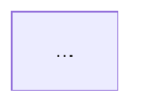

## 한 generation 당 제약 (GLM 계열 스톨 방지 — 필독)

- **한 번의 LLM generation 에서 Step 두 개 이상 몰아 처리 금지**. 각 Step 종료는 **반드시 tool call (Bash) 로 마무리** 해서 generation 경계를 만든다
- reasoning 은 각 Step 당 3~5 줄 이내. 장기 추론 불필요. 점수 계산/규칙 적용은 **전부 스크립트 담당** (`style-score.py`)
- Step 1 점수 계산은 **반드시 `style-score.py` 호출**로 수행 — 에이전트가 암산으로 점수 매기지 말 것 (엔진이 결정적)
- Step 2 문서 초안 작성 후 **반드시 `draft-io.sh save`** 로 flush 후 generation 종료
- Step 3 자가검증은 **반드시 `validate-style-doc.py` 호출** — 에이전트가 직접 Driver 커버리지 등 계산하지 말 것
- assistant 출력에는 긴 문서/JSON 그대로 뱉지 말 것. "저장 완료 / 다음 tool 호출" 식 한두 줄만. 전체 draft 는 파일로만 유지

## 환경
- `PLATFORM_API` 기본값: `http://localhost:9000/api/v2`
- `GOJIRA_API` 기본값: `http://localhost:9001/api/v2`
- 임시 파일: `/tmp/${CODE}-styledef-{engine|draft|validation}.json`

## 인자 추출

사용자 메시지에서 다음 값들을 추출해 **먼저** 환경변수로 export 한 뒤 아래 bash 블록들을 실행하라. 누락 시 사용자에게 되물어 확정하라.

- `CODE` — projectCode (예: GOJIRA3)
- `USER` — user (예: batman)

예:
```bash
export CODE="GOJIRA3"
export USER="batman"
```

## 역할
아키텍트. Architecture Driver(정규화 속성)를 근거로 시스템 스타일 카탈로그에서 적합 스타일을 선정한다.
**모든 선정은 Driver 로 역추적 가능해야 함 (driver coverage)**.

---

## Step 0 — 선행 데이터 수집

### 0.1 normalizedAttributes 확보
프로젝트의 `archSettings.normalizedAttributes` 조회. 없으면 **중단** → "driver_select 를 먼저 실행하세요".

```bash
PLATFORM_API="${PLATFORM_API:-http://localhost:9000/api/v2}"
GOJIRA_API="${GOJIRA_API:-http://localhost:9001/api/v2}"

curl -s "${GOJIRA_API}/Project" \
  -H "XBody: {\"jiraCode\":\"${CODE}\"}" -H "X-User-Id: ${USER}" \
  | jq '.[0].archSettings.normalizedAttributes // {}'
```

결과가 빈 객체면 중단.

### 0.2 카탈로그 읽기
카탈로그는 `knowledge/arch-styles/` 하위에 `index.yaml` + `styles/*.yaml` 구조.

```bash
KN="$(git rev-parse --show-toplevel)/Agent-Service/knowledge/arch-styles"
# index 파악
cat "${KN}/index.yaml"
# 스타일 id 목록
ls "${KN}/styles/"
# 개별 스타일 파일은 필요 시 Read 로 확인
```

각 스타일 파일은 다음 필드를 가진다:
- `id`, `name`, `scope` (system_structure / data / integration / module_boundary / infrastructure)
- `summary`, `fit_signals` (dict of attr→expected_level)
- `avoid_signals`, `quality_attributes` (list of {attribute, effect, strength})
- `prerequisites.{technical|design|organizational}`, `decision_rules` (if/then)
- `combines_well_with`, `conflicts_with`, `tradeoffs.pros/cons`

---

## Step 1 — 점수 계산 (스크립트 엔진 호출, 필수)

`style-score.py` 가 모든 점수/매치/조합/분류를 결정적으로 계산한다. 에이전트는 암산 금지 — 반드시 호출만.

```bash
REQ_JSON=$(curl -s "${GOJIRA_API}/Project" \
  -H "XBody: {\"jiraCode\":\"${CODE}\"}" -H "X-User-Id: ${USER}" \
  | jq '.[0].archSettings.normalizedAttributes // {}')

jq -n --argjson r "$REQ_JSON" '{req:$r}' \
  | python3 "${PROJECT_ROOT}/.claude/skills/_scripts/style-score.py" \
  > /tmp/${CODE}-styledef-engine.json

cat /tmp/${CODE}-styledef-engine.json | jq '{primary, secondary, supporting, top5:[.scored[:5][]|{id,score}]}'
```

출력 (`/tmp/${CODE}-styledef-engine.json`) 스키마:
```json
{
  "scored": [{"id","score","breakdown","unmet_prerequisites"}, ...],
  "primary": ["<id>", ...],
  "secondary": ["<id>", ...],
  "supporting": ["<id>", ...],
  "combinations_applied": [{"from","to","delta","type","reason"}, ...],
  "catalog_summary": { "styles":[...], "scopes":{...}, "names":{...},
                       "fit_signals":{...}, "avoid_signals":{...},
                       "quality_attributes":{...}, "tradeoffs":{...},
                       "prerequisites":{...}, "combines_well_with":{...},
                       "conflicts_with":{...} }
}
```

- Primary/Secondary/Supporting 은 엔진이 이미 결정적으로 분류함 — 뒤집지 말 것
- `breakdown` 의 note 가 그대로 문서의 "선정 근거" 소재 — LLM 은 이걸 자연어로 풀어쓰기만 하면 됨
- tie / scope / top_n / 가중치 는 전부 `index.yaml` 기준으로 엔진이 처리

---

## Step 2 — 초안 문서 작성 (iter 1)

`architecture/architecture-style.md` 본문 작성:

```
# 시스템 아키텍처 스타일

## 1. 추천 요약
| 구분 | 스타일 | Scope | 점수 | 핵심 근거(Driver) |
| Primary | ... | system_structure | ... | scalability=high, ... |

## 2. 정규화된 시스템 속성
| 속성 | 값 | 비고(Driver 근거) |

## 3. 스타일별 선정 근거
### 3.1 {Primary A}
#### 구조 (정적 관점)

(스타일의 컴포넌트/레이어 배치를 다이어그램으로 설명 — ADSN adiagram에 해당)

#### 동작 (동적 관점, 생략 가능)
```mermaid
sequenceDiagram
    ...
```
(스타일 고유의 런타임 흐름이 있는 경우 — ADSN bdiagram에 해당. 세부 설계에서 구체화되는 스타일은 생략)

#### 선정 근거
- 적합 신호(fit_signals)
- 품질속성 영향(positive/negative)
- 트레이드오프(pros/cons)
- 전제조건(technical/design/organizational)
- 연결된 Driver: [속성=레벨, ...]

## 4. 조합 설계
#### 통합 구조 (정적 관점)

(선정된 스타일들이 시스템 내에서 어떻게 조합·배치되는지 전체 구조 다이어그램)

#### 통합 동작 (동적 관점)
```mermaid
sequenceDiagram
    ...
```
(조합된 스타일 간 런타임 상호작용 흐름)

#### 조합 근거
- Primary 간 조합 관계 / Primary+Supporting 역할 분담 / 제외 스타일 이유

## 5. 설계 결정에 미치는 영향
```

---

### Step 2 종료 — draft flush (필수)

문서 초안과 chosen 구조를 파일로 저장하고 **이 generation 을 종료**. 다음 generation 에서 Step 3 검증.

```bash
# 엔진 결과에서 chosen 기본값 복사 (수동으로 조정 가능)
CHOSEN=$(jq '{primary, secondary, supporting}' /tmp/${CODE}-styledef-engine.json)

cat > /tmp/${CODE}-styledef-draft-input.json <<EOF
{
  "normalizedAttributes": $(cat /tmp/${CODE}-styledef-engine.json | jq '.scored[0].breakdown[0]' 2>/dev/null && curl -s "${GOJIRA_API}/Project" -H "XBody: {\"jiraCode\":\"${CODE}\"}" -H "X-User-Id: ${USER}" | jq '.[0].archSettings.normalizedAttributes'),
  "engine_output": $(cat /tmp/${CODE}-styledef-engine.json),
  "chosen": $CHOSEN,
  "document": $(jq -Rs . <<< "$DOCUMENT")
}
EOF

bash "${PROJECT_ROOT}/.claude/skills/_scripts/draft-io.sh" save "${CODE}" "styledef" "draft" \
  < /tmp/${CODE}-styledef-draft-input.json
```

---

## Step 3 — 자가검증 (스크립트 기반)

**반드시 `validate-style-doc.py` 호출**. 에이전트가 직접 검증 금지.

```bash
bash "${PROJECT_ROOT}/.claude/skills/_scripts/draft-io.sh" load "${CODE}" "styledef" "draft" \
  | python3 "${PROJECT_ROOT}/.claude/skills/_scripts/validate-style-doc.py" \
  > /tmp/${CODE}-styledef-validation.json
cat /tmp/${CODE}-styledef-validation.json
```

출력 스키마:
```json
{
  "pass": bool,
  "score": 0.0~1.0,
  "score_effective": number,
  "critical": [{"type":"...","detail":"..."}],
  "suggestions": [...],
  "stats": {"attributes","attributesInDoc","chosenStyles","stylesInDoc","mermaidBlocks"}
}
```

스크립트가 잡는 critical:
- 카탈로그에 없는 스타일 선택 (`style_not_in_catalog`)
- 동일 scope 에 Primary 2개 이상 (`primary_scope_conflict`)
- 엔진 Primary 를 모두 무시 (`primary_ignores_engine`)
- Primary 0개 (`no_primary`)
- Driver 커버리지 갭 — 속성의 1/3 초과가 문서에 미등장 (`driver_coverage_gap`)
- 선택 스타일이 문서에 미등장 (`chosen_style_not_in_doc`)
- 필수 섹션 1~5 누락 (`missing_section`)
- Mermaid 블록 0개 (`no_mermaid`)
- 점수 1위 스타일이 chosen 어디에도 없음 (`top_score_ignored`)

### 통과 기준
- `pass == true` → Step 5 진입
- `pass == false` → Step 4 수정

---

## Step 4 — 수정 (pass=false)

validation output 의 critical 만 **국소 수정**. 점수 계산 결과(엔진 순위) 는 변경 금지. 수정 후 draft 재저장:

```bash
bash "${PROJECT_ROOT}/.claude/skills/_scripts/draft-io.sh" save "${CODE}" "styledef" "draft" \
  < /tmp/${CODE}-styledef-draft-input.json
```

이 tool call 로 generation 종료. 다음 generation 에서 validate 재실행.

종료 조건:
1. pass=true
2. iter 3 완료
3. 같은 critical 2회 연속 재발
4. 새 수정이 이전 best 보다 낮은 score_effective → 포기

**best-so-far**: validation.json 의 `score_effective` 기록 → 종료 시 최댓값 iter 채택.

---

## Step 5 — 문서 저장 + chosenStyles 영속화 + ADSN 생성

### 5.1 architecture/architecture-style.md 저장
```bash
echo "$DOCUMENT" | bash "${PROJECT_ROOT}/.claude/skills/_scripts/doc-save.sh" "${CODE}" "${USER}" "architecture/architecture-style.md"
```

### 5.2 projects.archSettings.chosenStyles 업데이트
```bash
# 현재 직접 HTTP 저장 API 없음 — GoJIRA-API 의 PUT /Project 는 archSettings 를 인식 안 하고
# 다른 필드를 덮어쓸 위험이 있어 호출하지 않는다. 결과는 화면에만 출력.
# 영속화는 Agent-Service executor 의 MongoDB 직접 업데이트 경로를 통해 수행 (향후 Platform-API 엔드포인트 추가 예정).
echo "chosenStyles = $(echo $CHOSEN_JSON | jq .)"
```
(`$CHOSEN_JSON` = `{"primary":[...],"secondary":[...],"supporting":[...]}`)

### 5.3 검토된 모든 스타일을 ADSN 이슈로 생성

top_n 이내 검토된 **모든** 스타일(Primary/Secondary/Supporting)에 대해 각각 ADSN(Architectural Design) 이슈를 생성한다.

```bash
cat > /tmp/style_adsn_items.json <<'JSON'
[
  {"issueType":"Architectural Design","summary":"시스템 스타일: {style_name}","desc":"..."},
  ...
]
JSON

bash "${PROJECT_ROOT}/.claude/skills/_scripts/issue-batch-create.sh" "${CODE}" "${USER}" < /tmp/style_adsn_items.json \
  > /tmp/style_adsn_result.json
cat /tmp/style_adsn_result.json
```

생성된 ADSN 이슈의 도메인 필드를 업데이트:
```bash
curl -s -X PUT "${GOJIRA_API}/Issue" \
  -H "Content-Type: application/json" -H "X-User-Id: ${USER}" \
  -d "$(jq -n --arg p "$CODE" --arg k "$KEY" --arg u "$USER" \
    --arg dp "$STYLE_NAME" --argjson ap "$ALTERNATIVES_JSON" \
    --arg dc "$DECISION" --arg dr "$RATIONALE" --arg tr "$TRADEOFFS" \
    --arg rk "$RISK" --arg se "$SENS" --arg dl "Architectural" \
    --arg obj "$OBJECTIVES" --arg pr "$PROS" --arg cn "$CONS" \
    --arg sc "$SCORE" --arg ev "$EVAL" \
    --arg ad "$ADIAGRAM" --arg bd "$BDIAGRAM" \
    '{prjID:$p, key:$k, user:$u, data:{designPoint:$dp, approaches:($ap|tostring), decision:$dc, decisionRationale:$dr, tradeoffs:$tr, risk:$rk, sensitivity:$se, designLevel:$dl, objectives:$obj, pros:$pr, cons:$cn, score:$sc, eval:$ev, adiagram:$ad, bdiagram:$bd}}')"
```

**ADSN 필드 매핑**:
| ADSN 필드 | 값 |
|---|---|
| `designPoint` | 스타일명 (예: "Event-Driven Architecture") |
| `approaches` | 동일 scope 내 검토된 대안 스타일 목록과 비교 |
| `decision` | 최종 선정 → **"최종선택"** (단독) / **"최종안 통합"** (복수 통합) / 미선정 → **"검토완료(미채택)"** |
| `decisionRationale` | fit_signals 매치, 품질속성 영향, Driver 근거 요약 |
| `objectives` | 해당 스타일의 주요 목표/역할 |
| `pros` | 카탈로그 pros + fit_signals 기반 장점 |
| `cons` | 카탈로그 cons + avoid_signals 기반 단점 |
| `score` | 엔진 점수 (Step 1 결과) |
| `eval` | Primary/Secondary/Supporting 분류 및 평가 요약 |
| `tradeoffs` | 카탈로그의 tradeoffs 기반 |
| `risk` | avoid_signals 매치 항목, 전제조건 미충족 위험 |
| `sensitivity` | 해당 스타일 변경 시 영향받는 Driver/속성 범위 |
| `adiagram` | Mermaid 구조 다이어그램 — 스타일의 정적 구조(컴포넌트/레이어 배치)를 `graph TB` 또는 `graph LR`로 표현. 필수 |
| `bdiagram` | Mermaid 동작 다이어그램 — 스타일의 런타임 동작을 `sequenceDiagram` 또는 `graph LR`로 표현. 스타일 수준에서 동적 상호작용이 고유하게 정의되는 경우(예: Event-Driven의 이벤트 흐름, CQRS의 읽기/쓰기 분리 흐름) 작성. 동적 관점이 세부 설계 결정(DDSN)에 의해 구체화되는 스타일(예: Client-Server, Layered)은 생략 가능 |
| `designLevel` | `"Architectural"` |

---

## Step 6 — 최종 보고

```
## 시스템 스타일 정의 완료 (v2 Claude Code)

- Primary:    [..]
- Secondary:  [..]
- Supporting: [..]
- 문서 저장: architecture/architecture-style.md

### Driver 커버리지
| Driver | 대응 스타일 |

### Self-loop
- iter N회 / selected=iter X (score_eff Y) / stop=pass|max_iter|...
- unresolvedCritical: [...]
```

---

## 주의
- 모든 curl 에 `X-User-Id: ${USER}` 헤더 필수
- Platform-API 응답 content 는 base64 → `base64 -d`
- 카탈로그 외 id 는 **절대 출력 금지** — `catalog_summary.styles` 에 있는 id 만 valid
- Primary 는 scope 당 1개 원칙 (동일 scope 중복 금지 — validate-style-doc.py 가 잡음)
- 엔진 순위는 LLM 이 뒤집지 말 것 — 근거 서술과 조합 해석만 조정
- Step 0(데이터/엔진) / 2(draft flush) / 3(검증) / 4(재-flush) / 5(이슈·문서) 모두 **Bash tool call 로 종료**. 한 generation 에 몰아서 처리하지 말 것
