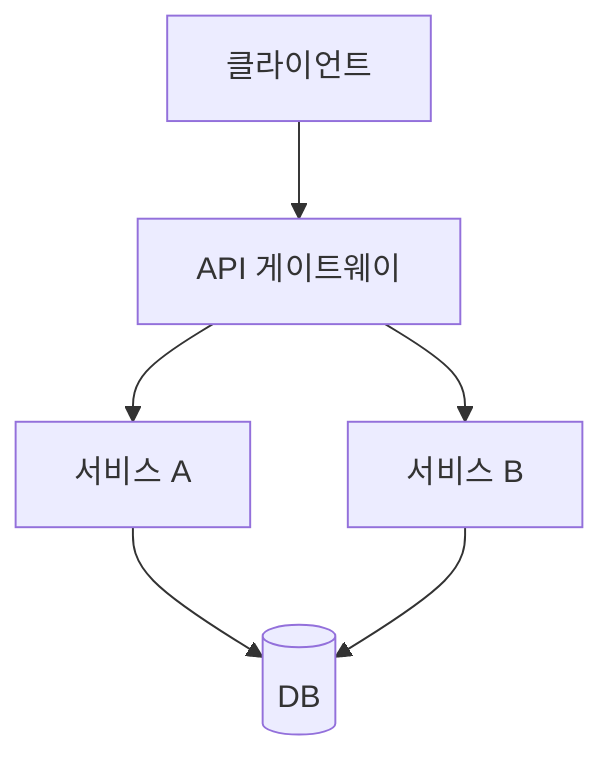
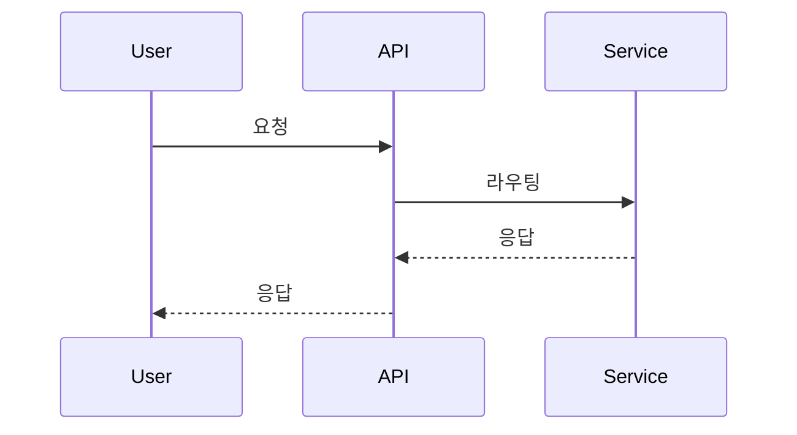
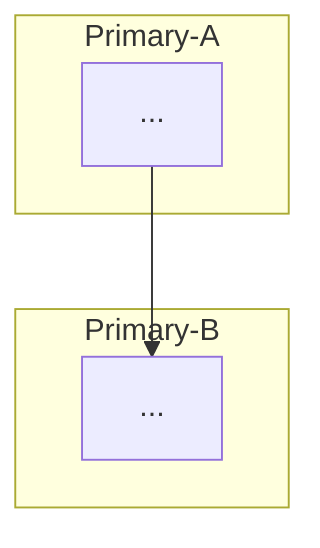
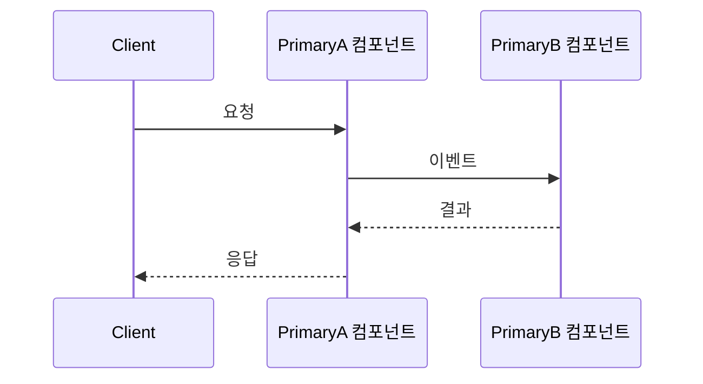

# 시스템 아키텍처 스타일

## 1. 추천 요약

| 구분 | 스타일 | Scope | 점수 | 핵심 근거(Driver) |
|------|--------|-------|------|-------------------|
| Primary | {style-id} | {scope} | {score} | {driver=level, ...} |
| Primary | {style-id} | {scope} | {score} | ... |
| Secondary | {style-id} | {scope} | {score} | ... |
| Supporting | {style-id} | {scope} | {score} | ... |

⚠️ Primary 는 scope 당 1개 원칙. 엔진(`style-score.py`) 순위는 뒤집지 말 것.

---

## 2. 정규화된 시스템 속성

| 속성 | 값 | 비고(Driver 근거) |
|------|-----|-------------------|
| {attribute} | {level} | {Driver key / 출처 / 의미} |
| ... | ... | ... |

`archSettings.normalizedAttributes` 에서 읽어 그대로 표로 정리. 모든 속성이 적어도 한 번은 3번 섹션에 등장해야 Driver 커버리지 pass.

---

## 3. 스타일별 선정 근거

### 3.1 {Primary-A-Name} ({style-id})

#### 구조 (정적 관점)

(스타일의 컴포넌트/레이어 배치를 다이어그램으로 — ADSN adiagram 에 해당)

#### 동작 (동적 관점, 생략 가능)

(스타일 고유의 런타임 흐름이 있는 경우 — ADSN bdiagram 에 해당. 세부 설계에서 구체화되는 스타일은 생략)

#### 선정 근거

- **적합 신호(fit_signals)**: {attr}={level} → +{delta} / ...
- **품질속성 영향**: Performance positive / Scalability positive / ...
- **트레이드오프**:
  - 장점 (pros): ...
  - 단점 (cons): ...
- **전제조건**: technical / design / organizational
- **연결된 Driver**: [{attr=level, ...}]
- **엔진 score**: {score}

---

### 3.2 {Primary-B or Secondary-Name} ({style-id})

(위와 동일 구조로 반복)

---

## 4. 조합 설계

### 4.1 통합 구조 (정적 관점)

(선정된 스타일들이 시스템 내에서 어떻게 조합·배치되는지 전체 구조)

### 4.2 통합 동작 (동적 관점)

(조합된 스타일 간 런타임 상호작용 흐름)

### 4.3 조합 근거

- **Primary 간 조합 관계**: {style-A} combines_well_with {style-B} — bonus {+delta}
- **Primary + Supporting 역할 분담**: {Supporting} 이 infrastructure scope 에서 보조
- **제외 스타일 이유**: {excluded-style} — avoid_signals 매치 / 전제조건 미충족 등
- **엔진 combinations_applied**: (combine bonus / conflict penalty 내역)

---

## 5. 설계 결정에 미치는 영향

- **ADSN 설계 영향**: ...
- **DDSN 세부 설계 시 고려사항**: ...
- **NFR 에 대한 기여**: 각 Primary 가 Performance/Scalability/... 에 끼치는 영향
- **잠재적 Risk / Sensitivity point**: SATAM 단계에서 재검토 대상
