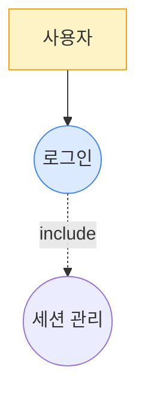

## 이 스킬을 언제 호출하나

사용자 요청이 아래 의도에 해당하면 이 스킬을 호출하고 `MODE` 를 확정한다.

- **MODE=relink** — "Feature-VOS 연결 재정리", "링크 재정리", "재링크", "relink", "링크만 다시" 등 **기존 Feature/UseCase 를 유지하면서 VOS 와의 연결/문서만 재정립** 하려는 요청
- **MODE=full** — "Use Case 분석", "Feature 도출", "VOS 에서 Use Case 뽑아" 등 **VOS 에서 신규 Use Case/Feature 를 도출** 해 달라는 요청

단순 현황 조회(고아 Feature, 커버리지 점검 등)만 원하는 거면 먼저 `issue-analyze` 로 분석하고, 구조 변경(이슈·링크 수정) 의도가 확인된 뒤에만 이 스킬을 호출한다. 분석 결과만 요구한 턴에서 이 스킬을 "미리 돌려놓지" 말 것.

## 한 generation 당 제약 (GLM 계열 스톨 방지 — 필독)

- **한 번의 LLM generation 에서 Step 두 개 이상 처리 금지**. 각 Step 종료는 **반드시 Bash tool call 로 마무리** 해 generation 경계 형성
- reasoning 은 각 Step 당 3~5 줄 이내. 장기 추론 불필요
- Step 1 도출 완료 시 **반드시 `draft-io.sh save`** — User Story / Use Case / Feature / document 전체 JSON 을 파일에 flush 후 generation 종료
- Step 2 자가검증은 **반드시 `validate-usecases.py` 호출** — 에이전트가 직접 VOS 커버리지 / Mermaid 구문 / Actor 다양성 계산 금지
- critical 수정 후 다시 `draft-io.sh save` → 이어 `validate-usecases.py` 로 재검증. 한 generation 당 1 iter
- assistant 출력에는 긴 document JSON 뱉지 말 것. "저장 완료 / critical N건" 한두 줄만

## 진행 상태 가시화 — `todowrite` (선택, OpenCode)

OpenCode 환경이면 각 Step 진입 시 내장 `todowrite` 로 현재/남은 단계를 알려주면 UX 가 좋다. 강제 아님, Claude Code 에서는 무시. 자세한 규칙은 `.claude/skills/_shared/todowrite-guide.md`.

이 스킬 Step 체크리스트:
```
# Todos
[ ] Step 0 — 데이터 수집 (VOS + 기존 Feature/UC)
[ ] Step 1 — 초안 생성 (iter 1)
[ ] Step 2 — 자가검증 (validate-usecases.py)
[ ] Step 3 — critical 수정 (반복, 최대 iter 3)
[ ] Step 5 — Feature/UC 이슈 + 링크 + use-cases.md 영속화
[ ] Step 6 — 최종 보고
```

## 환경
- `PLATFORM_API` 기본값: `http://localhost:9000/api/v2`
- `GOJIRA_API` 기본값: `http://localhost:9001/api/v2`
- 임시 파일: `/tmp/${CODE}-uc-{draft|validation}.json`

## 인자 추출

사용자 메시지에서 다음 값들을 추출해 **먼저** 환경변수로 export 한 뒤 아래 bash 블록들을 실행하라. 누락 시 사용자에게 되물어 확정하라.

- `CODE` — projectCode (예: GOJIRA3)
- `USER` — user (예: batman)
- `MODE` — `full`(기본) | `relink`. `relink` 는 **기존 Feature 이슈를 보존**하고 VOS ↔ Feature 링크 / use-cases.md 만 재생성. 사용자가 "연결 재정리", "링크만", "재링크" 류의 표현을 쓰면 `relink` 로 해석

예:
```bash
export CODE="GOJIRA3"
export USER="batman"
export MODE="full"   # 또는 relink
```

## 역할
소프트웨어 아키텍트. **모든 VOS 가 User Story → Use Case → Feature 로 빠짐없이 파생되는 커버리지**를 책임진다.

### 핵심 파생 규칙
```
VOS ──(1:N)──▶ User Story ──(N:M)──▶ Use Case ──(선별)──▶ Feature
```
1. **VOS → User Story**: 각 VOS 에서 최소 1개 User Story 파생 (Happy/Alternative/Exception)
2. **User Story → Use Case**: 유사 목적 Story 를 묶어 Use Case 도출. 모든 Story 는 반드시 하나의 UC 에 매핑
3. **Use Case Diagram**: Feature 선정 **이전에** 모든 Use Case 로 다이어그램 작성
4. **Feature 선정**: Actor 와 1차적으로 연결되는 Use Case 만 Feature (include/extend/보조 제외)
   - 이 단계에서 VOS → User Story → Use Case 경로가 보장되므로 **모든 VOS 는 반드시 1개 이상의 Feature 에 연결됨**
5. **Feature 미선정 Use Case 유지**: Feature 로 선정되지 않은 Use Case 는 삭제하지 않음. Use Case 다이어그램도 수정하지 않음

### VOS ↔ Feature 연결 양방향 필수
- 모든 **VOS** 는 최소 1 개 Feature 와 연결 (기존 원칙)
- 모든 **Feature** 는 최소 1 개 VOS 와 연결 — Feature 는 VOS → UC → Feature 로 도출된 것이므로 연결할 VOS 가 없다는 건 Feature 자체의 도출 근거가 없다는 신호
- `relatedVOS` 는 최소 1 개 VOS 키 필수. 빈 배열 금지

### NFR 성격 VOS 도 Feature 확보 (면제 없음)
품질속성/정책/제약 성격이 강한 VOS 라도 **반드시 그 요구를 "구현하는" 기능 Feature 를 도출**한다. 면제(NFR 표기만) 금지.
- 원칙: "이 요구를 만족시키려면 시스템이 **무슨 동작**을 해야 하는가?" 로 환원 → 그 동작이 Feature
- Feature 가 확보되면 후속 Requirement 단계에서 그 Feature 에 NFR/CNST 속성 Requirement 를 연결하여 품질속성을 표현

파생 예시:
- "개인정보는 사용자 동의 없이 수집되지 않아야 함" → Feature **"사용자 동의 수집 및 데이터 수집 정책 표시"** (동의 플로우, 프라이버시 설정 UC)
- "네트워크 불안정 시 게임 상태가 유지되어야 함" → Feature **"세션 자동 복구/재접속"** (재접속 UC, 상태 스냅샷 UC)
- "접근성 준수" → Feature **"접근성 설정/키보드 네비게이션"**
- "응답시간 XX 이하" → Feature **"성능 모니터링/로드 상태 표시"** 또는 기능 Feature 자체에 NFR 로 연결

---

## Step 0 — 데이터 수집

```bash
PLATFORM_API="${PLATFORM_API:-http://localhost:9000/api/v2}"
GOJIRA_API="${GOJIRA_API:-http://localhost:9001/api/v2}"

# project-description.md (docs/{user} 우선, fallback main — 스크립트 자동 처리)
DESC=$(bash "${PROJECT_ROOT}/.claude/skills/_scripts/doc-read.sh" "${CODE}" "${USER}" "business/project-description.md")
echo "=== project-description.md ==="
echo "$DESC"

# VOS 목록 (issueLinks 포함 — relink 차집합 계산 / Feature 미연결 VOS 검출용)
echo
echo "=== VOS 목록 ==="
curl -s "${GOJIRA_API}/Issue" -H "XBody: {\"prjID\":\"${CODE}\",\"infoType\":\"\"}" -H "X-User-Id: ${USER}" \
  | jq '[.[] | select(.issueType=="VOS") | {key,summary,description,client,issueLinks}]'

# 기존 Feature (issueLinks + 전체 본문 — relink 에서 원문 그대로 보존)
echo
echo "=== 기존 Feature ==="
curl -s "${GOJIRA_API}/Issue" -H "XBody: {\"prjID\":\"${CODE}\",\"infoType\":\"\"}" -H "X-User-Id: ${USER}" \
  | jq '[.[] | select(.issueType=="Feature") | {key,subkey,summary,description,actor,precondition,basicflow,alternativeflow,exceptionflow,postcondition,issueLinks}]'
```

- VOS 가 0건 → **중단** 하고 "vos-collect2 를 먼저 실행하세요" 보고
- `MODE=relink` 인데 기존 Feature 0 건 → **중단** 하고 `MODE=full` 로 전환 권고 (재링크 대상 없음)

---

## Step 1 — 초안 생성 (iter 1)

### MODE=relink 축약 규칙

이슈 생성/수정/삭제 금지. 기존 Feature 원문(summary/actor/flows) 보존. 다음만 수행:

- 모든 항목 `mode=reuse` 고정, `existingKey` = Step 0 의 기존 Feature key, `docId` = 기존 subkey (예: UC_001) 그대로
- 신규 Feature/UC 추가 금지 (커버리지 부족은 critical 보고만, 신규 create 는 MODE=full 로 재호출 권고)
- `relatedVOS` 만 각 Feature 원문과 VOS 목록을 대조해 재산정 — **빈 배열 금지, 최소 1개 VOS 필수**
- 모든 Step 1.1~1.9 (도메인 분석, User Story 파생, Use Case 도출, Diagram 작성, 시나리오 정의) 는 기존 문서에서 원문 그대로 취해 재작성 — 추가 도출 금지

그 외는 MODE=full 과 동일하게 Step 2 self-loop 수행.

### MODE=full (기본)

### 1.1 Business Domain 분석
- 도메인 경계와 범위 (시스템 책임 영역)
- 핵심 도메인 개념 (반복 등장 업무 용어)
- Actor 식별: Primary(가치 요청 트리거) / Supporting(협력)
- 외부 시스템
- 도메인 규칙/제약
→ document "## 1. Business Domain 분석" 섹션

### 1.2 User Story 파생 (VOS 기반)
각 VOS 에서 User Story 를 파생시킨다. **모든 VOS 는 최소 1개 User Story 를 가져야 한다.**

분류:
- (A) 정상(Happy Path): 성공 진행
- (B) 비정상(Alternative): 정상 흐름의 분기
- (C) 예외(Exception): 오류/실패

**암묵적 Story** 능동 발굴: 계정/인증, 중단/이탈, 다중 사용자 동기화, 데이터 영속성.

→ document "## 2.1 User Story 목록" 표 (ID/Actor/분류/Story/원본 VOS/매핑 UC-ID)

### 1.3 Use Case 도출
- 비슷한 목적 Story 묶기 → Use Case
- 다른 목적/시점/입출력 은 **별도 Use Case**
- 예: "게임 시작" vs "추측 입력" vs "게임 종료" 는 별도 UC
- **모든 User Story 는 반드시 하나의 UC 에 매핑**되어야 함
- VOS → Story → UC 경로가 보장되므로 모든 VOS 가 최소 1개 UC 에 연결됨

### 1.4 Use Case Diagram (Feature 선정 전 작성)
**모든 Use Case** 를 포함한 다이어그램을 이 단계에서 작성한다.
- Use Case Diagram → `graph TB` (**절대 `classDiagram` 금지**)
- 이 다이어그램은 Feature 선정 후에도 **수정하지 않음**

### 1.5 Feature 선정
Actor 와 1차적으로 직접 연결되는 Use Case 만 Feature 로 선정.
- include/extend/보조 Use Case 는 Feature 에서 **제외**
- 과도 통합 금지: "게임 플레이" 하나로 [시작/입력/결과/이력] 묶지 말 것
- **Feature 로 선정되지 않은 Use Case 는 삭제하지 않는다** — Use Case 목록과 다이어그램 그대로 유지
- VOS → Story → UC 파생 구조 상 **모든 VOS 에 대해 1개 이상의 Feature 연결이 보장됨**

### 1.6 시나리오 정의
각 **Feature** 에 Basic/Alternative/Exception Flow.
Basic 5단계 이상이면 별도 UC 분해 검토.

### 1.7 Mermaid 다이어그램 (시작 라인 정확히)
- Context Diagram → `graph LR`
- Use Case Diagram → `graph TB` (Step 1.4 에서 작성 완료, 그대로 사용)
- Sequence Diagram (Feature별) → `sequenceDiagram`

예시:
````

````

- Feature 로 선정된 UC 에는 `:::feature` 스타일 적용하여 시각적 구분
- Feature 미선정 UC 도 다이어그램에 그대로 포함

금지: classDiagram 으로 UC 표현, 외부 이미지(``) 참조, Mermaid 노드 ID 에 공백/한글 직접 사용.
**Sequence Diagram 에서 다중 수신자 쉼표 금지**: `Game-->>User1, User2: 메시지` → 개별 2줄로 분리.
**participant 에 반드시 `as` 키워드 사용**: `participant User2 as 후공 사용자` (O) / `participant User2 후공 사용자` (X)

### 1.8 문서 템플릿 (use-cases.md)

**반드시** 아래 템플릿 파일의 구조를 따른다. 실행 전 먼저 읽어서 구조를 확인하라:

```bash
cat "${PROJECT_ROOT}/.claude/skills/usecase-analyze2/templates/use-cases.md"
```

섹션/번호를 빠뜨리지 말 것. 특히 **모든 Feature 에 대해 Sequence Diagram 필수** — 누락 시 critical.

### 1.9 docId 부여
각 Feature 에 `docId: "UC-N"` (1부터 순차). document 본문의 모든 Feature 표기에 **동일 docId 사용**. "(Feature 이슈 키)" 칸에 docId 를 그대로 적음 (Step 5 에서 실제 key 로 치환).

### 1.10 relatedVOS + mode
각 Feature 에 `relatedVOS: ["GOJIRA3-N", ...]` (VOS 목록 실존 키만).
**최소 1개 VOS 키 필수 — 빈 배열 금지**. Feature 는 VOS → UC → Feature 로 도출된 것이므로 연결할 VOS 가 없는 Feature 는 정의상 부적절 (critical).
mode: `create` / `reuse` / `modify` / `delete_mark` (existingKey 필요).

### Step 1 종료 — draft flush (필수)

User Story / Use Case / Feature / document 전체를 draft 파일로 저장하고 **이 generation 을 종료**. 다음 generation 에서 Step 2 검증.

```bash
cat > /tmp/${CODE}-uc-draft-input.json <<'JSON'
{
  "vosKeys": [ ...Step 0 VOS 키 목록... ],
  "existingFeatureKeys": [ ...기존 Feature 키 (MODE=full 이면 빈 배열)... ],
  "userStories": [ ...Step 1.2 파생 목록... ],
  "useCases": [ ...Step 1.3 도출 목록... ],
  "features": [ ...Step 1.5/1.9/1.10 산출 Feature 목록 — docId/relatedVOS/mode 포함... ],
  "document": "...마크다운 전체 문자열..."
}
JSON

bash "${PROJECT_ROOT}/.claude/skills/_scripts/draft-io.sh" save "${CODE}" "uc" "draft" \
  < /tmp/${CODE}-uc-draft-input.json
```

출력 한 줄만 assistant 메시지에. 전체 JSON 재출력 금지.

---

## Step 2 — 자가검증 (스크립트 기반)

**반드시 `validate-usecases.py` 호출**. 에이전트가 직접 커버리지 / Mermaid 구문 / Actor 다양성 계산 금지.

```bash
bash "${PROJECT_ROOT}/.claude/skills/_scripts/draft-io.sh" load "${CODE}" "uc" "draft" \
  | python3 "${PROJECT_ROOT}/.claude/skills/_scripts/validate-usecases.py" \
  > /tmp/${CODE}-uc-validation.json
cat /tmp/${CODE}-uc-validation.json
```

출력 스키마:
```json
{
  "pass": bool,
  "score": 0.0~1.0,
  "score_effective": number,
  "critical": [{"type":"...","docId":"...","detail":"..."}],
  "suggestions": [...],
  "stats": {"vosKeys":N,"storyVosCovered":V1,"featureVosCovered":V2,
            "features":F,"sequenceDiagramCount":SD,
            "useCaseDiagramFound":bool,"contextDiagramFound":bool,"mermaidBlocks":M}
}
```

스크립트가 잡는 critical:
- `vos_no_story` — VOS 가 User Story 에 미파생
- `vos_no_feature` — VOS 가 Feature relatedVOS 에 미포함 (NFR 면제 없음)
- `missing_field` / `empty_field` — Feature 필수 필드 누락 (summary/actor/basicflow/docId/relatedVOS)
- `relatedVOS_empty` / `relatedVOS_hallucination` / `bad_relatedVOS_type`
- `duplicate_docId`
- `over_integration` — Feature 1건에 VOS 3건 이상 묶음
- `single_actor_all` — Feature ≥3 이 모두 동일 Actor
- `class_diagram_for_uc` — classDiagram 으로 UC 표현
- `missing_usecase_diagram` / `missing_sequence_diagram`
- `mermaid_multi_recipient` — 쉼표로 다중 수신자
- `external_image` — 외부 이미지 참조
- `nfr_placeholder` — (NFR) 플레이스홀더

### 통과 기준
- `pass == true` → Step 5 진입
- `pass == false` → Step 3 수정

---

## Step 3 — 수정 (pass=false)

validation output 의 critical 만 **국소 수정** 후 draft 재저장:

```bash
cat > /tmp/${CODE}-uc-draft-input.json <<'JSON'
{ ...수정된 vosKeys / userStories / useCases / features / document... }
JSON
bash "${PROJECT_ROOT}/.claude/skills/_scripts/draft-io.sh" save "${CODE}" "uc" "draft" \
  < /tmp/${CODE}-uc-draft-input.json
```

이 tool call 로 generation 종료. 다음 generation 에서 validate 재실행.

---

## Step 4 — 종료 조건
1. pass=true
2. iter 3 완료
3. 같은 critical 2회 연속 재발
4. 새 수정이 이전 best 보다 낮은 score_effective → 포기

**best-so-far**: `(features, document, coverageMatrix, score_effective)` 기록. 종료 시 최댓값 iter 를 selected.

---

## Step 5 — 이슈 생성 + 링크 + 문서 저장

### ⚠️ 실행 규칙
- **개별 curl POST/PUT 반복 절대 금지** — 반드시 batch 스크립트 사용.
- 스크립트 경로: `${PROJECT_ROOT}/.claude/skills/_scripts/`

### 5.1 Feature 이슈 일괄 생성

**MODE=relink 이면 이 섹션 전체 스킵** — 이슈 생성/수정/삭제 모두 하지 않는다. 바로 5.2 로.

create 모드 항목을 JSON 배열로 모아 batch 스크립트 **1회** 실행.
`issue-batch-create.sh` 는 순차 POST + PUT(추가 필드) + 재시도를 자동 처리한다.

```bash
# items 에 actor/precondition/basicflow 등을 포함시키면 PUT 으로 자동 업데이트됨
cat > /tmp/uc_items.json <<'JSON'
[
  {"issueType":"Feature","summary":"...","desc":"...","actor":"...","precondition":"...","basicflow":"...","alternativeflow":"...","exceptionflow":"...","postcondition":"..."},
  ...
]
JSON

bash "${PROJECT_ROOT}/.claude/skills/_scripts/issue-batch-create.sh" "${CODE}" "${USER}" < /tmp/uc_items.json \
  > /tmp/uc_result.json
cat /tmp/uc_result.json
```

결과의 `keys` 배열에서 생성된 Feature key 목록 확인.

### 5.2 VOS → Feature Contains 링크 일괄 생성

각 Feature 의 `relatedVOS` 를 순회해 링크 JSON 배열을 구성. 링크 방향: **VOS 가 inward, Feature 가 outward**.

> **중복 제거 필수** — `POST /Issue/link` 은 idempotent 아님 (매 호출마다 새 linkID 로 `$push`). Step 0 에서 수집한 VOS/Feature 의 `issueLinks[].{inwardIssue.key, outwardIssue.key, type.name}` 로 기존 튜플 집합 `EXISTING` 을 만들고, 새로 만들 집합 `DESIRED` 와 차집합을 계산:
> - `NEW = DESIRED - EXISTING` → `/tmp/uc_links.json` 에 이것만 씀
> - `KEPT = DESIRED ∩ EXISTING` → 보고에만 노출, POST 안 함
> - `REMOVAL_CANDIDATES = EXISTING - DESIRED` (VOS↔Feature 범위만) → **자동 삭제 금지**, 최종 보고에 ⚠ 목록으로만 표시

batch 스크립트 **1회** 실행 (NEW 만 POST):

```bash
cat > /tmp/uc_links.json <<'JSON'
[
  {"inwardKey":"GOJIRA3-1","outwardKey":"GOJIRA3-21","linkType":"Contains(WBSGantt)"},
  ...
]
JSON

bash "${PROJECT_ROOT}/.claude/skills/_scripts/issue-batch-link.sh" "${CODE}" "${USER}" < /tmp/uc_links.json \
  > /tmp/uc_link_result.json
cat /tmp/uc_link_result.json
```

링크 실패는 **silent drop 금지** — 최종 보고에 누락 건수 명시.

### 5.3 docId → subkey 치환
- 각 생성된 Feature 의 `subkey` (UC_001, UC_002...) 를 document 본문의 docId 와 매핑
- MODE=relink 는 docId 가 이미 기존 subkey 형식(UC_001) 이라 자연스럽게 no-op

### 5.4 use-cases.md 저장

```bash
echo "$DOCUMENT" | bash "${PROJECT_ROOT}/.claude/skills/_scripts/doc-save.sh" "${CODE}" "${USER}" "business/use-cases.md"
```

---

## Step 6 — 최종 보고

```
## Use Case 분석 완료 (v2 Claude Code) — MODE={full|relink}

- Feature 생성: N건 (키 리스트)   (relink 은 0)
- VOS-Feature 링크: 신규 NEW / 기존 유지 KEPT / ⚠ 제거 후보 REM (REM>0 이면 key 쌍 나열 + 수동 처리 안내)
- 문서 저장: business/use-cases.md
- Mermaid 다이어그램: Context / Use Case / Sequence

### VOS 커버리지 매트릭스 (전 VOS ≥1 Feature, 전 Feature ≥1 VOS 연결)
| VOS 키 | 매핑된 Feature | 비고 |
|---|---|---|
| GOJIRA3-N | UC-1, UC-3 | |
| GOJIRA3-M | UC-5 | NFR 성격 — 구현 기능 Feature 확보 후 Requirement 단계에서 NFR 로 속성화

### Self-loop
- iter N회 / selected=iter X (score_eff Y) / stop=pass|max_iter|...
- unresolvedCritical: [...]
```

---

## 주의
- 모든 curl 에 `X-User-Id: ${USER}` 헤더 필수 (403 방지)
- 링크 linkType 은 정확히 `Contains(WBSGantt)` (JIRA DC 표준)
- Platform-API `/file` 응답 content 는 base64 → `base64 -d`
- use-cases.md 본문은 **UTF-8 plain markdown** (Platform-API 가 서버 측에서 base64 인코딩 처리)
- Mermaid 코드블록은 반드시 ```mermaid ... ``` 로 감싸기
- Feature 생성 후 subkey 를 응답에서 받아 docId 치환에 사용
- MODE 요약: `full` — 신규 Feature create + 링크 + 문서 작성 / `relink` — 이슈 생성·수정 없음, 링크 차집합 POST + 문서 재작성. 두 모드 모두 `/Issue/link` 가 idempotent 아니므로 POST 전 기존 `issueLinks` 와 차집합 필수
