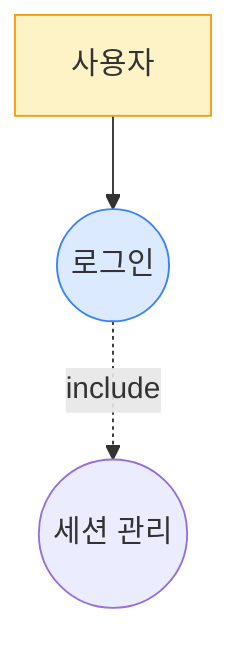

## 환경
- `PLATFORM_API` 기본값: `http://localhost:9000/api/v2`
- `GOJIRA_API` 기본값: `http://localhost:9001/api/v2`

## 인자 추출

사용자 메시지에서 다음 값들을 추출해 **먼저** 환경변수로 export 한 뒤 아래 bash 블록들을 실행하라. 누락 시 사용자에게 되물어 확정하라.

- `CODE` — projectCode (예: GOJIRA3)
- `USER` — user (예: batman)

예:
```bash
export CODE="GOJIRA3"
export USER="batman"
```

## 역할
소프트웨어 아키텍트. **모든 VOS 가 User Story → Use Case → Feature 로 빠짐없이 파생되는 커버리지**를 책임진다.

### 핵심 파생 규칙
```
VOS ──(1:N)──▶ User Story ──(N:M)──▶ Use Case ──(선별)──▶ Feature
```
1. **VOS → User Story**: 각 VOS 에서 최소 1개 User Story 파생 (Happy/Alternative/Exception)
2. **User Story → Use Case**: 유사 목적 Story 를 묶어 Use Case 도출. 모든 Story 는 반드시 하나의 UC 에 매핑
3. **Use Case Diagram**: Feature 선정 **이전에** 모든 Use Case 로 다이어그램 작성
4. **Feature 선정**: Actor 와 1차적으로 연결되는 Use Case 만 Feature (include/extend/보조 제외)
   - 이 단계에서 VOS → User Story → Use Case 경로가 보장되므로 **모든 VOS 는 반드시 1개 이상의 Feature 에 연결됨**
5. **Feature 미선정 Use Case 유지**: Feature 로 선정되지 않은 Use Case 는 삭제하지 않음. Use Case 다이어그램도 수정하지 않음

### NFR 성격 VOS 도 Feature 확보 (면제 없음)
품질속성/정책/제약 성격이 강한 VOS 라도 **반드시 그 요구를 "구현하는" 기능 Feature 를 도출**한다. 면제(NFR 표기만) 금지.
- 원칙: "이 요구를 만족시키려면 시스템이 **무슨 동작**을 해야 하는가?" 로 환원 → 그 동작이 Feature
- Feature 가 확보되면 후속 Requirement 단계에서 그 Feature 에 NFR/CNST 속성 Requirement 를 연결하여 품질속성을 표현

파생 예시:
- "개인정보는 사용자 동의 없이 수집되지 않아야 함" → Feature **"사용자 동의 수집 및 데이터 수집 정책 표시"** (동의 플로우, 프라이버시 설정 UC)
- "네트워크 불안정 시 게임 상태가 유지되어야 함" → Feature **"세션 자동 복구/재접속"** (재접속 UC, 상태 스냅샷 UC)
- "접근성 준수" → Feature **"접근성 설정/키보드 네비게이션"**
- "응답시간 XX 이하" → Feature **"성능 모니터링/로드 상태 표시"** 또는 기능 Feature 자체에 NFR 로 연결

---

## Step 0 — 데이터 수집

```bash
PLATFORM_API="${PLATFORM_API:-http://localhost:9000/api/v2}"
GOJIRA_API="${GOJIRA_API:-http://localhost:9001/api/v2}"

# project-description.md (docs/{user} 우선, fallback main — 스크립트 자동 처리)
DESC=$(bash "${PROJECT_ROOT}/.claude/skills/_scripts/doc-read.sh" "${CODE}" "${USER}" "business/project-description.md")
echo "=== project-description.md ==="
echo "$DESC"

# VOS 목록
echo
echo "=== VOS 목록 ==="
curl -s "${GOJIRA_API}/Issue" -H "XBody: {\"prjID\":\"${CODE}\",\"infoType\":\"\"}" -H "X-User-Id: ${USER}" \
  | jq '[.[] | select(.issueType=="VOS") | {key,summary,description,client}]'

# 기존 Feature
echo
echo "=== 기존 Feature ==="
curl -s "${GOJIRA_API}/Issue" -H "XBody: {\"prjID\":\"${CODE}\",\"infoType\":\"\"}" -H "X-User-Id: ${USER}" \
  | jq '[.[] | select(.issueType=="Feature") | {key,subkey,summary,actor}]'
```

VOS 가 0건이면 **중단** 하고 "vos-collect2 를 먼저 실행하세요" 보고.

---

## Step 1 — 초안 생성 (iter 1)

### 1.1 Business Domain 분석
- 도메인 경계와 범위 (시스템 책임 영역)
- 핵심 도메인 개념 (반복 등장 업무 용어)
- Actor 식별: Primary(가치 요청 트리거) / Supporting(협력)
- 외부 시스템
- 도메인 규칙/제약
→ document "## 1. Business Domain 분석" 섹션

### 1.2 User Story 파생 (VOS 기반)
각 VOS 에서 User Story 를 파생시킨다. **모든 VOS 는 최소 1개 User Story 를 가져야 한다.**

분류:
- (A) 정상(Happy Path): 성공 진행
- (B) 비정상(Alternative): 정상 흐름의 분기
- (C) 예외(Exception): 오류/실패

**암묵적 Story** 능동 발굴: 계정/인증, 중단/이탈, 다중 사용자 동기화, 데이터 영속성.

→ document "## 2.1 User Story 목록" 표 (ID/Actor/분류/Story/원본 VOS/매핑 UC-ID)

### 1.3 Use Case 도출
- 비슷한 목적 Story 묶기 → Use Case
- 다른 목적/시점/입출력 은 **별도 Use Case**
- 예: "게임 시작" vs "추측 입력" vs "게임 종료" 는 별도 UC
- **모든 User Story 는 반드시 하나의 UC 에 매핑**되어야 함
- VOS → Story → UC 경로가 보장되므로 모든 VOS 가 최소 1개 UC 에 연결됨

### 1.4 Use Case Diagram (Feature 선정 전 작성)
**모든 Use Case** 를 포함한 다이어그램을 이 단계에서 작성한다.
- Use Case Diagram → `graph TB` (**절대 `classDiagram` 금지**)
- 이 다이어그램은 Feature 선정 후에도 **수정하지 않음**

### 1.5 Feature 선정
Actor 와 1차적으로 직접 연결되는 Use Case 만 Feature 로 선정.
- include/extend/보조 Use Case 는 Feature 에서 **제외**
- 과도 통합 금지: "게임 플레이" 하나로 [시작/입력/결과/이력] 묶지 말 것
- **Feature 로 선정되지 않은 Use Case 는 삭제하지 않는다** — Use Case 목록과 다이어그램 그대로 유지
- VOS → Story → UC 파생 구조 상 **모든 VOS 에 대해 1개 이상의 Feature 연결이 보장됨**

### 1.6 시나리오 정의
각 **Feature** 에 Basic/Alternative/Exception Flow.
Basic 5단계 이상이면 별도 UC 분해 검토.

### 1.7 Mermaid 다이어그램 (시작 라인 정확히)
- Context Diagram → `graph LR`
- Use Case Diagram → `graph TB` (Step 1.4 에서 작성 완료, 그대로 사용)
- Sequence Diagram (Feature별) → `sequenceDiagram`

예시:
````

````

- Feature 로 선정된 UC 에는 `:::feature` 스타일 적용하여 시각적 구분
- Feature 미선정 UC 도 다이어그램에 그대로 포함

금지: classDiagram 으로 UC 표현, 외부 이미지(``) 참조, Mermaid 노드 ID 에 공백/한글 직접 사용.
**Sequence Diagram 에서 다중 수신자 쉼표 금지**: `Game-->>User1, User2: 메시지` → 개별 2줄로 분리.
**participant 에 반드시 `as` 키워드 사용**: `participant User2 as 후공 사용자` (O) / `participant User2 후공 사용자` (X)

### 1.8 문서 템플릿 (use-cases.md)

**반드시** 아래 템플릿 파일의 구조를 따른다. 실행 전 먼저 읽어서 구조를 확인하라:

```bash
cat "${PROJECT_ROOT}/.claude/skills/usecase-analyze2/templates/use-cases.md"
```

섹션/번호를 빠뜨리지 말 것. 특히 **모든 Feature 에 대해 Sequence Diagram 필수** — 누락 시 critical.

### 1.9 docId 부여
각 Feature 에 `docId: "UC-N"` (1부터 순차). document 본문의 모든 Feature 표기에 **동일 docId 사용**. "(Feature 이슈 키)" 칸에 docId 를 그대로 적음 (Step 5 에서 실제 key 로 치환).

### 1.10 relatedVOS + mode
각 Feature 에 `relatedVOS: ["GOJIRA3-N", ...]` (VOS 목록 실존 키만).
mode: `create` / `reuse` / `modify` / `delete_mark` (existingKey 필요).

---

## Step 2 — 자가검증 (커버리지가 핵심)

### VOS 커버리지 매트릭스 (필수)
VOS 목록의 **모든 키**가 최소 1 Feature 의 `relatedVOS` 에 포함되는지 점검.
- 미커버 VOS 가 있으면 **Feature 추가** (Step 1.4~1.8 반복) — **NFR 면제 금지**
- NFR 성격 VOS 도 "이 요구를 구현하는 동작" Feature 를 반드시 도출해서 매핑 (역할 섹션 파생 예시 참조)
- 억지 매핑 금지 — 의미 연관 불충분하면 새 Feature 추가

### critical 기준
- 필수 필드(summary, actor, basicflow, docId, relatedVOS) 누락
- `relatedVOS` 가 VOS 목록에 없는 키 참조 (hallucination)
- **VOS 1건이라도** User Story 에서 파생되지 않음 (파생 경로 단절)
- **VOS 1건이라도** Feature 매핑 안 됨 — **NFR 면제 없음**. 품질속성/정책/제약 VOS 라도 구현 기능 Feature 를 반드시 도출해 매핑
- `coverageMatrix` 에 `(NFR)` 플레이스홀더 사용 금지
- Use Case Diagram 을 classDiagram 으로 작성
- **Use Case Diagram 에 Feature 미선정 UC 가 누락됨** (모든 UC 포함 필수)
- Context/Use Case/Sequence 중 2개 이상 누락
- **Sequence Diagram 이 일부 Feature 에만 있고 나머지 누락** (모든 Feature 필수)
- Mermaid 구문 오류 (쉼표 다중 수신자, `as` 누락 등)
- 외부 이미지 참조
- Feature 1건뿐인데 VOS 3건 이상 (과도 통합)
- 모든 Feature 의 Actor 동일 (다른 Actor 누락)
- docId 중복/누락
- Feature 선정 후 Use Case 목록/다이어그램에서 미선정 UC 를 삭제함

### 점수
- `score`: 0.0~1.0
- `score_effective = score - 0.5 × |critical|`
- `pass`: `score_effective >= 0.8`

---

## Step 3 — 수정 (pass=false)

critical + suggestions 항목만 **국소 수정**. 나머지 원문 유지. 수정 후 Step 2 로.

---

## Step 4 — 종료 조건
1. pass=true
2. iter 3 완료
3. 같은 critical 2회 연속 재발
4. 새 수정이 이전 best 보다 낮은 score_effective → 포기

**best-so-far**: `(features, document, coverageMatrix, score_effective)` 기록. 종료 시 최댓값 iter 를 selected.

---

## Step 5 — 이슈 생성 + 링크 + 문서 저장

### ⚠️ 실행 규칙
- **개별 curl POST/PUT 반복 절대 금지** — 반드시 batch 스크립트 사용.
- 스크립트 경로: `${PROJECT_ROOT}/.claude/skills/_scripts/`

### 5.1 Feature 이슈 일괄 생성

create 모드 항목을 JSON 배열로 모아 batch 스크립트 **1회** 실행.
`issue-batch-create.sh` 는 순차 POST + PUT(추가 필드) + 재시도를 자동 처리한다.

```bash
# items 에 actor/precondition/basicflow 등을 포함시키면 PUT 으로 자동 업데이트됨
cat > /tmp/uc_items.json <<'JSON'
[
  {"issueType":"Feature","summary":"...","desc":"...","actor":"...","precondition":"...","basicflow":"...","alternativeflow":"...","exceptionflow":"...","postcondition":"..."},
  ...
]
JSON

bash "${PROJECT_ROOT}/.claude/skills/_scripts/issue-batch-create.sh" "${CODE}" "${USER}" < /tmp/uc_items.json \
  > /tmp/uc_result.json
cat /tmp/uc_result.json
```

결과의 `keys` 배열에서 생성된 Feature key 목록 확인.

### 5.2 VOS → Feature Contains 링크 일괄 생성

```bash
cat > /tmp/uc_links.json <<'JSON'
[
  {"inwardKey":"GOJIRA3-1","outwardKey":"GOJIRA3-21","linkType":"Contains(WBSGantt)"},
  ...
]
JSON

bash "${PROJECT_ROOT}/.claude/skills/_scripts/issue-batch-link.sh" "${CODE}" "${USER}" < /tmp/uc_links.json \
  > /tmp/uc_link_result.json
cat /tmp/uc_link_result.json
```

### 5.3 docId → subkey 치환
- 각 생성된 Feature 의 `subkey` (UC_001, UC_002...) 를 document 본문의 docId 와 매핑

### 5.4 use-cases.md 저장

```bash
echo "$DOCUMENT" | bash "${PROJECT_ROOT}/.claude/skills/_scripts/doc-save.sh" "${CODE}" "${USER}" "business/use-cases.md"
```

---

## Step 6 — 최종 보고

```
## Use Case 분석 완료 (v2 Claude Code)

- Feature 생성: N건 (키 리스트)
- VOS-Feature 링크: L건
- 문서 저장: business/use-cases.md
- Mermaid 다이어그램: Context / Use Case / Sequence

### VOS 커버리지 매트릭스 (전 VOS 가 1개 이상 Feature 연결)
| VOS 키 | 매핑된 Feature | 비고 |
|---|---|---|
| GOJIRA3-N | UC-1, UC-3 | |
| GOJIRA3-M | UC-5 | NFR 성격 — 구현 기능 Feature 확보 후 Requirement 단계에서 NFR 로 속성화

### Self-loop
- iter N회 / selected=iter X (score_eff Y) / stop=pass|max_iter|...
- unresolvedCritical: [...]
```

---

## 주의
- 모든 curl 에 `X-User-Id: ${USER}` 헤더 필수 (403 방지)
- 링크 linkType 은 정확히 `Contains(WBSGantt)` (JIRA DC 표준)
- Platform-API `/file` 응답 content 는 base64 → `base64 -d`
- use-cases.md 본문은 **UTF-8 plain markdown** (Platform-API 가 서버 측에서 base64 인코딩 처리)
- Mermaid 코드블록은 반드시 ```mermaid ... ``` 로 감싸기
- Feature 생성 후 subkey 를 응답에서 받아 docId 치환에 사용
