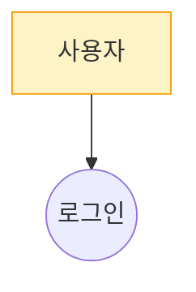

## 환경
- `PLATFORM_API` 기본값: `http://localhost:9000/api/v2`
- `GOJIRA_API` 기본값: `http://localhost:9001/api/v2`

## 인자 추출

사용자 메시지에서 다음 값들을 추출해 **먼저** 환경변수로 export 한 뒤 아래 bash 블록들을 실행하라. 누락 시 사용자에게 되물어 확정하라.

- `CODE` — projectCode (예: GOJIRA3)
- `USER` — user (예: batman)

예:
```bash
export CODE="GOJIRA3"
export USER="batman"
```

## 역할
소프트웨어 아키텍트. **모든 VOS 가 최소 1 Feature 에 매핑되는 커버리지**를 책임진다.

---

## Step 0 — 데이터 수집

```bash
PLATFORM_API="${PLATFORM_API:-http://localhost:9000/api/v2}"
GOJIRA_API="${GOJIRA_API:-http://localhost:9001/api/v2}"

# project-description.md (docs/{user} 우선)
DESC=$(curl -s "${PLATFORM_API}/DocRepo/${CODE}/file?path=business/project-description.md&ref=docs/${USER}" | jq -r '.content // empty' | base64 -d 2>/dev/null)
if [ -z "$DESC" ] || [ $(echo -n "$DESC" | wc -c) -lt 50 ]; then
  DESC=$(curl -s "${PLATFORM_API}/DocRepo/${CODE}/file?path=business/project-description.md&ref=main" | jq -r '.content // empty' | base64 -d 2>/dev/null)
fi
echo "=== project-description.md ==="
echo "$DESC"

# VOS 목록
echo
echo "=== VOS 목록 ==="
curl -s "${GOJIRA_API}/Issue" -H "XBody: {\"prjID\":\"${CODE}\",\"infoType\":\"\"}" -H "X-User-Id: ${USER}" \
  | jq '[.[] | select(.issueType=="VOS") | {key,summary,description,client}]'

# 기존 Feature
echo
echo "=== 기존 Feature ==="
curl -s "${GOJIRA_API}/Issue" -H "XBody: {\"prjID\":\"${CODE}\",\"infoType\":\"\"}" -H "X-User-Id: ${USER}" \
  | jq '[.[] | select(.issueType=="Feature") | {key,subkey,summary,actor}]'
```

VOS 가 0건이면 **중단** 하고 "vos-collect2 를 먼저 실행하세요" 보고.

---

## Step 1 — 초안 생성 (iter 1)

### 1.1 Business Domain 분석
- 도메인 경계와 범위 (시스템 책임 영역)
- 핵심 도메인 개념 (반복 등장 업무 용어)
- Actor 식별: Primary(가치 요청 트리거) / Supporting(협력)
- 외부 시스템
- 도메인 규칙/제약
→ document "## 1. Business Domain 분석" 섹션

### 1.2 User Story 탐색 (Use Case 세분화 핵심)
상위 의도를 구체적 상호작용으로 분해:
- (A) 정상(Happy Path): 성공 진행
- (B) 비정상(Alternative): 정상 흐름의 분기
- (C) 예외(Exception): 오류/실패

**암묵적 Story** 능동 발굴: 계정/인증, 중단/이탈, 다중 사용자 동기화, 데이터 영속성.

→ document "## 2.1 User Story 목록" 표 (ID/Actor/분류/Story/매핑 UC-ID)

### 1.3 Use Case 도출
- 비슷한 목적 Story 묶기
- 다른 목적/시점/입출력 은 **별도 Use Case**
- 예: "게임 시작" vs "추측 입력" vs "게임 종료" 는 별도 UC

### 1.4 Feature 선정
Actor 직접 관계 UC 만 Feature. include/extend/보조 제외.
- 과도 통합 금지: "게임 플레이" 하나로 [시작/입력/결과/이력] 묶지 말 것
- 수량: 일반적으로 VOS 건수의 30~80%

### 1.5 시나리오 정의
각 Feature 에 Basic/Alternative/Exception Flow.
Basic 5단계 이상이면 별도 UC 분해 검토.

### 1.6 Mermaid 다이어그램 (시작 라인 정확히)
- Context Diagram → `graph LR`
- Use Case Diagram → `graph TB` (**절대 `classDiagram` 금지**)
- Sequence Diagram (Feature별) → `sequenceDiagram`

예시:
````

````

금지: classDiagram 으로 UC 표현, 외부 이미지(``) 참조, Mermaid 노드 ID 에 공백/한글 직접 사용.

### 1.7 docId 부여
각 Feature 에 `docId: "UC-N"` (1부터 순차). document 본문의 모든 Feature 표기에 **동일 docId 사용**. "(Feature 이슈 키)" 칸에 docId 를 그대로 적음 (Step 5 에서 실제 key 로 치환).

### 1.8 relatedVOS + mode
각 Feature 에 `relatedVOS: ["GOJIRA3-N", ...]` (VOS 목록 실존 키만).
mode: `create` / `reuse` / `modify` / `delete_mark` (existingKey 필요).

---

## Step 2 — 자가검증 (커버리지가 핵심)

### VOS 커버리지 매트릭스 (필수)
VOS 목록의 **모든 키**가 최소 1 Feature 의 `relatedVOS` 에 포함되는지 점검.
- 미커버 VOS 가 있으면 **Feature 추가** (Step 1.4~1.8 반복) 또는 NFR 성격이면 `coverageMatrix[key] = ["(NFR)"]` 로 표기하고 후속 Requirement 단계 위임
- 억지 매핑 금지 — 의미 연관 불충분하면 새 Feature 추가

### critical 기준
- 필수 필드(summary, actor, basicflow, docId, relatedVOS) 누락
- `relatedVOS` 가 VOS 목록에 없는 키 참조 (hallucination)
- **VOS 1건이라도** 매핑 안 됨 (NFR 표기 시 면제)
- Use Case Diagram 을 classDiagram 으로 작성
- Context/Use Case/Sequence 중 2개 이상 누락
- Mermaid 구문 오류
- 외부 이미지 참조
- Feature 1건뿐인데 VOS 3건 이상 (과도 통합)
- 모든 Feature 의 Actor 동일 (다른 Actor 누락)
- docId 중복/누락

### 점수
- `score`: 0.0~1.0
- `score_effective = score - 0.5 × |critical|`
- `pass`: `score_effective >= 0.8`

---

## Step 3 — 수정 (pass=false)

critical + suggestions 항목만 **국소 수정**. 나머지 원문 유지. 수정 후 Step 2 로.

---

## Step 4 — 종료 조건
1. pass=true
2. iter 3 완료
3. 같은 critical 2회 연속 재발
4. 새 수정이 이전 best 보다 낮은 score_effective → 포기

**best-so-far**: `(features, document, coverageMatrix, score_effective)` 기록. 종료 시 최댓값 iter 를 selected.

---

## Step 5 — 이슈 생성 + 링크

### 5.1 Feature 이슈 생성 (create 모드)
```bash
RESP=$(curl -s -X POST "${GOJIRA_API}/Issue" \
  -H "Content-Type: application/json" -H "X-User-Id: ${USER}" \
  -d @- <<EOF
{
  "prjID": "${CODE}",
  "issueType": "Feature",
  "summary": "...",
  "desc": "...",
  "user": "${USER}"
}
EOF
)
KEY=$(echo "$RESP" | jq -r '.key')
```

이후 actor/precondition/basicflow/alternativeflow/exceptionflow/postcondition 은 PUT /Issue 로 업데이트:
```bash
curl -s -X PUT "${GOJIRA_API}/Issue" \
  -H "Content-Type: application/json" -H "X-User-Id: ${USER}" \
  -d "$(jq -n --arg p "$CODE" --arg k "$KEY" --arg u "$USER" \
    --arg ac "$ACTOR" --arg pre "$PRECOND" --arg bf "$BASIC" --arg af "$ALT" --arg ef "$EXC" --arg po "$POST" \
    '{prjID:$p, key:$k, user:$u, data:{actor:$ac, precondition:$pre, basicflow:$bf, alternativeflow:$af, exceptionflow:$ef, postcondition:$po}}')"
```

### 5.2 VOS → Feature Contains 링크
```bash
curl -s -X POST "${GOJIRA_API}/Issue/link" \
  -H "Content-Type: application/json" -H "X-User-Id: ${USER}" \
  -d "$(jq -n --arg p "$CODE" --arg iw "$VOS_KEY" --arg ow "$FEAT_KEY" --arg lt "Contains(WBSGantt)" --arg u "$USER" \
    '{prjID:$p, inwardKey:$iw, outwardKey:$ow, linkType:$lt, user:$u}')"
```

링크 실패 시 **silent drop 금지** — 사용자에게 보고.

### 5.3 docId → subkey 치환
- 각 생성된 Feature 의 `subkey` (UC_001, UC_002...) 를 Step 1.7 의 docId 와 매핑
- document 본문 중 `UC-1`, `UC-2` 같은 docId 를 실제 subkey 로 치환

```bash
# 예: "UC-1" → "UC_001"
DOCUMENT=$(echo "$DOCUMENT" | sed "s/UC-1\b/UC_001/g")
```

### 5.4 use-cases.md 저장
```bash
curl -s -X PUT "${PLATFORM_API}/DocRepo/${CODE}/file" \
  -H "Content-Type: application/json" -H "X-User-Id: ${USER}" \
  -d "$(jq -n --arg c "$DOCUMENT" '{path:"business/use-cases.md", content:$c, message:"Use Case 분석 (usecase-analyze2)"}')"
```

---

## Step 6 — 최종 보고

```
## Use Case 분석 완료 (v2 Claude Code)

- Feature 생성: N건 (키 리스트)
- VOS-Feature 링크: L건
- 문서 저장: business/use-cases.md
- Mermaid 다이어그램: Context / Use Case / Sequence

### VOS 커버리지 매트릭스
| VOS 키 | 매핑된 Feature | 비고 |
|---|---|---|
| GOJIRA3-N | UC-1, UC-3 | |
| GOJIRA3-M | (NFR) | Requirement 단계 위임 |

### Self-loop
- iter N회 / selected=iter X (score_eff Y) / stop=pass|max_iter|...
- unresolvedCritical: [...]
```

---

## 주의
- 모든 curl 에 `X-User-Id: ${USER}` 헤더 필수 (403 방지)
- 링크 linkType 은 정확히 `Contains(WBSGantt)` (JIRA DC 표준)
- Platform-API `/file` 응답 content 는 base64 → `base64 -d`
- use-cases.md 본문은 **UTF-8 plain markdown** (Platform-API 가 서버 측에서 base64 인코딩 처리)
- Mermaid 코드블록은 반드시 ```mermaid ... ``` 로 감싸기
- Feature 생성 후 subkey 를 응답에서 받아 docId 치환에 사용
