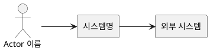
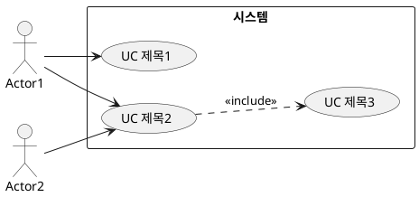
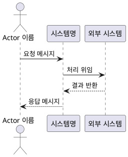
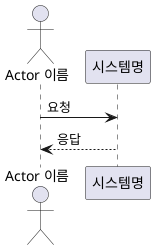

# Use Cases

## 1. Business Domain 분석

### 1.1 도메인 경계와 범위
- **시스템 책임 영역**: (시스템이 담당하는 범위)
- **범위**: (주요 기능 나열)

### 1.2 핵심 도메인 개념
- **개념명**: 설명
- ...

### 1.3 Actor 식별
- **Primary Actor (가치 요청 트리거)**:
  - Actor1: 역할 설명
  - Actor2: 역할 설명
- **Supporting Actor (협력)**:
  - Actor3: 역할 설명

### 1.4 도메인 규칙/제약
- 규칙1
- 규칙2

---

## 2. User Story

### 2.1 User Story 목록

| ID | Actor | 분류 | Story | 원본 VOS | 매핑 UC |
|----|-------|------|-------|----------|---------|
| US-1 | Actor1 | Happy | ~로서 ~할 수 있다 | {VOS-KEY} | UC_001 |
| US-2 | Actor1 | Alternative | ~할 때 ~할 수 있다 | {VOS-KEY} | UC_001 |
| ... | ... | ... | ... | ... | ... |

⚠️ **모든 VOS 는 최소 1개 User Story 로 파생되어야 함** — VOS 누락 시 critical.

---

## 3. Use Case 목록

### 3.1 Use Case 요약

| UC ID | Use Case 명 | 관련 User Story | Feature 선정 | 비고 |
|-------|------------|----------------|:------------:|------|
| UC_001 | {UC 제목} | US-1, US-2 | ✅ | |
| UC_002 | {UC 제목} | US-3 | ✅ | |
| UC_003 | {UC 제목} | US-4, US-5 | — | include (UC_002에 포함) |
| ... | ... | ... | ... | ... |

⚠️ Feature 로 선정되지 않은 Use Case 도 **삭제하지 않음** — 목록과 다이어그램에 그대로 유지.

---

## 4. 다이어그램 (전체)

### 4.1 Context Diagram



### 4.2 Use Case Diagram

⚠️ **모든 Use Case 포함** — Feature 선정 여부와 무관. Feature 와 비Feature UC 모두 `usecase "..." as UC_NNN` 으로 선언.



---

## 5. Feature 상세

⚠️ **모든 Feature 에 시나리오 + Sequence Diagram 필수** — 누락 시 critical.

### 5.1 UC_001: {Feature 제목} (Feature 이슈: {key})

**Actor**: ...
**Precondition**: ...

**Basic Flow**:
1. 사용자가 ~한다
2. 시스템이 ~한다
3. ...

**Alternative Flow**:
- (없음) 또는 분기 시나리오

**Exception Flow**:
1. ~실패 시 ~를 표시한다

**Postcondition**: ...

#### Sequence Diagram



---

### 5.N UC_00N: {Feature 제목} (Feature 이슈: {key})

**Actor**: ...
**Precondition**: ...

**Basic Flow**:
1. ...

**Alternative Flow**: ...
**Exception Flow**: ...
**Postcondition**: ...

#### Sequence Diagram



(... 모든 Feature 에 대해 위 형식 반복 ...)

---

## 6. VOS 커버리지 매트릭스

| VOS 키 | 파생 User Story | 매핑된 Feature | 비고 |
|--------|----------------|---------------|------|
| {key}-1 | US-1, US-2 | UC_001, UC_003 | |
| {key}-2 | US-3 | UC_002 | |
| {key}-3 | US-7 | UC_005 | NFR 성격 — 구현 기능 Feature 확보 후 Requirement 단계에서 NFR 속성화 |

⚠️ **VOS → User Story → Use Case → Feature** 경로가 **모든** VOS 에 대해 추적 가능해야 함.
⚠️ NFR/품질속성/정책 성격의 VOS 도 (NFR) 로 빼지 말고 구현 기능 Feature 를 반드시 도출 — "이 요구를 만족시키려면 시스템이 무슨 동작을 해야 하는가?" 로 환원.

---

### 문서 작성 규칙
- **코드 블록 닫기 후 반드시 빈 줄 1개** — ` ``` ` 바로 뒤에 텍스트 이어붙이기 금지 (PlantUML 렌더 실패 원인)

### PlantUML 작성 규칙
- 모든 블록은 ` ```plantuml ` ... ` ``` ` 로 감싸고 내부는 `@startuml` ~ `@enduml` 쌍 필수
- Use Case Diagram: `actor` + `usecase "..." as UC_NNN` + `rectangle "..."` 묶음 (**절대 `class` 다이어그램 금지**)
- 기본 actor 스타일: `skinparam actorStyle stick` (UML 표준 stick figure)
- 레이아웃: `left to right direction` (use case / context 권장)
- include/extend 는 점선 화살표: `UC001 ..> UC002 : <<include>>`
- Sequence Diagram: `participant "이름" as 별칭` 또는 공백 없는 별칭 사용. 공백 있는 이름은 반드시 따옴표
- 외부 이미지 참조(``) 금지 — PlantUML 인라인만 허용
