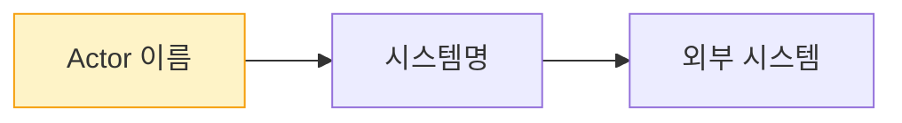
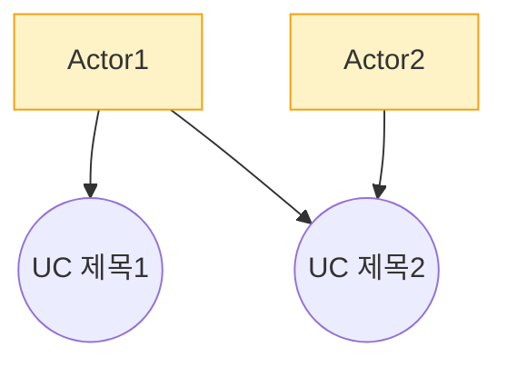
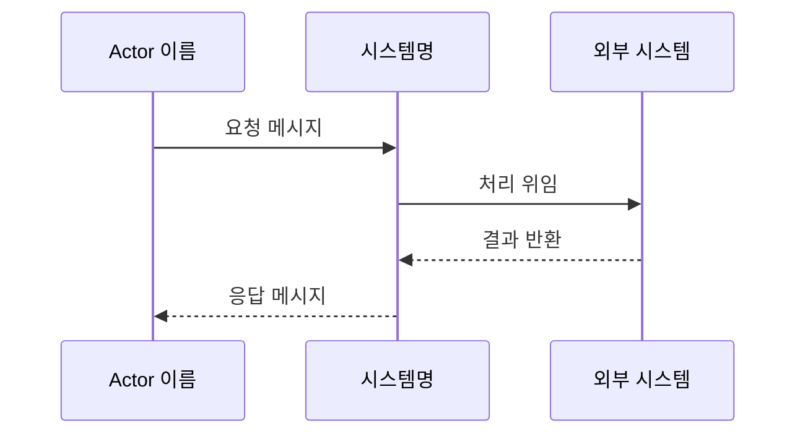
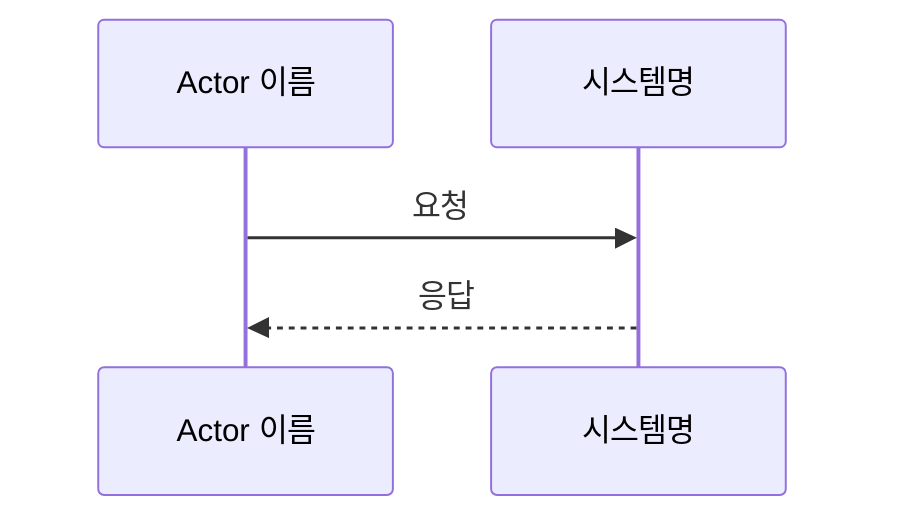

# Use Cases

## 1. Business Domain 분석

### 1.1 도메인 경계와 범위
- **시스템 책임 영역**: (시스템이 담당하는 범위)
- **범위**: (주요 기능 나열)

### 1.2 핵심 도메인 개념
- **개념명**: 설명
- ...

### 1.3 Actor 식별
- **Primary Actor (가치 요청 트리거)**:
  - Actor1: 역할 설명
  - Actor2: 역할 설명
- **Supporting Actor (협력)**:
  - Actor3: 역할 설명

### 1.4 도메인 규칙/제약
- 규칙1
- 규칙2

---

## 2. User Story

### 2.1 User Story 목록

| ID | Actor | 분류 | Story | 매핑 UC |
|----|-------|------|-------|---------|
| US-1 | Actor1 | Happy | ~로서 ~할 수 있다 | UC_001 |
| US-2 | Actor1 | Alternative | ~할 때 ~할 수 있다 | UC_001 |
| ... | ... | ... | ... | ... |

---

## 3. 다이어그램 (전체)

### 3.1 Context Diagram

### 3.2 Use Case Diagram

---

## 4. Feature 상세

⚠️ **모든 Feature 에 시나리오 + Sequence Diagram 필수** — 누락 시 critical.

### 4.1 UC_001: {Feature 제목} (Feature 이슈: {key})

**Actor**: ...
**Precondition**: ...

**Basic Flow**:
1. 사용자가 ~한다
2. 시스템이 ~한다
3. ...

**Alternative Flow**:
- (없음) 또는 분기 시나리오

**Exception Flow**:
1. ~실패 시 ~를 표시한다

**Postcondition**: ...

#### Sequence Diagram

---

### 4.N UC_00N: {Feature 제목} (Feature 이슈: {key})

**Actor**: ...
**Precondition**: ...

**Basic Flow**:
1. ...

**Alternative Flow**: ...
**Exception Flow**: ...
**Postcondition**: ...

#### Sequence Diagram

(... 모든 Feature 에 대해 위 형식 반복 ...)

---

## 5. VOS 커버리지 매트릭스

| VOS 키 | 매핑된 Feature | 비고 |
|--------|---------------|------|
| {key}-1 | UC_001, UC_003 | |
| {key}-2 | UC_002 | |
| {key}-3 | (NFR) | 후속 Requirement 단계 위임 |

---

### Mermaid 작성 규칙
- Use Case Diagram: `graph TB` 사용 (**classDiagram 금지**)
- Sequence Diagram 다중 수신자: `A-->>B, C: msg` 금지 → 개별 2줄로 분리
- participant 에 반드시 `as` 키워드: `participant U2 as 후공 사용자` (O) / `participant U2 후공 사용자` (X)
- 노드 ID 에 공백/한글 직접 사용 금지: `User1[게임 이용자]` (O) / `게임 이용자` (X)
- 외부 이미지 참조 금지
