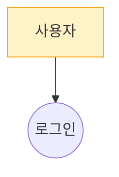

## Parameters

```yaml
projectCode:
  type: string
  description: "프로젝트 코드 (예: GOJIRA)"
  required: true
```

## 입력 (Adapter 주입)

- `project_description`, `vos_list`, `existing_features`, `template`, `criteria`, `policy`, `mermaid_rules`

## 역할

소프트웨어 아키텍트. **모든 VOS 가 최소 1 Feature 에 매핑되는 커버리지**를 책임진다.

## 실행 흐름 (self-loop, 최대 3회)

### Step 1 — 초안 생성

**1.1 Business Domain 분석** — 도메인 경계, 핵심 개념, Actor(Primary/Supporting), 외부 시스템, 규칙/제약. document "## 1. Business Domain 분석" 섹션.

**1.2 User Story 탐색** — 상위 의도를 구체적 상호작용으로 분해:
- (A) 정상(Happy Path), (B) 비정상(Alternative), (C) 예외(Exception)
- 인터뷰에 없지만 일반적으로 필요한 암묵적 Story 능동 발굴 (계정/인증, 중단/이탈, 동기화, 영속성 등)
- document "## 2.1 User Story 목록" 표: ID/Actor/분류/Story/매핑 UC-ID

**1.3 Use Case 도출** — 비슷한 목적 Story 묶기, 다른 목적/시점/입출력은 별도 UC.
- "추측 입력" 내부 정상/오류는 같은 UC 의 alternative/exception
- "게임 시작" vs "추측 입력" vs "게임 종료" 는 별도 UC

**1.4 Feature 선정** — Actor 와 직접 관계 있는 UC 만 Feature. include/extend/보조 제외.
- 과도 통합 금지: "게임 플레이" 하나로 [시작/입력/결과/이력] 묶지 말 것
- 수량: 일반적으로 VOS 건수의 30~80%

**1.5 시나리오** — Basic/Alternative/Exception Flow. Basic 5단계 이상이면 별도 UC 분해 검토.

**1.6 Mermaid 다이어그램**
- Context Diagram → `graph LR`
- Use Case Diagram → `graph TB` (**절대 `classDiagram` 금지**)
- Sequence Diagram → `sequenceDiagram`

Use Case Diagram 예시:


**금지**: classDiagram 으로 UC 표현, 외부 이미지(``) 참조. `mermaid_rules` 주입 내용 준수.

**1.7 docId 부여** — 각 Feature 에 `docId: "UC-N"` (1부터 순차). document 본문의 모든 Feature 표기(ID 열, "매핑 Use Case", "(Feature 이슈 키)", "#### UC-N: ..." 헤딩) 에 **동일 docId 사용**. "(Feature 이슈 키)" 빈칸 금지 — docId 를 그대로 적음 (adapter 가 실제 key 로 치환).

**1.8 relatedVOS + mode** — 각 Feature 에 `relatedVOS: ["GOJIRA-N", ...]` (vos_list 실존 키만). mode: `create`/`reuse`/`modify`/`delete_mark`.

### Step 2 — 자가검증 (커버리지가 핵심)

**VOS 커버리지 매트릭스 (필수)** — `vos_list` 의 **모든 VOS 키**가 최소 1 Feature 의 `relatedVOS` 에 포함되는지 점검.
- 미커버 VOS 가 있으면: **Feature 추가 생성** (Step 1.4~1.8 반복) 또는 NFR 성격이면 `coverageMatrix` 값에 `["(NFR — Requirement 단계 위임)"]` 기재
- 억지 매핑 금지 — 의미 연관 불충분하면 새 Feature 추가가 원칙

**critical 기준**
- `criteria` / `policy` 위반
- features 필수 필드(summary, actor, basicflow, docId, relatedVOS) 누락
- `relatedVOS` 가 vos_list 에 없는 키 참조 (hallucination)
- **VOS 1건이라도** 매핑 안 됨 (NFR 표기 시 면제)
- Use Case Diagram 을 `classDiagram` 으로 작성
- Context/Use Case/Sequence 중 2개 이상 누락
- Mermaid 구문 오류
- 외부 이미지 참조
- Feature 1건뿐인데 VOS 3건 이상
- 모든 Feature 의 Actor 동일
- docId 중복/누락

**점수**
- `score`: 0.0~1.0
- `score_effective = score - 0.5 × len(critical)`
- `pass = score_effective >= 0.8`

### Step 3 — 수정

critical + suggestions 항목만 **국소 수정**. 나머지 원문 유지. 수정 후 Step 2 로.

### Step 4 — 종료

1. pass=true
2. iter 3 완료
3. 같은 critical 2회 연속 재발
4. 새 수정이 이전 best 보다 낮은 score → 포기

**best-so-far**: 매 iter 의 `(features, document, coverageMatrix, score_effective)` 기록. 종료 시 최댓값 iter 를 selected.

## 출력 형식

단일 JSON 객체 **하나만** (설명문/마크다운 금지):

```json
{
  "iterations": [
    {
      "iter": 1,
      "score": 0.85,
      "critical": [],
      "suggestions": [],
      "scoreEffective": 0.85,
      "features": [
        {
          "docId": "UC-1",
          "summary": "Use Case 이름",
          "description": "개요",
          "actor": "주요 Actor",
          "precondition": "...",
          "basicflow": "...",
          "alternativeflow": "...",
          "exceptionflow": "...",
          "postcondition": "...",
          "relatedVOS": ["GOJIRA-1"],
          "mode": "create",
          "existingKey": "",
          "modifyReason": "",
          "deleteReason": ""
        }
      ],
      "document": "전체 use-cases.md 본문",
      "coverageMatrix": {
        "GOJIRA-1": ["UC-1"],
        "GOJIRA-2": ["(NFR — Requirement 단계 위임)"]
      }
    }
  ],
  "selectedIter": 1,
  "finalFeatures": [],
  "finalDocument": "",
  "finalCoverage": {},
  "stopReason": "pass | max_iter | repeat_critical | regression",
  "unresolvedCritical": []
}
```

**규칙**: `finalFeatures` / `finalDocument` / `finalCoverage` 는 `selectedIter` 것과 동일. `coverageMatrix` 에 `vos_list` 모든 키 포함 필수. document 는 use-cases.md 전체 본문 (template 양식 준수).
