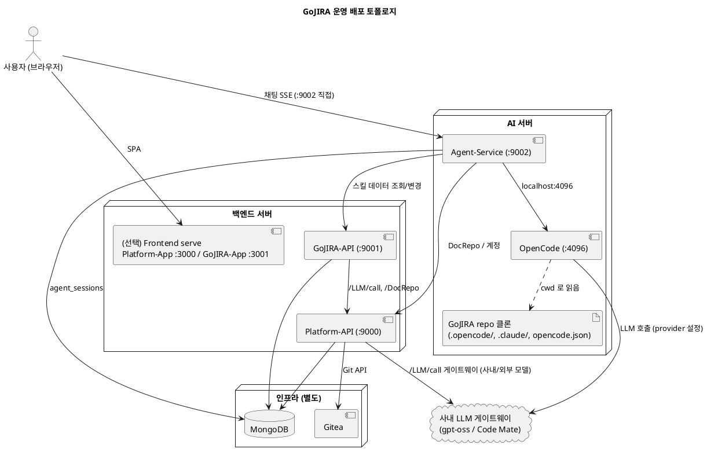

# 배포 계획 — GoJIRA

> 본 문서는 GoJIRA 의 운영 배포 토폴로지, 컴포넌트 배치 원칙, 티어 간 네트워크 요구사항, scale-out 시 선행 작업을 정리합니다.
> 사내망 Windows 환경 셋업 절차는 [docs/setup-windows.md](../setup-windows.md), 포트 매핑은 [docs/ports.md](../ports.md) 참조.

## 1. 배치 원칙

| 원칙 | 이유 |
|---|---|
| **OpenCode + Agent-Service 는 같은 서버** | Agent-Service 가 OpenCode 를 매 초 단위로 호출 (`/session`, `/prompt_async`, `/event` SSE 폴링). 특히 `/event` 는 long-lived 스트림 — cross-host 면 forwarding/타임아웃 이슈 빈발. 같은 서버면 `OPENCODE_SERVER_URL=http://127.0.0.1:4096` 으로 끝 |
| **OpenCode 의 cwd 는 반드시 GoJIRA repo 클론 디렉토리** | OpenCode 는 cwd 에서 `opencode.json`(default model), `.opencode/agents/gojira.md`(agent 정의), `.claude/skills/*/SKILL.md`(워크플로우 스킬) 를 디스크로 읽음. 다른 cwd 에서 띄우면 `prompt_async failed: UnknownError` |
| **백엔드(Go) 와 인프라(Mongo/Gitea) 는 분리 가능** | Platform-API / GoJIRA-API 는 거의 무상태 HTTP 서버. MongoDB/Gitea 는 별도 인프라로 운영. 각 서비스의 `_URL` 환경변수로 cross-host 연결 |
| **git push 는 발행(PR) 시 1회만** | Platform-API 의 로컬 git 워크트리(`RepoBaseDir`) 는 사실상 캐시. 변경마다 push 하지 않음 — race condition 차단 + 워크트리 무상태성 |
| **시크릿은 ENC: 암호화** | OPENAI_API_KEY / X-Dep-Ticket 등은 `gojira-shared/secret` AES-256-GCM 으로 `ENC:` 접두사 저장. 평문이 .env / git / 로그에 남으면 안 됨 |

## 2. 운영 토폴로지 (3 티어)



## 3. 각 서버 구성

### 3.1 AI 서버

| 항목 | 내용 |
|---|---|
| 실행 | OpenCode(`:4096`) + Agent-Service(`:9002`) |
| 필수 파일 | GoJIRA repo 클론 (최소 `.opencode/`, `.claude/`, `opencode.json` — 실무는 repo 전체) |
| 필수 도구 | `curl`, `jq`, `python3` (스킬 스크립트가 사용) |
| OpenCode 기동 | **반드시 repo 클론 디렉토리에서**: `cd <repo> && opencode serve --port 4096 --hostname 0.0.0.0` |
| OpenCode LLM provider | `opencode auth login` 으로 사내 LLM(Code Mate 등) 등록. `opencode.json` 의 `model` / `small_model` 을 해당 provider 모델로 (`codemate/DSllmOCoderStable` 등) |
| Agent-Service 환경 | `.env` — 아래 §4.1 |

### 3.2 백엔드 서버

| 항목 | 내용 |
|---|---|
| 실행 | Platform-API(`:9000`) + GoJIRA-API(`:9001`). 선택적으로 Frontend build serve(`:3000`/`:3001`) |
| 가동 순서 | Platform-API → GoJIRA-API (의존 순. GoJIRA-API 의 `/LLM/call` peer 가 Platform-API) |
| LLM 게이트웨이 | Platform-API 가 단독으로 `llm.json` + ENC: 시크릿 보유. GoJIRA-API/Agent-Service 는 키 없이 `POST /LLM/call` 만 호출 |
| 환경 | `.env` — 아래 §4.2 / §4.3 |

### 3.3 인프라

| 항목 | 내용 |
|---|---|
| MongoDB | 공용 DB (`gojira` database). 사내망 예: `10.227.37.89:44330` |
| Gitea | Git 서버 — DocRepo + 이슈 YAML. 사내망 예: `10.227.37.92:44350` (Docker 아닌 직접 설치도 OK — `FixReviewState` 의 docker 의존만 자동 skip) |
| 보안 | 각 서버 IP 가 MongoDB/Gitea 의 inbound 허용 그룹에 등록되어야 함 |

## 4. 환경변수 (서버별)

### 4.1 AI 서버 — Agent-Service/.env

```ini
GOJIRA_MONGO_URI=mongodb://<infra-host>:<port>
GOJIRA_API_URL=http://<backend-host>:9001/api/v2
GOJIRA_PLATFORM_API=http://<backend-host>:9000/api/v2
OPENCODE_SERVER_URL=http://127.0.0.1:4096
# OpenCode 가 password 보호 시:
# OPENCODE_SERVER_USERNAME=opencode
# OPENCODE_SERVER_PASSWORD=<password>
```

OpenCode 가 spawn 하는 스킬 셸이 보는 환경변수 (셸 rc 또는 서비스 환경에 설정):

```ini
PROJECT_ROOT=<repo-클론-절대경로>
PLATFORM_API=http://<backend-host>:9000/api/v2
GOJIRA_API=http://<backend-host>:9001/api/v2
```

### 4.2 백엔드 서버 — Platform-API/.env

```ini
PLATFORM_MONGO_URI=mongodb://<infra-host>:<port>
PLATFORM_GITHUB_TOKEN=ENC:<gitea-PAT>
PLATFORM_GITHUB_ORG=<gitea-org>
GITHUB_URL=http://<gitea-host>:<port>/
PLATFORM_GOJIRA_API=http://localhost:9001/api/v2
# 사내 LLM (llm.json 의 ${PLATFORM_LLM_TICKET} 치환)
PLATFORM_LLM_TICKET=ENC:<X-Dep-Ticket>
PLATFORM_LLM_USER_ID=<knox-id>
GOJIRA_ENC_KEY=<32바이트 hex/base64>   # ENC: 복호화 마스터 키
```

### 4.3 백엔드 서버 — GoJIRA-API/.env

```ini
GOJIRA_MONGO_URI=mongodb://<infra-host>:<port>
GOJIRA_PLATFORM_API=http://localhost:9000/api/v2
GOJIRA_JIRA_URL=http://<jira-host>:8000
# JIRA 실제 연동 시:
# GOJIRA_JIRA_USER=ENC:...
# GOJIRA_JIRA_PASS=ENC:...
```

> 각 Go 서비스는 `gojira-shared/envload` 가 `.env` 를 자동 탐색 (`{SERVICE}_ENV_FILE` 환경변수 → cwd → binary 디렉토리 → 그 부모). cwd 와 binary 위치가 어긋나도 동작. 못 찾으면 시도한 절대경로 전부 로그로 노출.

## 5. 티어 간 네트워크 요구사항

| 출발 | 도착 | 용도 |
|---|---|---|
| AI 서버 | 인프라 (MongoDB) | Agent-Service 의 `agent_sessions` |
| AI 서버 | 백엔드 서버 (Platform-API, GoJIRA-API) | 스킬 curl + Agent-Service 의 데이터 조회/변경 |
| AI 서버 | 사내 LLM 게이트웨이 | OpenCode 의 provider 호출 (codemate 등) |
| 백엔드 서버 | 인프라 (MongoDB, Gitea) | 이슈/문서/계정 |
| 백엔드 서버 | 사내 LLM 게이트웨이 | Platform-API 의 `/LLM/call` (repo 이름 번역 등) |
| 브라우저 | AI 서버 (Agent-Service `:9002`) | 채팅 SSE 직접 호출 (CORS `*` 허용) |
| 브라우저 | 백엔드 서버 (Platform-API/GoJIRA-API) | SPA API |
| Gitea | 백엔드 서버 (Platform-API) | Webhook (push/PR/review) |

## 6. 테스트 vs 운영

| 항목 | 테스트 (단일 PC) | 운영 (3 티어) |
|---|---|---|
| 서버 분리 | 전부 Windows 한 대 (또는 WSL+Windows 혼합) | AI / 백엔드 / 인프라 3 티어 |
| OpenCode 위치 | 사용자 PC (Windows native 또는 WSL) — `start-all.bat` 이 repo cwd 에서 띄움 | AI 서버에서 repo 클론 디렉토리 기준 |
| 서비스 가동 | `start-all.bat` / `stop-all.bat` (배치 4~6 창) | nssm / systemd 서비스 등록 (자동 재시작) |
| Frontend | `npm start` dev server | `npm run build` 후 정적 serve (nginx/IIS) |
| SSO | 미사용 (DEV_USER) | ADFS 연동 (`USE_SSO=true`) |
| 시크릿 마스터 키 | 임시값 가능 | 사내 KMS / Group Policy 보관 |
| 로그 | stdout 콘솔 | ELK / Splunk 등 수집 |

## 7. Scale-out 시 선행 작업

현재 구조는 단일 인스턴스 운영에 최적화되어 있어, 수평 확장 시 다음 작업이 선행되어야 합니다.

### 7.1 AI 서버 — 가장 까다로움

| # | 제약 | 필요한 조치 |
|---|---|---|
| 1 | Agent-Service 의 `event_buffer` 가 프로세스 in-memory (subscriber + 세션별 이벤트 버퍼) | sticky session (같은 세션은 같은 인스턴스로 LB 라우팅) **또는** event_buffer 를 Redis 등 공유 저장소로 이전 |
| 2 | OpenCode `serve` 의 세션 저장소가 instance-local (`opencode.db`) — OpenCode-A 의 세션은 OpenCode-B 에 없음 | "Agent-Service 인스턴스 ↔ OpenCode 인스턴스" 를 1:1 쌍으로 고정. scale-out 은 쌍 단위. 세션→쌍 lookup 레이어 추가 |
| 3 | 스킬 임시파일 `/tmp/${CODE}-*.json` 고정 경로 | 같은 프로젝트 동시 스킬 실행 시 clobber (드문 케이스). 인스턴스별 tmp 격리 또는 프로젝트 단위 lock |

**결론**: AI 서버는 "OpenCode + Agent-Service 쌍" 단위로만 수평 확장 가능. 그러려면 세션 라우팅 레이어가 추가로 필요.

### 7.2 백엔드 서버 — 대체로 OK, 손볼 곳 2개

| # | 제약 | 필요한 조치 |
|---|---|---|
| 1 | Platform-API 의 Notice SSE/WebSocket broadcast 가 in-memory — instance-A 발행 공지가 instance-B 클라이언트에 안 감 | Redis pub/sub 등으로 cross-instance broadcast |
| 2 | 로컬 git 워크트리 (`RepoBaseDir`) 가 per-instance 파일시스템 | "git push 발행 시 1회" 정책이라 워크트리는 캐시 — 큰 문제 없음. 완벽하게 하려면 공유 FS(NFS) 또는 워크트리 무상태화 |
| 3 | TTL worker / trash purge worker 가 인스턴스마다 실행 (중복, 무해) | 깔끔하게 하려면 leader election |

### 7.3 인프라

| 컴포넌트 | scale-out |
|---|---|
| MongoDB | replica set / sharding (표준) |
| Gitea | 클러스터 구성 가능하나 단일로 보통 충분 |

> **권장**: 지금 단계에서 scale-out 대비 코드를 미리 넣지 않음 (premature). 위 항목들은 실제 수평 확장이 필요해질 때 명시적 작업으로 진행. 가장 큰 제약은 AI 서버 — OpenCode + Agent-Service 의 1:1 쌍 + 세션 라우팅.

## 8. 관련 문서

- `docs/setup-windows.md` — 사내망 Windows 셋업 절차 + start-all.bat / stop-all.bat
- `docs/ports.md` — 전체 포트 매핑 (단일 출처)
- `docs/design-platform.md` — Platform-API / GoJIRA-API / Agent-Service 설계
- `docs/design-agent.md` — OpenCode bridge 구조 + 채팅 라이프사이클
- `docs/architecture/project-description.md` — GoJIRA 플랫폼 과제 설명
- `docs/architecture/use-cases.md` — Use Case 분석
