# Use Cases — GoJIRA

> 본 문서는 GoJIRA 플랫폼 자체에 대한 Use Case 분석입니다.
> 입력: `docs/architecture/project-description.md` 의 이해관계자 + 주요 사항.
> 사용자 프로젝트별 `business/use-cases.md` 와는 별개입니다.

## 1. Business Domain 분석

### 1.1 시스템 책임 영역
SW/시스템 엔지니어링 프로젝트의 **이슈 관리 + 설계 문서 + AI 에이전트 워크플로우** 를 단일 인터페이스로 제공하는 자체 호스팅 플랫폼. 이해관계자 요구(VOS) 에서 출발해 Feature → Requirement → Driver → Style → Design 까지의 결정 흐름을 추적성 있게 누적·자동화하는 책임을 갖는다.

### 1.2 핵심 도메인 개념

| 개념 | 설명 |
|---|---|
| **Issue** | JIRA DC 호환 이슈. 타입은 VOS / Feature / Requirement(FR/NFR/CNST) / ADSN / DDSN / UseCase 등. Mongo + Gitea YAML 동시 영속화 |
| **Workflow Stage** | 9 단계 DAG (`projdesc → vos → usecase → requirement → driver → style → design-decide → design-integrate, satam`) |
| **Skill** | 단계별 자동화 스크립트(`SKILL.md` + `_scripts/*.sh|py`). OpenCode 가 자연어 요청에서 디스패치 |
| **DocRepo** | 사용자 브랜치(`docs/{user}`) 기반 Git 문서 저장소. PR/Review/Merge 워크플로우 |
| **Drift Hash** | 각 stage 의 입력 이슈 + archSettings 해시. 변경 감지로 재생성 필요성 판정 |
| **Architecture Driver** | Requirement 중 아키텍처 결정에 영향이 큰 항목 (ASR 라벨) |
| **ADSN/DDSN** | Architectural Design / Detailed Design 결정 이슈. style 후보 + DP별 설계안 |
| **LLM Gateway** | Platform-API 의 단일 엔드포인트(`POST /LLM/call`). 키/모델/엔드포인트 단독 관리 |

### 1.3 Primary Actor

| Actor | 역할 |
|---|---|
| **SW/시스템 엔지니어** | 이슈 작성, 자연어로 스킬 트리거, 설계 문서 편집·리뷰. 일차 사용자 |
| **프로젝트 매니저** | 진행률 모니터링, 알림 수신, 일정 리스크 분석 |
| **아키텍트** | 워크플로우 산출물 검수, 추적성 / drift 점검 |
| **운영자(인프라)** | 자체 호스팅 서비스 가동·모니터링, 포트/네트워크 정책 |
| **보안/감사자** | 시크릿 키 관리, LLM 호출 감사 로그 점검 |

### 1.4 Supporting Actor

| Actor | 역할 |
|---|---|
| **JIRA Datacenter** | 외부 이슈 마스터 — 양방향 동기화 대상 |
| **Gitea** | Git 서버 — DocRepo + 이슈 YAML 영속화 |
| **OpenCode 서버** | LLM ReACT 런타임 + 스킬 디스패치 (사용자 PC 로컬, `:4096`) |
| **사내 LLM 게이트웨이 (gpt-oss-120b)** | 모델 추론 — X-Dep-Ticket 인증 |
| **외부 LLM (OpenAI 호환)** | 모델 추론 대안 |
| **ADFS SSO** | 사용자 인증 |
| **Pumlex (PlantUML)** | 다이어그램 렌더 |

### 1.5 도메인 규칙

- **모든 결정은 추적 가능**: VOS → Feature → Requirement → Driver → Style → Design 의 issueLink 가 끊기지 않아야 한다
- **외부 SaaS LLM 직접 호출 금지**: GoJIRA-API / Agent-Service 는 키 없이 Platform-API `POST /LLM/call` 만 사용
- **시크릿은 ENC: 접두사 암호화**: 평문 키가 .env / git / 로그에 남으면 안 됨
- **사용자별 브랜치에서 작업 시작**: 모든 문서 편집은 `docs/{user}` 에서 시작, main 은 PR 머지로만 변경
- **단계별 LLM 출력은 critique loop 통과 필수**: 스킬은 self-loop (max 3 iter) 로 자가검증
- **drift 미해소 시 재실행 압력 유지**: 상위 stage 변경이 감지되면 하류 stage 가 작업 시작 전 사용자에게 옵션 제시

---

## 2. User Story

### 2.1 User Story 목록

| ID | Actor | Category | Story | VOS | Use Case |
|---|---|---|---|---|---|
| US-1 | 엔지니어 | A | 이슈, 설계 문서, AI 에이전트 채팅을 하나의 SPA 에서 끊김 없이 쓸 수 있다 | VOS-1 | UC-3 |
| US-2 | 엔지니어 | A | GoJIRA 에서 만든 이슈가 JIRA DC 와 자동으로 양방향 동기화된다 | VOS-2 | UC-1, UC-2 |
| US-3 | 엔지니어 | A | 자연어로 "VOS 뽑아줘" / "Feature 분석해줘" 라고 하면 에이전트가 워크플로우 스킬을 자동 실행해 산출물을 만든다 | VOS-3 | UC-3, UC-4 |
| US-4 | 아키텍트 | A | VOS↔Feature↔Requirement↔Driver↔Design 의 연결을 매트릭스로 한눈에 본다 | VOS-4 | UC-5 |
| US-5 | 아키텍트 | A | 상위 산출물이 바뀌면 영향받는 하류 stage 가 자동으로 표시되고 재실행 옵션이 제시된다 | VOS-4 | UC-6 |
| US-6 | 엔지니어 | A | 설계 문서의 PlantUML 다이어그램이 LLM 의 흔한 실수에도 항상 정상 렌더된다 | VOS-5 | UC-8 |
| US-7 | 엔지니어 | A | OpenCode TUI 에서 입력한 메시지가 GoJIRA 채팅창에도 user 메시지로 즉시 표시된다 | VOS-6 | UC-3 |
| US-8 | PM | A | 프로젝트의 이슈 진행률, 일정 지연 리스크, 알림을 ProjectMap 에서 본다 | VOS-7 | UC-9, UC-10 |
| US-9 | 운영자 | A | 모든 서비스의 포트/의존 매트릭스를 단일 출처 문서에서 확인하고 새 환경에 셋업한다 | VOS-8 | UC-15 |
| US-10 | 보안/감사 | A | LLM 호출이 한 곳(Platform-API) 을 통해서만 발생하므로 키 회수·감사·차단을 단일 지점에서 한다 | VOS-10 | UC-11 |
| US-11 | 보안/감사 | A | OPENAI_API_KEY 등 시크릿이 평문으로 .env / git / 로그에 남지 않는다 | VOS-9 | UC-12 |
| US-12 | 엔지니어 | A | 여러 사용자가 같은 설계 문서를 동시에 편집해도 자기 브랜치에서 작업 후 PR 로 통합한다 | VOS-11 | UC-7 |
| US-13 | 엔지니어 | A | 사내 LLM(gpt-oss-120b) 과 외부 OpenAI 호환 모델 사이를 설정만으로 전환한다 | VOS-12 | UC-13 |
| US-14 | 엔지니어 | B | TUI 에서 작업하다가 채팅창으로 돌아와도 turn 사이 메시지 흐름이 끊기지 않는다 | VOS-6 | UC-3 |
| US-15 | 엔지니어 | C | 채팅 turn 중 SSE 가 끊겨도 메시지가 사라지지 않고 자동 복구된다 | VOS-1 | UC-3 |
| US-16 | 아키텍트 | C | 변경 없는 stage 를 강제 재실행하라고 하면 사용자에게 옵션이 명시적으로 제시된다 | VOS-4 | UC-6 |
| US-17 | 운영자 | C | 사내망에서 SSO/프록시 정책으로 외부 모델이 막혀도 사내 게이트웨이로 폴백한다 | VOS-12 | UC-13 |

⚠️ 모든 VOS(12개) 가 최소 1개 User Story 로 파생됨.

---

## 3. Use Case 목록

### 3.1 Use Case 요약

| ID | Use Case | Stories | Feature 선정 |
|---|---|---|---|
| UC-1 | 이슈 CRUD (Mongo + Gitea YAML 동시 영속화) | US-2 | F-1 |
| UC-2 | JIRA Datacenter 양방향 동기화 | US-2 | F-1 (포함) |
| UC-3 | AI 에이전트 자연어 대화 (SSE 스트리밍, TUI 양방향) | US-1, US-3, US-7, US-14, US-15 | F-2 |
| UC-4 | 워크플로우 스킬 자동 실행 (LLM + critique loop + 결정적 조립) | US-3 | F-3 |
| UC-5 | 추적성 매트릭스 시각화 (RelationMap) | US-4 | F-4 |
| UC-6 | drift 감지 + 변경 영향 분석 (재실행 메뉴 제시) | US-5, US-16 | F-5 |
| UC-7 | 설계 문서 협업 편집 (사용자 브랜치 + 편집 세션 + PR + 충돌 해소) | US-12 | F-6 |
| UC-8 | PlantUML 결정적 자동 보정 + 렌더 | US-6 | F-7 |
| UC-9 | ProjectMap 일정·진행률 시각화 | US-8 | F-8 |
| UC-10 | 실시간 알림 수신 (SSE/WebSocket 브로드캐스트) | US-8 | F-8 (포함) |
| UC-11 | LLM 게이트웨이 호출 (`POST /LLM/call`) | US-10 | F-9 |
| UC-12 | 시크릿 암호화 저장·복호화 (`gojira-shared/secret`) | US-11 | F-10 |
| UC-13 | 모델 선택 (사내/외부 라우팅, llm.json) | US-13, US-17 | F-9 (포함) |
| UC-14 | SSO 로그인 + 권한 제어 (간접 — Platform-App 진입 단계) | (US-1 prerequisite) | (비-Feature, 포함) |
| UC-15 | 자체 호스팅 운영 (서비스 가동 + 포트 단일 출처) | US-9 | F-11 |

⚠️ Feature 미선정 UC 도 다이어그램에는 포함됨 (UC-14).

---

## 4. 다이어그램 (전체)

### 4.1 Context Diagram

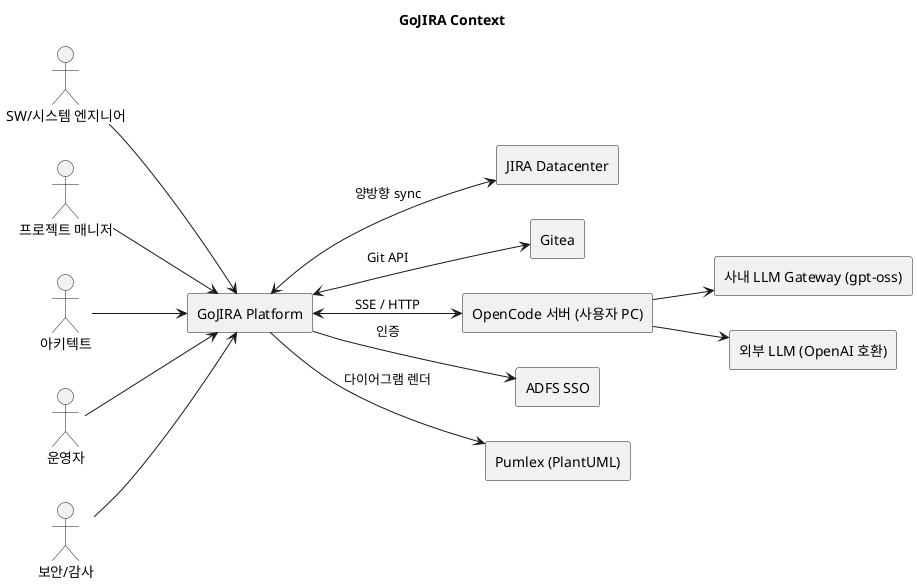

### 4.2 Use Case Diagram

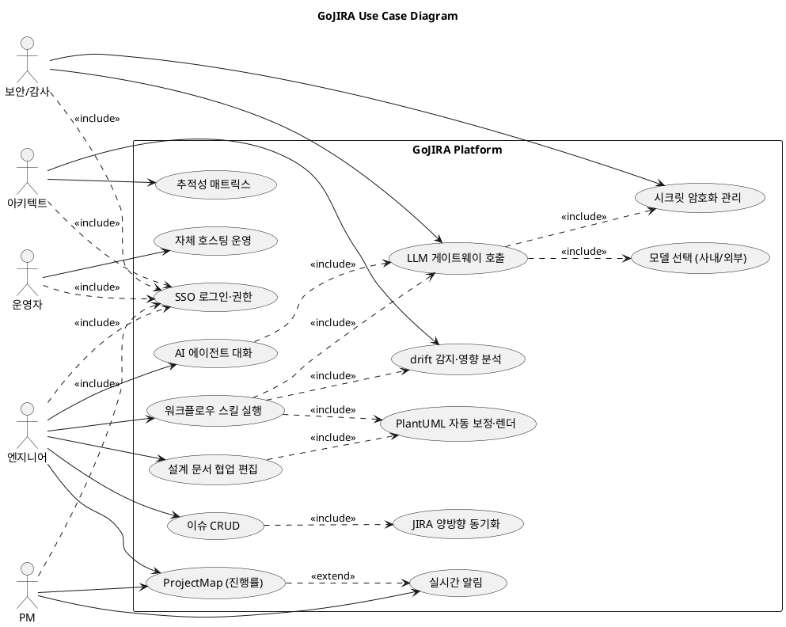

---

## 5. Feature 상세

### F-1. 이슈 관리 (CRUD + JIRA 양방향 동기화)

- **Actor**: 엔지니어
- **relatedVOS**: VOS-2
- **Precondition**: 사용자가 SSO 로 로그인 + 프로젝트 권한 보유
- **Basic Flow**:
  1. 사용자가 GoJIRA-App 에서 이슈 생성/수정 입력
  2. GoJIRA-API 가 Mongo `issues` 에 저장
  3. 동일 이슈를 Gitea 의 `data/issues/<subkey>.yaml` 에 git commit
  4. JIRA 동기화 워커가 변경분을 JIRA DC v2 REST 로 push
  5. 역방향: JIRA 에서 변경 발생 시 polling/webhook 으로 Mongo 동기화
- **Alternative Flow**:
  - JIRA 가 일시 다운 → 큐에 적재, 복구 시 재시도
  - YAML commit 충돌 → 자동 rebase 또는 사용자 conflict-resolve UI 로 라우팅
- **Exception Flow**:
  - JIRA 인증 토큰 만료 → 401 발생 시 사용자 안내 + 재인증 흐름
  - 영구 삭제 대신 `issues_trash` 컬렉션으로 soft-delete (3일 retention)
- **Postcondition**: Mongo / Gitea YAML / JIRA DC 가 동일 이슈에 대해 동일 상태

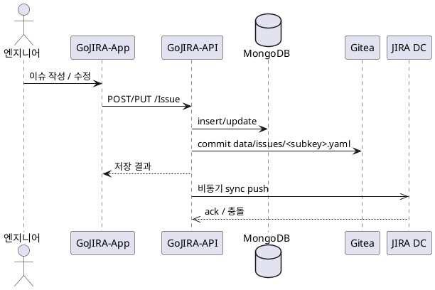

---

### F-2. AI 에이전트 자연어 대화 (SSE + TUI 양방향)

- **Actor**: 엔지니어
- **relatedVOS**: VOS-1, VOS-3, VOS-6
- **Precondition**: OpenCode 서버 가동(`:4096`), 사용자 PC 에 로컬 실행
- **Basic Flow**:
  1. 사용자가 GoJIRA-App 채팅창에 자연어 입력
  2. Agent-Service 가 메시지를 OpenCode 세션에 forward
  3. OpenCode 가 LLM ReACT 루프로 스킬 디스패치
  4. Agent-Service 가 OpenCode `/event` SSE 를 UI 포맷으로 번역
  5. UI 는 `생각하는 중 → 추론 중 → 도구 사용 중: {skill} → 응답 작성 중` 단계별 라벨로 표시
- **Alternative Flow**:
  - OpenCode TUI 에서 사용자 입력 → translator 가 `user_message` SSE 이벤트 yield → 채팅창에 user 버블 표시 (turn 사이도 끊김 없음)
  - subscriber 는 persistent — turn 종료 후에도 다음 입력 대기
- **Exception Flow**:
  - SSE 끊김 → `loadSession` 가 Mongo 를 stale 한 상태로 덮어쓰는 것을 `preserveOnShrink` 가드로 차단
  - 사용자가 명시적 abort → `fullClose` 로만 ES 종료 (turn 정상 종료엔 ES 유지)
- **Postcondition**: 사용자/AI 메시지 모두 Mongo `agent_sessions` + OpenCode 세션에 영속화

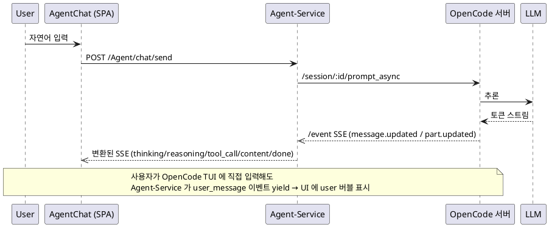

---

### F-3. 워크플로우 스킬 자동 실행

- **Actor**: 엔지니어
- **relatedVOS**: VOS-3, VOS-4
- **Precondition**: 상위 stage 산출물 존재 (예: usecase-analyze 는 vos 산출물 필요)
- **Basic Flow**:
  1. 사용자가 자연어로 단계 요청 ("Feature 도출", "Driver 선정" 등)
  2. OpenCode 가 SKILL.md description 매칭으로 스킬 선택
  3. 해당 스킬의 Step 0: drift-check 로 변동 여부 확인
  4. Step 1: LLM 으로 산출물 분할 생성 (sub-step 단위 generation 경계)
  5. Step 2: `validate-*.py` 자가검증 (커버리지 / PlantUML / 필수 필드)
  6. Step 3: critical 발견 시 국소 수정 (max iter 3)
  7. Step 5: Mongo 이슈 batch 생성/수정 + Gitea 문서 PUT
  8. Step 6: baseline 갱신 + 보고
- **Alternative Flow**:
  - drift CLEAN → 사용자에게 옵션 [1 종료 / 2 문서만 재생성 / 3 처음부터 다시] 명시 제시
  - MODE=relink → 이슈 보존 + 링크/문서만 재정립
- **Exception Flow**:
  - LLM 스톨 → step 분할 + draft-io.sh save 경계로 회복
  - PlantUML 구문 오류 → `plantuml-fix.py` 결정적 보정으로 복구
  - validate 실패 → critique loop 재시도, 같은 critical 2회 연속 재발 시 best-so-far 채택 후 종료
- **Postcondition**: 이슈 + 문서 + archSettings 갱신, drift baseline 새 hash

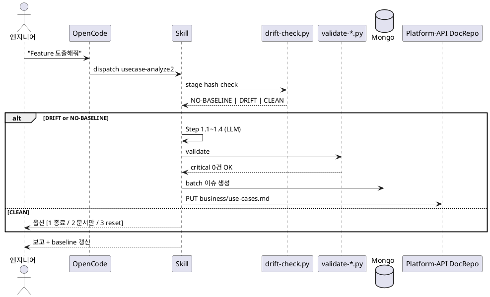

---

### F-4. 추적성 매트릭스 (RelationMap)

- **Actor**: 아키텍트
- **relatedVOS**: VOS-4
- **Precondition**: VOS / Feature / Requirement 등 이슈가 issueLink 로 연결되어 있음
- **Basic Flow**:
  1. 사용자가 GoJIRA-App `RelationMap` 진입
  2. GoJIRA-API 가 프로젝트의 모든 이슈 + issueLinks 반환
  3. UI 가 VOS → Feature → Requirement → Driver → ADSN/DDSN 그래프로 시각화
  4. 노드 클릭 시 IssueDetailDialog 로 본문 + 양방향 링크 표시
- **Alternative Flow**: 필터 (타입별 / 미연결 노드만)
- **Exception Flow**: 끊긴 링크(고아 노드) 시각적 강조
- **Postcondition**: 사용자가 추적성 단절 지점을 시각적으로 인지

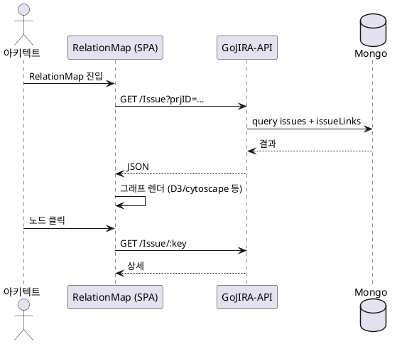

---

### F-5. drift 감지 + 변경 영향 분석

- **Actor**: 아키텍트
- **relatedVOS**: VOS-4
- **Precondition**: 이전 실행에서 archSettings.lastRunHash 가 기록되어 있음
- **Basic Flow**:
  1. 스킬 진입 시 `drift-check.py check` 호출
  2. 현재 stage 의 입력 이슈 + archSettings hash 계산
  3. 저장된 baseline 과 비교 → CLEAN / DRIFT / NO-BASELINE 판정
  4. 상위 stage 의 drift 도 함께 검사
  5. 결과에 따라 작업 모드 결정 (A/B/C 분기)
- **Alternative Flow**: 사용자 강제 재실행 (`force=true`) 시 CLEAN 이어도 진행
- **Exception Flow**: hash 계산 실패 → fail-fast (silent 진행 금지)
- **Postcondition**: 작업 완료 시 Step 6 의 `set-baseline` 으로 새 hash 기록

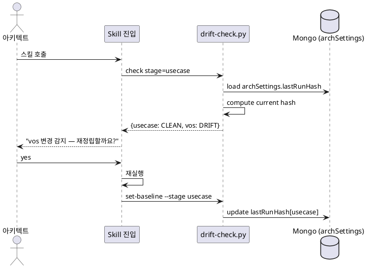

---

### F-6. 설계 문서 협업 편집 (브랜치 + 편집 세션 + PR + 충돌 해소)

- **Actor**: 엔지니어
- **relatedVOS**: VOS-11
- **Precondition**: 사용자 브랜치 `docs/{user}` 존재 (자동 생성됨)
- **Basic Flow**:
  1. 사용자가 DocEditor 에서 파일 열기
  2. Platform-API 가 `edit/start` 로 편집 락 + heartbeat 세션 발급
  3. 사용자 편집 → `edit/file` PUT 으로 저장
  4. heartbeat 갱신으로 락 유지
  5. 작성 완료 시 `edit/commit` → `edit/pr` 로 docs/{user} → main PR 생성
  6. 다른 사용자가 main 변경분이 있으면 `edit/rebase` 로 통합
- **Alternative Flow**: 충돌 발생 시 `conflict-resolve` UI 진입 → diff 비교 + 수동 해소
- **Exception Flow**:
  - heartbeat 끊김 (탭 닫음 등) → `edit/release` 자동 호출, 다른 사용자가 락 획득 가능
  - PR 머지 충돌 → 사용자에게 conflict 마커 표시 후 재편집 요청
- **Postcondition**: main 에 머지된 문서가 모든 사용자에게 반영, git history 보존

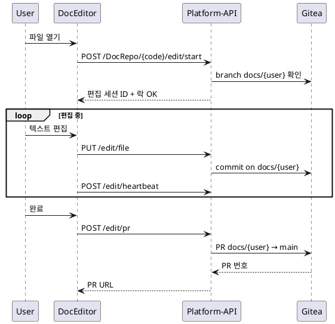

---

### F-7. PlantUML 결정적 자동 보정 + 렌더

- **Actor**: 엔지니어 (간접 — 모든 LLM 산출 문서 저장 시 자동)
- **relatedVOS**: VOS-5
- **Precondition**: 마크다운에 ` ```plantuml ` 코드 블록 포함
- **Basic Flow**:
  1. 스킬이 `doc-save.sh` 로 문서 저장 호출
  2. `doc-save.sh` 가 내부에서 `plantuml-fix.py` 실행
  3. 6+ 패턴 결정적 보정 (이중 fence, sequence destroy 화살표, component state 키워드, sequence cloud/file, 미정의 participant, quoted label newline)
  4. 보정된 마크다운을 Platform-API `PUT /file` 로 영속화
  5. UI 렌더 시 Pumlex (`:3030`) 가 PlantUML → SVG 변환
- **Alternative Flow**: `--check` 플래그로 dry-run (실제 수정 없이 diff 확인)
- **Exception Flow**: 보정 후에도 PlantUML 서버 422 반환 시 원본 텍스트 유지 + 사용자 경고
- **Postcondition**: 모든 ` ```plantuml ` 블록이 정상 렌더, LLM 호출 0회 / ~30ms 처리

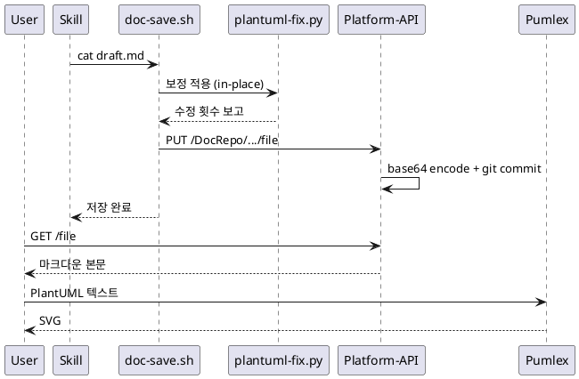

---

### F-8. ProjectMap (일정·진행률) + 실시간 알림

- **Actor**: PM
- **relatedVOS**: VOS-7
- **Precondition**: 프로젝트에 이슈 + schedule 정보 있음
- **Basic Flow**:
  1. PM 이 GoJIRA-App ProjectMap 진입
  2. GoJIRA-API 가 이슈 + 마일스톤 + branchAlerts 반환
  3. UI 가 간트 차트 형태로 렌더, 알람 아이콘 표시
  4. SSE/WebSocket 으로 실시간 알림 수신 → 화면 업데이트
- **Alternative Flow**: 일정 지연 분석 — `schedule-analyze` 스킬 호출
- **Exception Flow**: 알림 채널 단절 → 폴링으로 자동 폴백
- **Postcondition**: PM 이 진행 현황을 즉시 인지, 알림은 NoticePopup 으로 표시

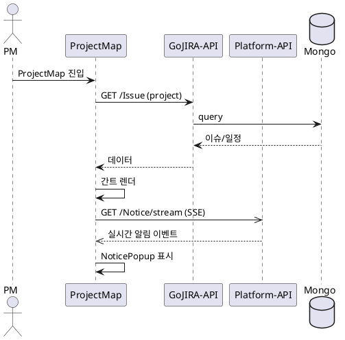

---

### F-9. LLM 게이트웨이 호출 + 모델 선택

- **Actor**: 보안/감사 (감사 측면) + 엔지니어 (간접 — 스킬 실행이 트리거)
- **relatedVOS**: VOS-10, VOS-12
- **Precondition**: Platform-API 가 `llm.json` + 시크릿(`ENC:` 암호화) 설정 보유
- **Basic Flow**:
  1. GoJIRA-API / Agent-Service 가 `POST /api/v2/LLM/call` 호출 (키 없음)
  2. Platform-API 가 `llm.json` 의 active 모델 + 환경변수 치환(`${VAR}`) 으로 endpoint 결정
  3. 사내 게이트웨이면 X-Dep-Ticket 헤더 부착, OpenAI 호환이면 Bearer 헤더
  4. LLM 응답을 그대로 호출자에게 반환
  5. 호출 메타(모델/시간/토큰) 를 감사 로그에 기록
- **Alternative Flow**:
  - 모델 전환 — 운영자가 `llm.json` 의 active 키 변경
  - fallback — primary 실패 시 secondary 모델로 자동 전환
- **Exception Flow**:
  - 사내망에서 외부 LLM 차단 → 폴백 정책에 따라 사내 게이트웨이로
  - 시크릿 복호화 실패 → fail-fast (서비스 시작 단계에서 검증)
- **Postcondition**: 호출자는 키를 보지 못한 채 응답만 수신, 모든 호출이 단일 지점 통과

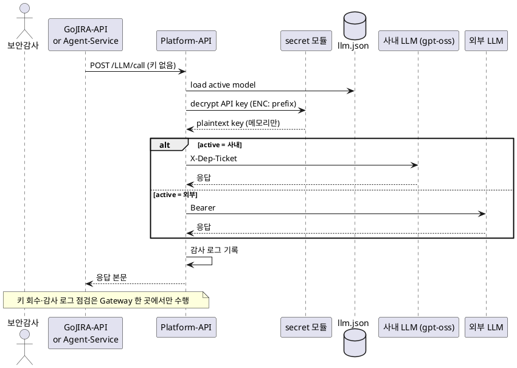

---

### F-10. 시크릿 암호화 관리

- **Actor**: 보안/감사
- **relatedVOS**: VOS-9
- **Precondition**: `gojira-shared/secret` 모듈 빌드, 마스터 키 환경 분리
- **Basic Flow**:
  1. 운영자가 새 시크릿(API 키 등) 설정 시 `secret encrypt` CLI 로 `ENC:<base64>` 형식 생성
  2. .env 또는 설정 파일에 `ENC:` 접두사 그대로 기록
  3. 서비스 시작 시 `gojira-shared/secret` 의 AES-256-GCM 으로 복호화 (메모리만)
  4. 평문 키는 .env / git / 로그 어디에도 남지 않음
- **Alternative Flow**: 키 로테이션 — 새 마스터 키로 전 시크릿 재암호화
- **Exception Flow**: 복호화 실패 → 서비스 시작 단계에서 fail-fast
- **Postcondition**: 모든 외부 시스템 자격증명이 암호화 상태로 영속화

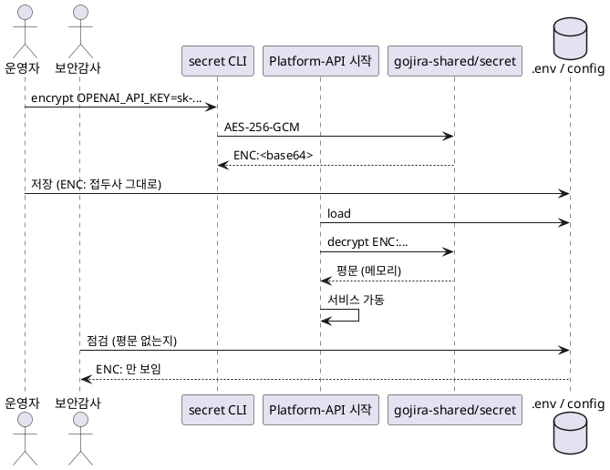

---

### F-11. 자체 호스팅 운영 (서비스 가동 + 포트 단일 출처)

- **Actor**: 운영자
- **relatedVOS**: VOS-8
- **Precondition**: Docker / Go / Python / Node 실행 환경
- **Basic Flow**:
  1. 운영자가 `docs/ports.md` 로 포트/의존 매트릭스 확인
  2. 인프라(MongoDB, Gitea, Pumlex, OpenCode) 가동
  3. Platform-API → GoJIRA-API → Agent-Service 순으로 백엔드 가동 (의존 순)
  4. Platform-App / GoJIRA-App 프론트 가동
  5. 각 서비스의 startup 로그에서 자기 포트 + peer 포트 출력 확인
- **Alternative Flow**: `.env` 의 `PORT` / `*_URL` override 로 포트 변경
- **Exception Flow**:
  - 필수 환경변수 누락 → 서비스 시작 단계에서 fail-fast (log.Fatalf / ValidationError)
  - 의존 서비스 미가동 → peer 호출 실패 로그
- **Postcondition**: 모든 서비스가 listen + peer 도달 가능, ports.md 와 실제 상태 일치

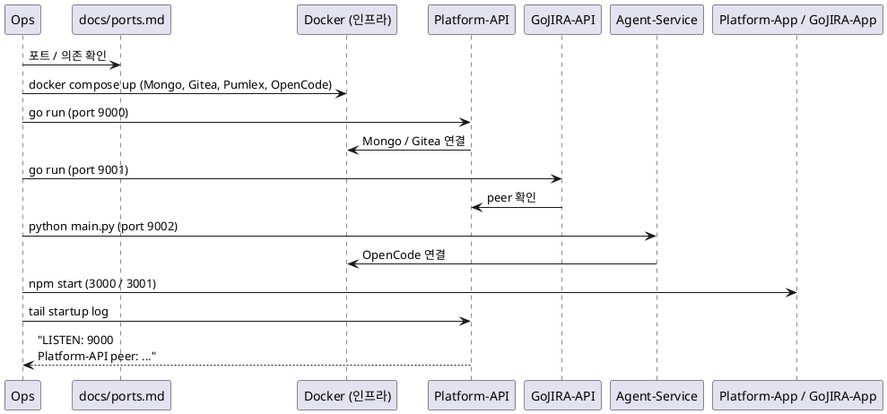

---

## 6. VOS 커버리지 매트릭스

| VOS 키 | 요지 | User Story | Use Case | Feature |
|---|---|---|---|---|
| VOS-1 | 단일 SPA 인터페이스 + SSE 안정성 | US-1, US-15 | UC-3 | F-2 |
| VOS-2 | JIRA DC 양방향 동기화 | US-2 | UC-1, UC-2 | F-1 |
| VOS-3 | AI 에이전트 워크플로우 자동 실행 | US-3 | UC-3, UC-4 | F-2, F-3 |
| VOS-4 | 추적성 + drift 영향 분석 | US-4, US-5, US-16 | UC-5, UC-6 | F-4, F-5 |
| VOS-5 | PlantUML 정확 렌더 | US-6 | UC-8 | F-7 |
| VOS-6 | TUI ↔ 채팅창 양방향 반영 | US-7, US-14 | UC-3 | F-2 |
| VOS-7 | 진행률 + 실시간 알림 | US-8 | UC-9, UC-10 | F-8 |
| VOS-8 | 자체 호스팅 + 포트 단일 출처 | US-9 | UC-15 | F-11 |
| VOS-9 | 시크릿 평문 노출 차단 | US-11 | UC-12 | F-10 |
| VOS-10 | LLM 단일 게이트웨이 (감사 가능) | US-10 | UC-11 | F-9 |
| VOS-11 | 사용자별 브랜치 동시 편집 | US-12 | UC-7 | F-6 |
| VOS-12 | 사내/외부 LLM 모델 중립 선택 | US-13, US-17 | UC-13 | F-9 |

⚠️ 모든 VOS(12개) 가 ≥1 Feature 와 연결, 모든 Feature(11개) 가 ≥1 VOS 와 연결.

> 본 문서는 GoJIRA 플랫폼 자체에 대한 Use Case 분석이며, Feature 별 상세 설계는 `docs/design-platform.md`(서비스 전체), `docs/design-agent.md`(F-2/F-3 구현), `docs/design-application.md`(F-1/F-4/F-8 UI), `docs/design-microfrontend.md`(F-1/F-2/F-8 통합 컨테이너), `docs/design-workflow.md`(F-3 정책), `docs/skill-infrastructure-v3.md`(F-3/F-5/F-7), `docs/ports.md`(F-11) 를 참조합니다.
