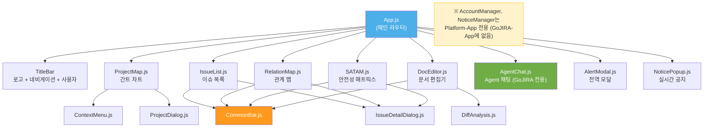
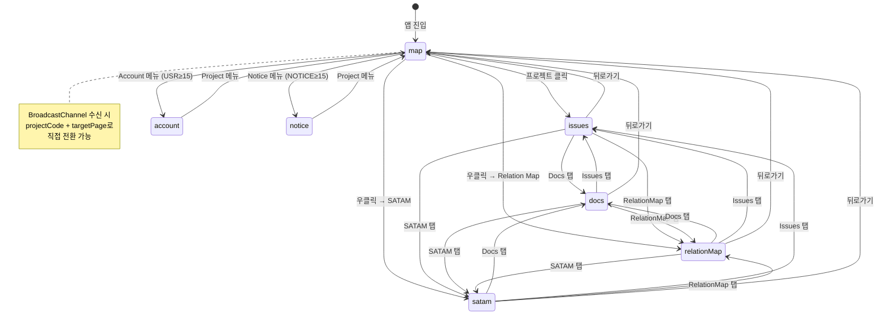
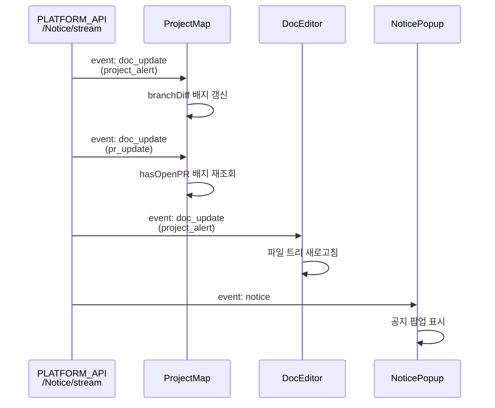
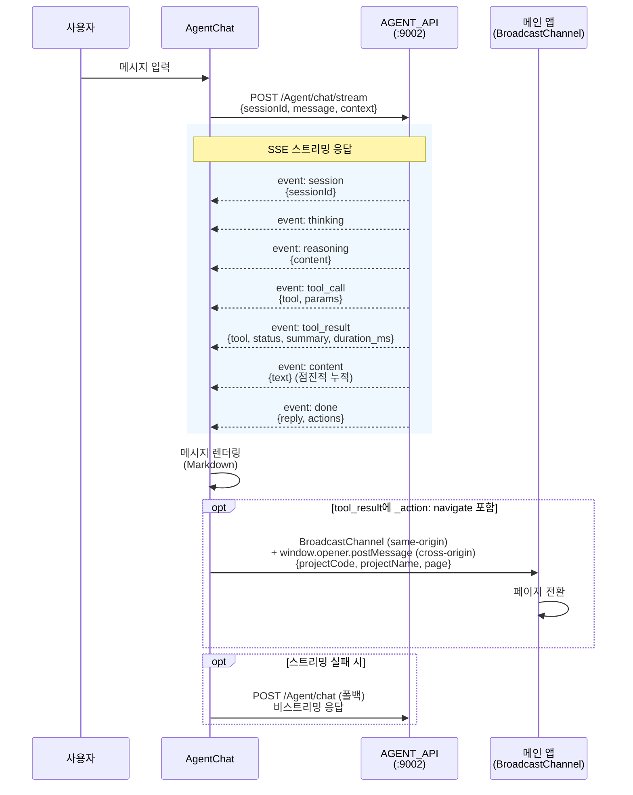
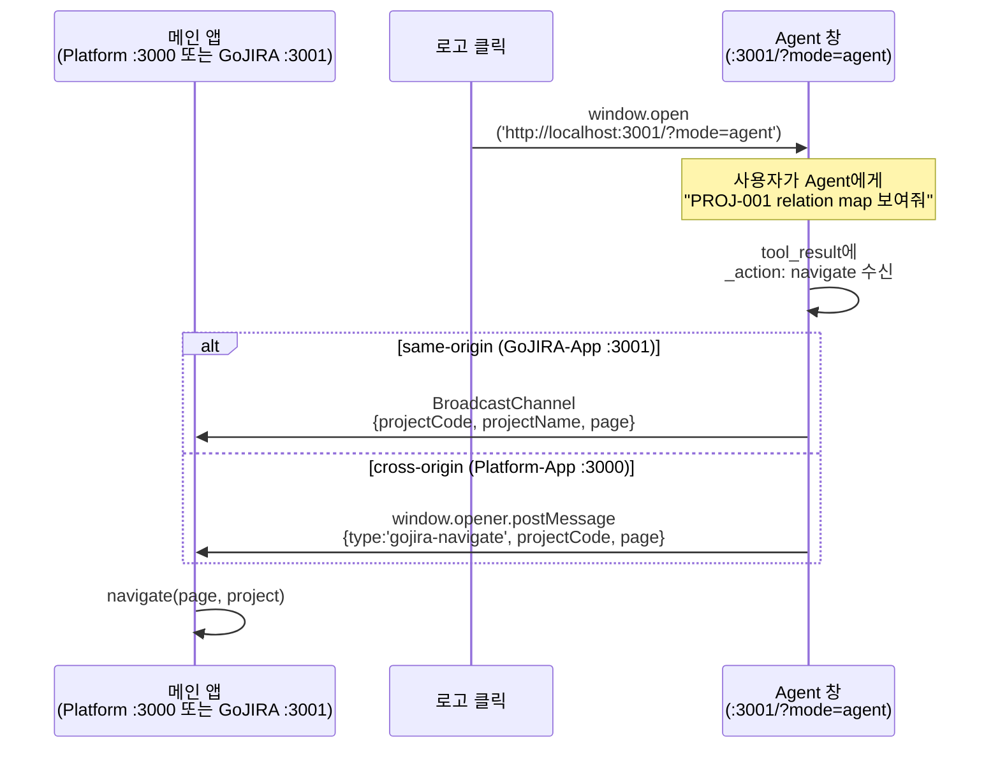
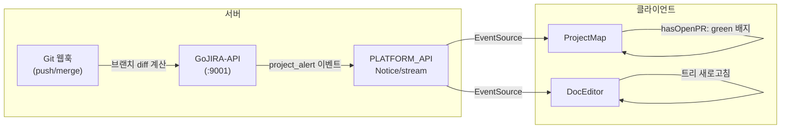

# GoJIRA 애플리케이션 설계서

> GoJIRA-App (React SPA, :3001) — Module Federation Remote
> 최종 갱신: 2026-04-10

---

## 1. 개요

GoJIRA-App은 시스템/소프트웨어 엔지니어링 프로젝트를 관리하기 위한 싱글 페이지 애플리케이션이다. React 기반으로 동작하며, 라우터 라이브러리 없이 상태 기반 페이지 전환을 사용한다.

### 1.1 주요 기능

| 기능 | 설명 |
|------|------|
| **ProjectMap** | 간트 차트 형태의 프로젝트 타임라인 |
| **IssueList** | 이슈 목록 조회/편집 |
| **RelationMap** | VOS-Feature-Requirement-Design 관계 시각화 |
| **SATAM** | 안전성 분석 매트릭스 (Risk/Sensitivity/Mitigation) |
| **DocEditor** | Git 기반 문서 편집/PR/Diff |
| **AgentChat** | AI 에이전트 대화 (SSE 스트리밍) |

### 1.2 백엔드 연동

| 서비스 | 포트 | 용도 |
|--------|------|------|
| PLATFORM_API | :9000 | 인증, 계정, 공지, 문서 저장소 |
| API_BASE (GoJIRA-API) | :9001 | 이슈, 프로젝트, 알람 |
| AGENT_API | :9002 | Agent 채팅, 스트리밍 |

---

## 2. 앱 아키텍처

### 2.1 컴포넌트 트리



### 2.2 공통 유틸리티

```
src/
├── config.js          # API 엔드포인트 설정 (PLATFORM_API, API_BASE, AGENT_API)
├── utils/
│   ├── auth.js        # 인증 (SSO 쿠키 / 개발용 고정 사용자)
│   └── exportUtils.js # HTML/JPG/Clipboard 내보내기
└── components/
    ├── CommonBar.js         # 공통 상단바 (탭 네비게이션, 편집모드, Export)
    ├── AlertModal.js        # 전역 알림/확인 모달
    ├── NoticePopup.js       # SSE 기반 실시간 공지 팝업
    ├── ContextMenu.js       # 우클릭 컨텍스트 메뉴
    ├── ProjectDialog.js     # 프로젝트 생성/편집 다이얼로그
    ├── IssueDetailDialog.js # 이슈 상세 편집 모달
    └── DiffAnalysis.js      # Semantic/Unified/Summary Diff 뷰
```

---

## 3. 컴포넌트 설계

### 3.1 App.js (메인 라우터)

앱의 진입점. React Router를 사용하지 않고 `page` 상태로 화면을 전환한다.

**상태 관리:**

| 상태 | 타입 | 초기값 | 설명 |
|------|------|--------|------|
| `user` | string | `getAuthUser()` | 현재 로그인 사용자 |
| `authority` | object | null | 권한 정보 (USR, NOTICE 등) |
| `page` | string | `sessionStorage` 또는 'map' | 현재 페이지 |
| `selectedProject` | object | `sessionStorage` 또는 null | 선택된 프로젝트 |
| `allUsers` | array | [] | 사용자 목록 (관리자 전용) |

**권한 기반 메뉴:**

- 기본: Project
- `authority.USR >= 15`: Account 메뉴 노출
- `authority.NOTICE >= 15`: Notice 메뉴 노출

**Agent 독립 모드:**

- URL 파라미터 `?mode=agent` 감지 시 `<AgentChat standalone />` 단독 렌더링
- GoJIRA-App 로고 클릭 시 `window.open('/?mode=agent', 'gojira-agent', 'width=480,height=720')`
- Platform-App 로고 클릭 시 `window.open('http://localhost:3001/?mode=agent', ...)` (cross-origin)
- AgentChat은 **GoJIRA-App 전용** (Platform-App에서 제거됨). 향후 멀티 에이전트 시 공통화 검토

### 3.2 ProjectMap.js (간트 차트)

프로젝트 타임라인을 간트 차트로 시각화한다.

**축 구성:**

- 가로축: 시간 (기본 현재 -1년 ~ +2년, 슬라이더로 -5년 ~ +5년 조절)
- 세로축: 프로젝트 목록 (행 높이 48px)
- 사이드바: 프로젝트명 (180px 고정)

**마일스톤 표시:**

| 마일스톤 | 의미 | 표시 |
|----------|------|------|
| PA | Project Approval | 속이 빈 원 |
| EA | Engineering Approval | 속이 빈 원 |
| ER1 | Engineering Review 1 | 속이 빈 원 |
| ER2 | Engineering Review 2 | 속이 빈 원 |
| CA | Customer Approval | 속이 빈 원 |

**상태 색상:**

- 진행중: 파란색
- 완료: 회색
- 지연: tomato

**기능:**

- 조회기간 슬라이더 (range slider)
- 정렬: 시작일 / 종료일 / 과제명 / 부서명
- `+ Add` 버튼으로 프로젝트 생성
- 우클릭 → ContextMenu (상세보기, 편집, 삭제)
- 알람 배지: `branchDiff` (tomato), `hasOpenPR` (green)

**SSE 구독:**

- `EventSource` → `PLATFORM_API/Notice/stream`
- `doc_update` 이벤트: 브랜치 알림 갱신
- `pr_update` 이벤트: PR 상태 알림 재조회

### 3.3 IssueList.js

이슈 목록 테이블 뷰.

**필터 옵션 (sessionStorage 유지):**

| 키 | 이슈 타입 |
|----|-----------|
| V | VOS |
| F | Feature |
| R | Requirement |
| A | Architectural Design |
| D | Detailed Design |

**편집 모드:**

- `status`: 드롭다운 (To Do / In Progress / Done)
- `priority`: 드롭다운 (Highest ~ Lowest)
- `summary`: 인라인 텍스트 편집
- 삭제 버튼

**정렬:** 컬럼 헤더 클릭 시 오름차순/내림차순 토글

**이슈 클릭:** `IssueDetailDialog` 모달 열기

### 3.4 IssueDetailDialog.js

이슈 상세 편집 모달. 이슈 타입별 탭 구성.

**탭별 필드:**

| 탭 | 이슈 타입 | 주요 필드 |
|----|-----------|-----------|
| VOS | VOS | summary, description, priority, status |
| Feature (UC) | Feature | summary, description, 유스케이스 |
| Requirement | Requirement | summary, subtype(QA/FR/CNST), ASR 여부 |
| Design (ADSN) | Architectural/Detailed Design | summary, 설계 상세 |
| Trade Off | 공통 | Risk/Sensitivity/Mitigation YAML 편집 |

### 3.5 RelationMap.js

이슈 간 관계를 컬럼 기반으로 시각화한다.

**컬럼 구성:**

| 컬럼 | 이슈 타입 | 추가 버튼 |
|------|-----------|-----------|
| VOS | VOS | VOS |
| Feature | Feature | Feature |
| Requirement | Requirement | QA, FR, CNST |
| Design | Architectural/Detailed Design | ADSN, DDSN |
| Test (선택) | Test | Test |

**카드:**

- SubKey 색상 코딩: VOS(녹색), UC(주황), QA/FR/CNST(빨강), ADSN(파랑), DDSN(보라)
- Key, Summary 표시

**연결선:**

- `issueLinks` (contains, relates) 기반 베지어 곡선
- 같은 타입 연결: 배경에 렌더링
- 다른 타입 연결: 전면에 렌더링
- 카드 선택 시 관련 체인 하이라이트

**편집 모드:**

- `+` 버튼으로 이슈 추가
- 드래그로 연결 생성
- ASR/Reserved 토글

**필터:**

- A: ASR 이슈만
- R: Reserved 이슈만
- T: Test 컬럼 표시/숨김

**정렬:** 강조 > 타입 > ASR > SubKey

### 3.6 SATAM.js (안전성 분석 매트릭스)

Design 이슈와 Requirement 이슈 간의 안전성 분석 매트릭스.

**매트릭스 구조:**

- 가로축 (열): Design 이슈
- 세로축 (행): Requirement 이슈 (SubType 정렬: QA → CNST → FR)

**셀 마크:**

| 마크 | 의미 | 색상 |
|------|------|------|
| R | Risk | 빨강 (#e83a1e) |
| S | Sensitivity | 주황 (#ff9a1e) |
| M | Mitigation | 파랑 (#4cafe8) |

**Contains 관계:** 검은 원으로 표시

**편집 모드:**

- 셀 클릭 → R/S/M 추가/삭제
- Link as Solution (contains 관계 생성)

**필터:**

| 키 | 의미 |
|----|------|
| A | ASR 이슈만 |
| F | FR 이슈만 |
| S | 최종설계 (DDSN 제외) |
| D | DDSN 포함 |
| R | Reserved 포함 |

**Trade Off YAML 파싱:**

```yaml
- ID : R1
  QA : [GOJIRA-001, GOJIRA-002]
  Counter Risk : ["R1:GOJIRA-003"]
  Description : 위험 요소 설명
```

**SATAM 분석:** Agent Assist 버튼 → AgentChat으로 분석 요청

### 3.7 DocEditor.js (문서 편집기)

Git 기반 마크다운 문서 편집기.

**파일 트리:**

- Main 탭: main 브랜치 파일 (읽기 전용)
- Workspace 탭: 사용자 브랜치 (`docs/{user}`) 파일

**파일 상태 표시:**

| 상태 | 표시 |
|------|------|
| modified | 변경됨 배지 |
| added | 추가됨 배지 |
| deleted | 삭제됨 배지 |
| mainOnly | M 배지 (gray), italic, Pull 동기화 안내 |

**초기 폴더 구조 (프로젝트 생성 시 자동 생성):**

```
business/
  project-description.md    # 과제 배경, 목적, 주요 사항
  use-cases.md              # 유즈케이스 정의
  requirements.md           # FR/NFR/CNST 요구사양
architecture/
  architecture.md           # 아키텍처 설계
```

**편집 흐름:**

1. 초기 파일 생성 (`init-files` — 없는 파일만 생성)
2. 사용자 브랜치 자동 생성 (`ensure-branch`)
3. 트리 비교 (main vs workspace)
4. 파일 편집 → 저장 → commit/push

**PR 기능:** 생성 / 승인 / 반려 / 머지

**Diff 모드:** Semantic / Unified / Summary (DiffAnalysis 컴포넌트)

**SSE 구독:** `EventSource` → `PLATFORM_API/Notice/stream` → `doc_update` 이벤트로 main 변경 시 트리 실시간 갱신

### 3.8 AgentChat.js (AI 에이전트 채팅)

AI 에이전트와의 대화 인터페이스.

**모드:**

| 모드 | 조건 | 동작 |
|------|------|------|
| standalone | `?mode=agent` | 전체 화면, 닫기 버튼 숨김 |
| panel | 기본 | 인라인 패널 |

**세션 관리:**

- `sessionStorage`에 `agent_sessionId` 저장
- 이력 검색: `GET /Agent/sessions?q=검색어`
- 세션 로드: `GET /Agent/session/{sid}`

**디버그 뷰 (Master 사용자, USR >= 15):**

- 접기/펼치기 블록으로 "작업 과정" 표시
- 추론(reasoning), 도구 호출(tool_call), 도구 결과(tool_result) 단계별 표시
- 실행 시간(duration_ms), 상세 결과(detail) 확인 가능

**일반 사용자:** 스피너 + "작업 중..." 표시만 노출

### 3.9 CommonBar.js (공통 상단바)

프로젝트 하위 페이지에서 공통으로 사용하는 상단 바.

**레이아웃:**

```
[Title] [Docs] [Issues] [RelationMap] [SATAM] | [옵션...] | [Pull] [Export] [Agent분석] [편집모드]
```

**Export 메뉴:**

- HTML 파일
- JPG 이미지
- HTML 클립보드

---

## 4. 페이지 전환

### 4.1 상태 다이어그램



### 4.2 전환 메커니즘

```javascript
// 상태 기반 전환 (React Router 미사용)
const navigate = (page, project) => {
  setPage(page);
  setSelectedProject(project);
  sessionStorage.setItem('gojira_page', page);
  // project도 sessionStorage에 저장 → 새로고침 시 복원
};
```

**페이지 판별 로직:**

| 조건 | 렌더링 |
|------|--------|
| `page === 'docs' && selectedProject` | DocEditor |
| `page === 'issues' && selectedProject` | IssueList |
| `page === 'relationMap' && selectedProject` | RelationMap |
| `page === 'satam' && selectedProject` | SATAM |
| `?mode=agent` URL 파라미터 | AgentChat (standalone) |
| 그 외 | ProjectMap |

> **참고:** Account/Notice 페이지는 Platform-App(:3000) 전용. GoJIRA-App에서는 렌더링하지 않음.

---

## 5. 실시간 통신

### 5.1 SSE (Server-Sent Events) 구독

각 컴포넌트가 `EventSource`를 직접 생성하여 서버 이벤트를 구독한다.



**EventSource 연결 전략:**

- 컴포넌트 마운트 시 생성, 언마운트 시 `close()`
- 브라우저 내장 자동 재연결 (기본 3초)
- 각 컴포넌트가 독립적으로 구독 (공유 매니저 없음)

### 5.2 이벤트 타입

| 이벤트 | 소스 | 수신 컴포넌트 | 동작 |
|--------|------|---------------|------|
| `doc_update` (project_alert) | DocRepo 웹훅 | ProjectMap, DocEditor | 브랜치 차이/트리 갱신 |
| `doc_update` (pr_update) | PR 상태 변경 | ProjectMap | 알림 재조회 |
| `notice` | 공지 등록 | NoticePopup | 팝업 표시 |

---

## 6. Agent 채팅 설계

### 6.1 SSE 스트리밍 시퀀스



### 6.2 메시지 타입

| role | 설명 |
|------|------|
| `user` | 사용자 입력 |
| `process` | 작업 과정 (steps 배열, Master 전용 상세 뷰) |
| `assistant` | AI 응답 (Markdown 렌더링) |

### 6.3 크로스 윈도우 통신



---

## 7. 프로젝트 알람 설계

### 7.1 알람 흐름



### 7.2 알람 배지

| 배지 | 색상 | 의미 | 위치 |
|------|------|------|------|
| `branchDiff` | tomato | main과 사용자 브랜치 간 차이 존재 | ProjectMap 행, CommonBar |
| `hasOpenPR` | green | 열린 PR 존재 | ProjectMap 행, CommonBar |

### 7.3 알람 데이터 구조

```typescript
// GET /Project/alerts?user={knoxId}
interface ProjectAlert {
  jiraCode: string;
  branchDiff: boolean;   // main과 사용자 브랜치 차이 존재
  hasOpenPR: boolean;    // 열린 PR 존재
  issueUpdated: boolean; // 이슈 변경 알림
}
```

---

## 8. 설계 결정 기록

### 8.1 React SPA (라우터 미사용)

**결정:** React Router를 사용하지 않고, `page` 상태 + `sessionStorage`로 페이지 전환을 관리한다.

**사유:**

- 페이지 수가 제한적 (7개)이고 모두 단일 앱 내 전환
- URL 기반 라우팅이 불필요 (딥링크 요구사항 없음)
- 상태 복원은 `sessionStorage`로 충분
- 의존성 최소화

### 8.2 독립 Agent 창 (팝업 방식)

**결정:** AgentChat을 인라인 패널이 아닌 `window.open` 팝업으로 분리한다.

**사유:**

- 초기 오버레이 패널 방식에서 부모 컴포넌트 리마운트 이슈 발생
- Wrapper 컴포넌트로 감싸는 방식도 상태 유실 문제 지속
- 독립 창은 자체 React 트리를 갖기 때문에 메인 앱 상태 변경의 영향을 받지 않음
- `BroadcastChannel`로 크로스 윈도우 통신을 해결

### 8.3 BroadcastChannel (크로스 윈도우 통신)

**결정:** `window.postMessage` 대신 `BroadcastChannel`을 사용한다.

**사유:**

- `window.opener` 참조 기반 통신은 창이 새로고침되면 참조가 끊어짐
- `BroadcastChannel`은 같은 origin의 모든 탭/창 간 통신 가능
- 송신 측이 수신 측의 존재를 알 필요 없음 (느슨한 결합)

### 8.4 SSE (EventSource) 구독 전략

**결정:** 공유 매니저 없이 각 컴포넌트가 독립적으로 `EventSource`를 생성한다.

**사유:**

- 컴포넌트별로 관심 이벤트가 다름 (ProjectMap: project_alert + pr_update, DocEditor: project_alert, NoticePopup: notice)
- 동시에 마운트되는 컴포넌트가 최대 2개 (예: ProjectMap은 다른 페이지와 동시 마운트되지 않음)
- EventSource는 브라우저가 HTTP/2 멀티플렉싱으로 처리하므로 연결 수 부담 적음
- 복잡한 구독 관리 레이어 불필요

### 8.5 sessionStorage (상태 유지)

**결정:** 전역 상태 관리 라이브러리(Redux 등) 대신 `sessionStorage`로 페이지 상태를 유지한다.

**사유:**

- 유지해야 할 상태가 단순 (page, selectedProject, 필터 옵션, 정렬 키, viewRange)
- 새로고침 시 복원만 되면 충분
- 탭 간 상태 공유 불필요 (각 탭은 독립 세션)
- 외부 의존성 없이 구현 가능

### 8.6 Agent 스트리밍 폴백

**결정:** SSE 스트리밍 실패 시 비스트리밍 REST API로 자동 폴백한다.

**사유:**

- 프록시/방화벽 환경에서 SSE 연결이 차단될 수 있음
- 폴백으로 기능 자체는 항상 동작 보장
- 스트리밍: `POST /Agent/chat/stream` → 폴백: `POST /Agent/chat`

### 8.7 인증 전략

**결정:** SSO 쿠키 기반 인증과 개발용 고정 사용자 모드를 `config.USE_SSO` 플래그로 전환한다.

**사유:**

- 운영 환경: ADSSO 쿠키로 자동 인증
- 개발 환경: SSO 인프라 없이 고정 사용자(`DEV_USER`)로 즉시 개발 가능
- 관리자(USR >= 15)는 사용자 전환 드롭다운으로 다른 사용자 시뮬레이션 가능
