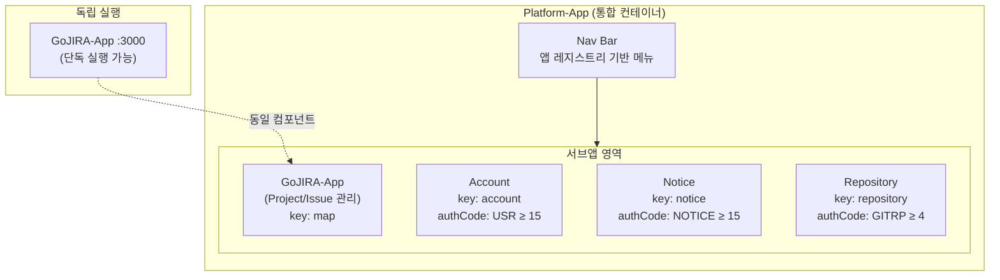
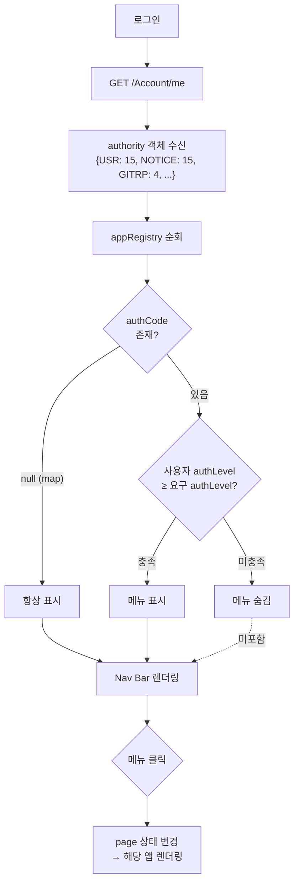
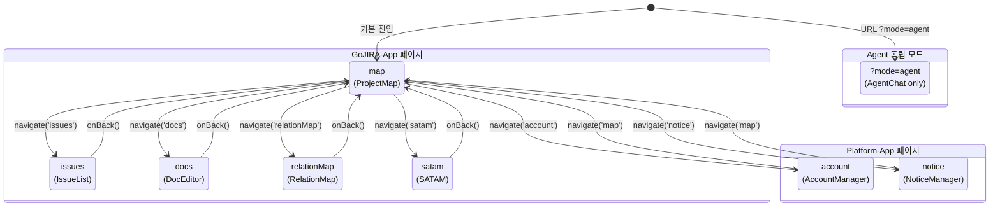
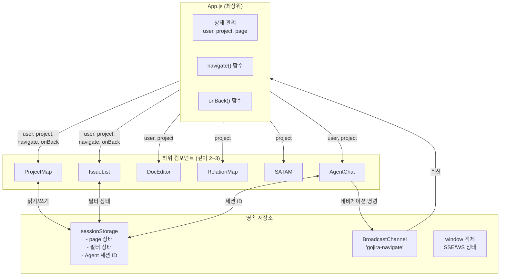
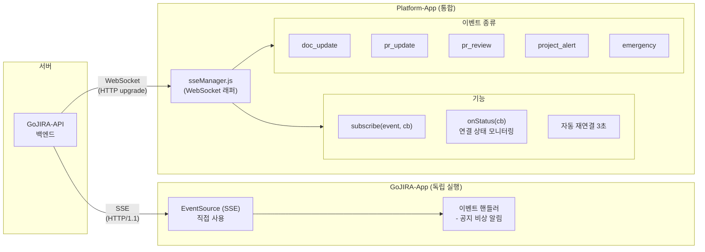
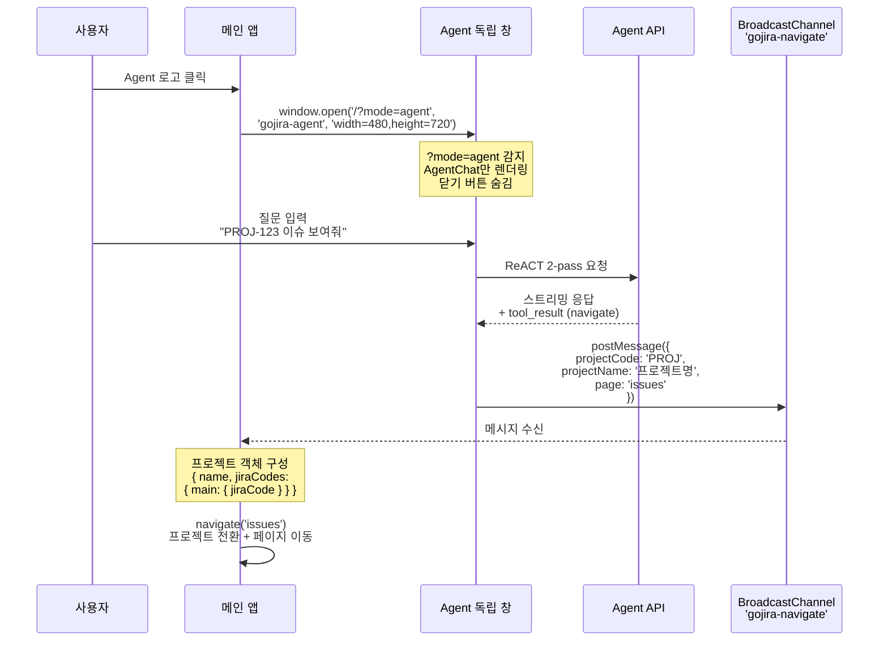

# GoJIRA 마이크로 프론트엔드 아키텍처

## 1. 개요

GoJIRA는 **2중 앱 구조**를 채택한 마이크로 프론트엔드 시스템이다. 독립 실행 가능한 도메인 앱(GoJIRA-App)과 이를 포함하는 통합 컨테이너(Platform-App)로 구성되며, 앱 레지스트리 패턴을 통해 여러 서브앱을 선언적으로 관리한다.

**핵심 설계 원칙:**
- 선언적 권한 기반 메뉴 제어
- 상태 기반 페이지 전환 (React Router 미사용)
- 순수 Props 전달 (Context API 미사용)
- 독립 창 기반 Agent 통합

---

## 2. 2중 앱 구조

GoJIRA-App은 단독으로 `:3000`에서 실행 가능하며, Platform-App 안에서는 서브앱으로 로드된다.



**구조 설명:**
- **Platform-App**: 앱 레지스트리를 통해 서브앱들을 동적으로 등록하고 렌더링
- **GoJIRA-App**: 프로젝트/이슈 관리 도메인 앱. Platform-App 없이도 `:3000`에서 독립 실행 가능
- **Account/Notice/Repository**: Platform-App 전용 앱. `authCode + authLevel`로 접근 제어

---

## 3. 앱 레지스트리와 권한

### 레지스트리 구조

```javascript
appRegistry = [
  { key: 'map',        label: 'Project',    component: GoJIRAApp, authCode: null },
  { key: 'account',    label: 'Account',    component: null, authCode: 'USR',    authLevel: 15 },
  { key: 'notice',     label: 'Notice',     component: null, authCode: 'NOTICE', authLevel: 15 },
  { key: 'repository', label: 'Repository', component: null, authCode: 'GITRP',  authLevel: 4 }
]
```

### 권한 기반 메뉴 렌더링 흐름



**권한 매트릭스:**

| 메뉴 | authCode | authLevel | 설명 |
|------|----------|-----------|------|
| Project | null | - | 모든 사용자 접근 가능 |
| Account | USR | 15 | 사용자 관리 (관리자) |
| Notice | NOTICE | 15 | 공지 관리 (관리자) |
| Repository | GITRP | 4 | 저장소 접근 |

- 권한 없이 접근 시 `map`으로 리다이렉트

---

## 4. 페이지 전환 메커니즘

React Router를 사용하지 않고, `page` 상태와 `navigate()` 함수로 페이지 전환을 제어한다.



**상세 동작:**
- `page` 상태 변경 → 조건부 렌더링으로 해당 컴포넌트 표시
- `sessionStorage`에 `page` 영속화 → 새로고침 후에도 유지
- `activeNav` 판별: map, issues, docs, relationMap, satam은 모두 **Project** 탭으로 표시
- Agent 독립 모드: URL에 `?mode=agent` 감지 시 `AgentChat`만 렌더링

---

## 5. 데이터 흐름과 상태 관리

### Props 전달 구조



**상태 관리 전략:**
- **Prop Drilling**: App.js에서 하위 컴포넌트로 `user`, `project`, `navigate`, `onBack` 직접 전달
- **sessionStorage**: 페이지 상태, 필터 상태, Agent 세션 ID 영속화
- **BroadcastChannel**: Agent 독립 창 → 메인 앱 간 네비게이션 동기화
- **window 객체**: SSE/WebSocket 상태 저장 (HMR 안정성 확보)

---

## 6. 실시간 통신

GoJIRA-App과 Platform-App은 서로 다른 실시간 통신 전략을 사용한다.



**SSE vs WebSocket 선택 이유:**

| 항목 | SSE (GoJIRA-App) | WebSocket (Platform-App) |
|------|-------------------|--------------------------|
| 프로토콜 | HTTP/1.1 스트림 | HTTP upgrade → WS |
| 연결 제한 | origin당 6개 점유 | 별도 프로토콜, 제한 없음 |
| 다중 창 영향 | API 호출 차단 가능 | 영향 없음 |
| 재연결 | 브라우저 내장 | 수동 구현 (3초) |
| 적합 시나리오 | 단일 창, 단순 알림 | 다중 창, 다수 이벤트 |

---

## 7. Agent 독립 창

### 통신 시퀀스



**독립 창 특성:**
- `window.open`으로 `width=480, height=720` 크기의 별도 창 생성
- URL 파라미터 `?mode=agent` 감지 → `AgentChat` 컴포넌트만 렌더링
- 닫기 버튼 숨김 (창 닫기는 OS 수준에서 처리)
- `BroadcastChannel('gojira-navigate')`로 메인 앱과 양방향 동기화

---

## 8. 전역 모달 시스템

`AlertModal` 컴포넌트는 Promise 기반의 전역 모달 함수를 제공한다.

### 인터페이스

```javascript
// 어디서나 import하여 사용
import { modalAlert, modalConfirm, modalPrompt } from './AlertModal';

// 사용 예시
const confirmed = await modalConfirm('정말 삭제하시겠습니까?');
if (confirmed) { /* 삭제 로직 */ }

const name = await modalPrompt('프로젝트 이름을 입력하세요');
```

### 동작 원리

```
let showAlertFn = null;  // 모듈 레벨 변수

// AlertModal 컴포넌트 마운트 시 함수 연결
useEffect(() => {
  showAlertFn = (type, message) => { /* 상태 업데이트 */ };
}, []);

// export 함수에서 호출
export function modalConfirm(message) {
  return new Promise(resolve => showAlertFn('confirm', message, resolve));
}
```

- `let showAlertFn = null` 패턴으로 컴포넌트와 export 함수를 연결
- Promise 기반으로 `async/await` 흐름에 자연스럽게 통합
- 앱 전체에서 하나의 모달 인스턴스만 사용하여 중복 방지

---

## 9. CSS 및 빌드 구조

### CSS 전략

| 파일 | 범위 | 역할 |
|------|------|------|
| `index.css` | 글로벌 | 폰트 정의만 |
| `App.css` | 앱 레이아웃 | titlebar, nav, body |
| `ProjectMap.css` | 컴포넌트 | 접두사: 없음 |
| `IssueList.css` | 컴포넌트 | 접두사: 없음 |
| `RelationMap.css` | 컴포넌트 | 접두사: `rm-` |
| `SATAM.css` | 컴포넌트 | 접두사: `satam-` |
| `DocEditor.css` | 컴포넌트 | 접두사: 없음 |
| `AgentChat.css` | 컴포넌트 | 접두사: `ac-` |

- **BEM 미사용**: 접두사 기반 네이밍으로 충돌 방지 (`ac-`, `satam-`, `rm-` 등)
- CSS Modules 미사용: create-react-app 기본 설정 유지

### 빌드 구성

| 항목 | 값 |
|------|------|
| 빌드 도구 | create-react-app (react-scripts 5.0.1) |
| React 버전 | 19.2.4 |
| 번들 방식 | 단일 bundle.js (코드 분할 미적용) |
| 환경변수 | `REACT_APP_*` 접두사 |
| 주요 의존성 | react-markdown, remark-gfm, html2canvas, diff |

### 컴포넌트 규모 (라인 수)

```
SATAM             ████████████████████████████████████████████  1121
RelationMap       █████████████████████████████████             845
ProjectMap        ████████████████████████████████              838
DocEditor         ████████████████████████████                  726
AgentChat         ████████████████                              411
IssueList         ███████████████                               404
AccountManager    ██████████████                                360
DiffAnalysis      ███████████                                   296
IssueDetailDialog ██████████                                    272
ProjectDialog     ███████                                       186
NoticeManager     ██████                                        162
CommonBar         ████                                          122
NoticePopup       ███                                            96
AlertModal        ███                                            92
ContextMenu       █                                              46
```

---

## 10. 설계 결정 기록 (ADR)

### ADR-1: React Router 미사용

| 항목 | 내용 |
|------|------|
| **상태** | 채택 |
| **맥락** | 앱 내 페이지가 10개 미만이며, URL 히스토리(뒤로가기) 기능이 불필요 |
| **결정** | `page` 상태 + `navigate()` 함수 + `sessionStorage` 영속화 |
| **근거** | SPA 내 서브페이지 간 빠른 전환. 라우터 의존성 제거로 번들 축소 |
| **결과** | 딥링크 불가, 브라우저 뒤로가기 미지원. 현재 요구사항에서는 문제 없음 |

### ADR-2: Prop Drilling (Context API 미사용)

| 항목 | 내용 |
|------|------|
| **상태** | 채택 |
| **맥락** | 컴포넌트 트리 깊이가 2~3레벨로 얕음 |
| **결정** | App.js에서 하위 컴포넌트로 Props 직접 전달 |
| **근거** | Context의 리렌더링 범위 제어 부담 대비 이점이 적음. 데이터 흐름 추적이 명확 |
| **결과** | 깊이 증가 시 재검토 필요. 현재 구조에서는 최적 |

### ADR-3: 앱 레지스트리 패턴 (Module Federation 미사용)

| 항목 | 내용 |
|------|------|
| **상태** | 채택 |
| **맥락** | 현재 등록된 앱이 2~3개이며, 단일 빌드로 통합 가능 |
| **결정** | 배열 기반 앱 레지스트리 + 조건부 렌더링 |
| **근거** | Module Federation은 5개 이상 앱, 독립 배포 필요 시 도입. 현재는 과도한 복잡도 |
| **전환 조건** | 앱 5개 이상 또는 독립 팀 배포 필요 시 Module Federation 검토 |

### ADR-4: WebSocket 래퍼 (SSE 대체)

| 항목 | 내용 |
|------|------|
| **상태** | 채택 (Platform-App) |
| **맥락** | SSE는 HTTP/1.1 origin당 6개 연결 한도를 점유하여 다중 창 환경에서 API 호출을 차단 |
| **결정** | Platform-App에서는 WebSocket으로 래핑한 `sseManager.js` 사용 |
| **근거** | WebSocket은 HTTP upgrade 후 별도 프로토콜로 동작하여 연결 한도에 포함되지 않음 |
| **GoJIRA-App 예외** | 독립 실행 시에는 단일 창이므로 SSE(EventSource) 직접 사용 |

### ADR-5: BroadcastChannel (postMessage 대신)

| 항목 | 내용 |
|------|------|
| **상태** | 채택 |
| **맥락** | Agent 독립 창과 메인 앱 간 통신 필요. `window.opener`는 직접 열지 않은 창과 통신 불가 |
| **결정** | `BroadcastChannel('gojira-navigate')` 사용 |
| **근거** | 같은 origin 내 모든 창/탭에 브로드캐스트. `window.opener` 의존 제거. 직접 열지 않은 창과도 통신 가능 |
| **데이터** | `{ projectCode, projectName, page }` |

### ADR-6: Agent 독립 창 (오버레이 대신)

| 항목 | 내용 |
|------|------|
| **상태** | 채택 |
| **맥락** | 오버레이 방식은 메인 앱 조작을 방해하고, Wrapper 컴포넌트의 리마운트로 포커스 소실 발생 |
| **결정** | `window.open('/?mode=agent')` 으로 독립 창 생성 |
| **근거** | 메인 앱과 독립적으로 크기/위치 조절 가능. 리마운트 문제 없음. BroadcastChannel로 동기화 |
| **결과** | 팝업 차단기에 의해 차단될 수 있으나, 사용자 클릭 이벤트에서 호출하므로 대부분 허용 |

### ADR-7: 전역 모달 함수 (각 컴포넌트 모달 대신)

| 항목 | 내용 |
|------|------|
| **상태** | 채택 |
| **맥락** | 15개 이상 컴포넌트에서 확인/경고 모달이 필요하며, 각각 모달 상태를 관리하면 코드 중복 |
| **결정** | `modalAlert()`, `modalConfirm()`, `modalPrompt()` 전역 함수 + 단일 `AlertModal` 컴포넌트 |
| **근거** | `await modalConfirm('...')` 형태로 비동기 흐름에 자연스럽게 통합. 중복 UI 방지 |
| **패턴** | 모듈 레벨 `let showAlertFn = null` 로 컴포넌트와 함수 연결 |
