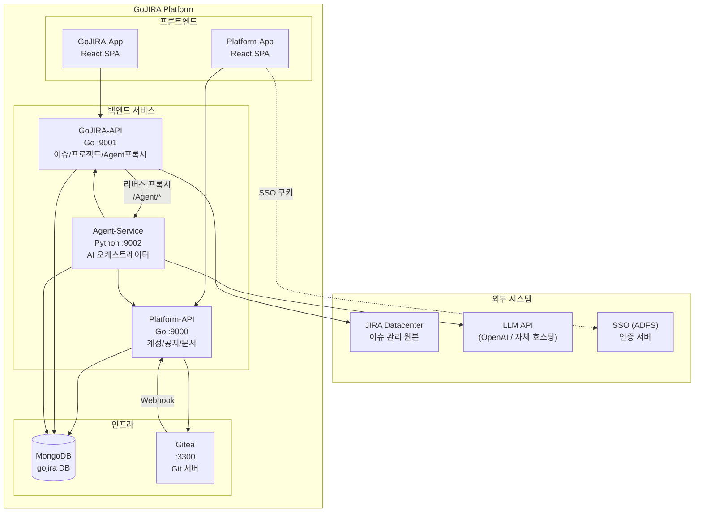
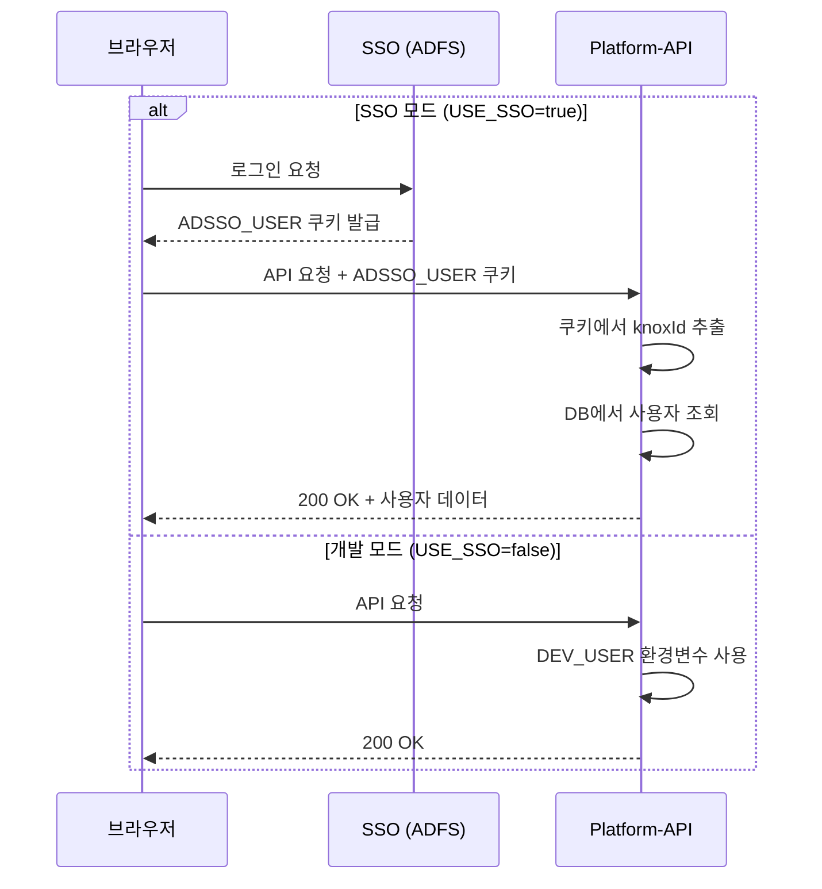
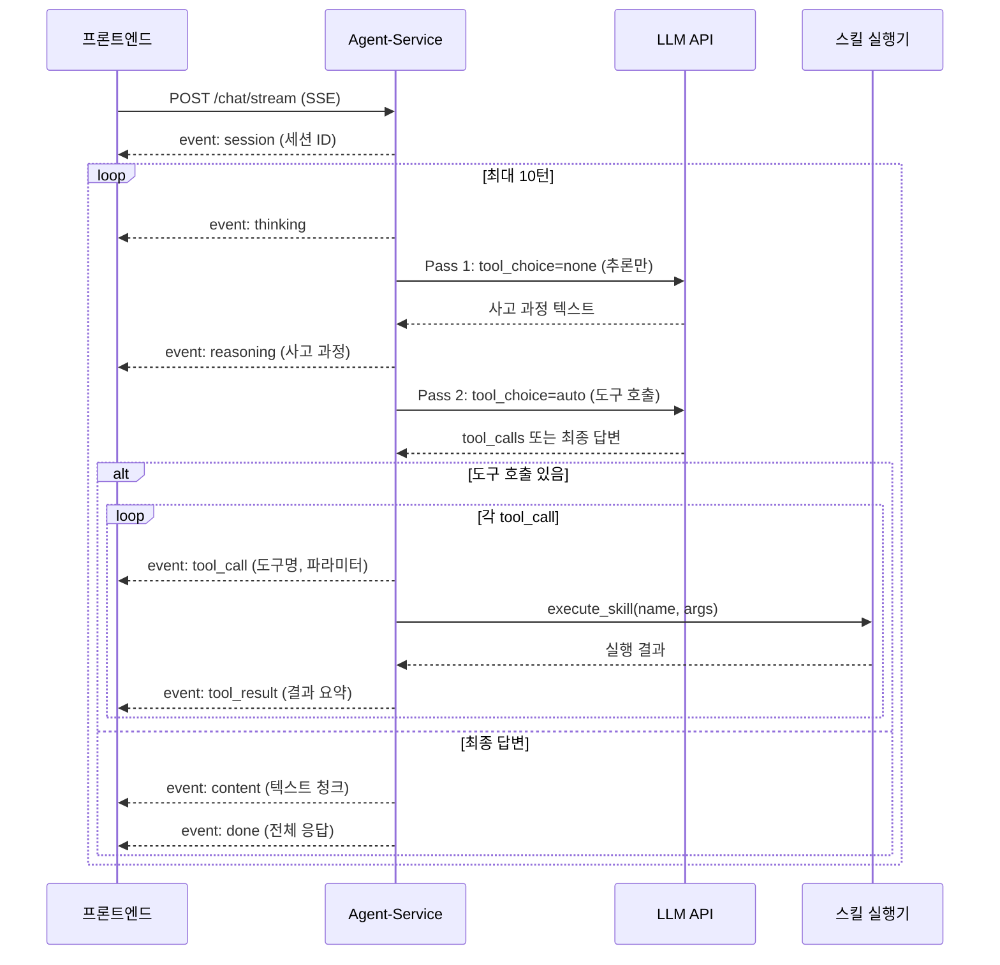
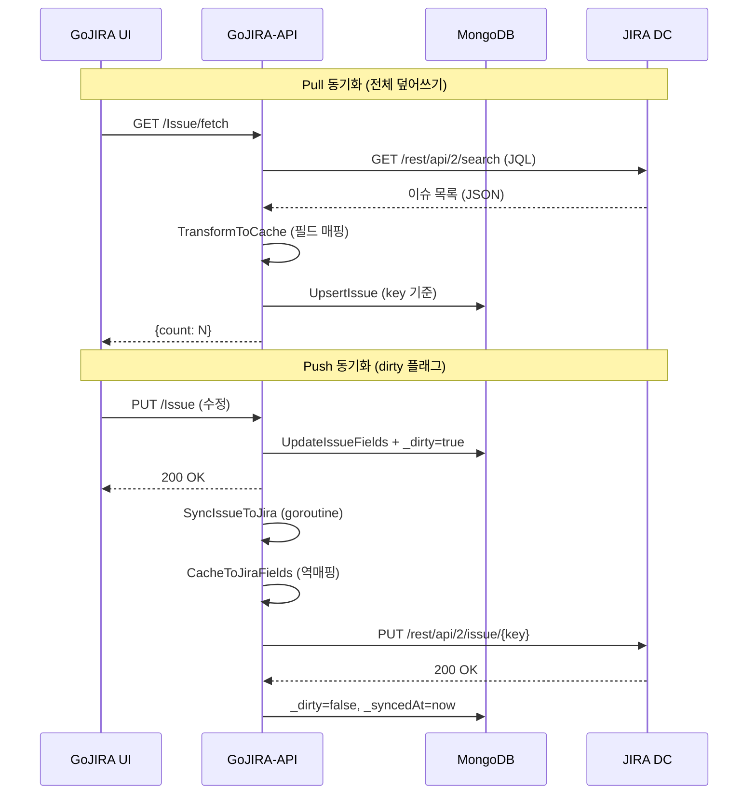
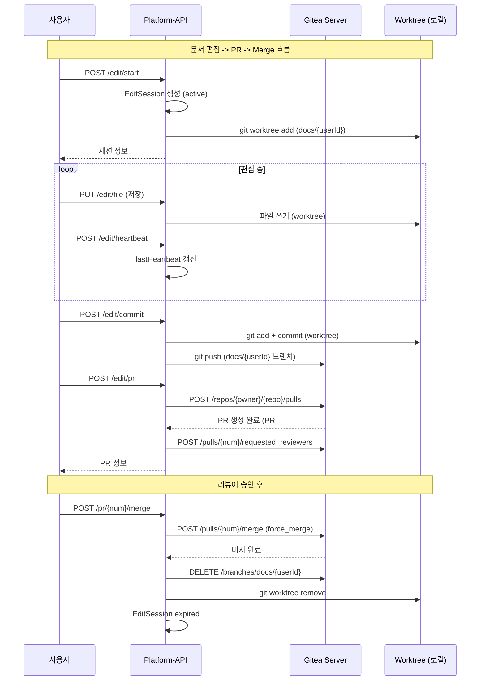
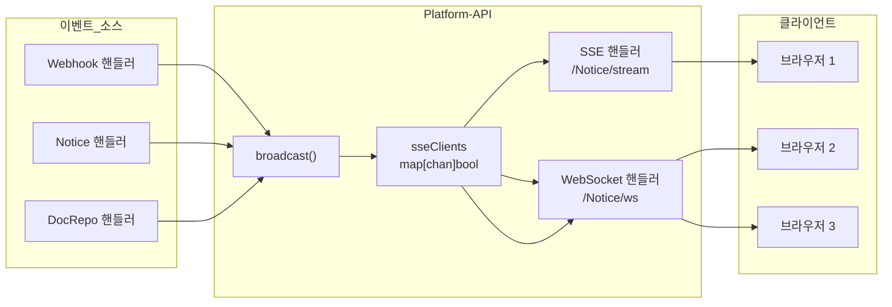

# GoJIRA 플랫폼 설계서

> 최종 갱신: 2026-04-10  
> 버전: 1.0  
> 상태: 확정

---

## 목차

1. [개요](#1-개요)
2. [서비스 아키텍처](#2-서비스-아키텍처)
3. [Platform-API 설계](#3-platform-api-설계)
4. [GoJIRA-API 설계](#4-gojira-api-설계)
5. [Agent-Service 설계](#5-agent-service-설계)
6. [데이터베이스 설계](#6-데이터베이스-설계)
7. [외부 연동](#7-외부-연동)
8. [실시간 통신 설계](#8-실시간-통신-설계)
9. [보안 설계](#9-보안-설계)
10. [설계 결정 기록 (ADR)](#10-설계-결정-기록-adr)

---

## 1. 개요

GoJIRA는 JIRA Datacenter 기반 프로젝트 관리 시스템을 보완하는 통합 플랫폼이다.  
이슈 관리, 문서 이력 관리, AI 에이전트를 하나의 인터페이스로 제공한다.

### 1.1 설계 목표

| 목표 | 설명 |
|------|------|
| **양방향 동기화** | JIRA DC와 MongoDB 간 이슈 데이터의 실시간 양방향 동기화 |
| **문서 이력 관리** | Gitea 기반 문서 버전 관리, PR/Review 워크플로 |
| **AI 에이전트** | LLM 기반 프로젝트 분석, 이슈 관리 자동화 |
| **실시간 UX** | SSE/WebSocket을 통한 즉시 알림 및 상태 반영 |
| **데이터 주권** | 모든 데이터를 자체 인프라에서 관리 |

### 1.2 기술 스택

| 계층 | 기술 |
|------|------|
| Backend API | Go 1.21+ (chi router), Python 3.9+ (FastAPI) |
| Database | MongoDB 7.0 |
| Git Platform | Gitea (self-hosted, Docker) |
| LLM | OpenAI SDK (gpt-4o), 엔드포인트 교체 가능 |
| 실시간 통신 | SSE, WebSocket (gorilla/websocket) |
| 컨테이너 | Docker Compose |

---

## 2. 서비스 아키텍처

### 2.1 시스템 컨텍스트 (C4 Container)



### 2.2 서비스 간 통신

| 경로 | 프로토콜 | 설명 |
|------|----------|------|
| GoJIRA-App -> GoJIRA-API | HTTP REST | 이슈/프로젝트 CRUD |
| GoJIRA-API -> Agent-Service | HTTP 리버스 프록시 | `GOJIRA_AGENT_PROXY` 환경변수로 제어 |
| Agent-Service -> GoJIRA-API | HTTP REST | 스킬 실행 시 데이터 조회/변경 |
| Agent-Service -> Platform-API | HTTP REST | 문서/계정 정보 조회 |
| Platform-API -> Gitea | REST API (v1) | 문서 CRUD, PR, 브랜치 관리 |
| Gitea -> Platform-API | Webhook (POST) | push/PR/review 이벤트 수신 |
| GoJIRA-API -> JIRA DC | REST API (v2) | 이슈 동기화 |
| Platform-API -> Client | SSE / WebSocket | 실시간 알림 브로드캐스트 |

---

## 3. Platform-API 설계

> Go, chi/v5 라우터, 포트 :9000

### 3.1 라우트 구조

```
/webhook/github                    # Gitea Webhook 수신
/api/v{version}/
  Account/
    me                             # 현재 사용자 (SSO 쿠키 기반)
    users, users/{id}              # 사용자 CRUD
    users/{id}/authority           # 권한 계산 (비트마스크)
    authGroups, authGroups/{id}    # 권한 그룹 CRUD
    orgUnits, orgUnits/{id}        # 조직 단위 CRUD
    userProjects, userProjects/{id}# 사용자-프로젝트 매핑
    connections, connections/{id}  # 접속 상태 관리
  Notice/
    stream                         # SSE 연결
    ws                             # WebSocket 연결
    active                         # 활성 공지 조회
    {id}, {id}/view                # 공지 CRUD + 조회수
  Notification/
    unread                         # 미읽은 알림
    read                           # 읽음 처리
  DocRepo/
    {code}/tree                    # 파일 트리
    {code}/file                    # 파일 읽기/쓰기/삭제
    {code}/pr, {code}/prs          # PR 생성/목록
    {code}/pr/{num}/review         # PR 리뷰 (승인/반려)
    {code}/pr/{num}/merge          # PR 머지
    {code}/edit/start              # 편집 세션 시작
    {code}/edit/commit             # 편집 커밋
    {code}/edit/pr                 # 편집 -> PR 생성
    {code}/edit/heartbeat          # 세션 유지 (TTL 갱신)
  Git/users                        # Gitea 사용자 목록
```

### 3.2 인증 설계



### 3.3 계정 모델

#### User

| 필드 | 타입 | 설명 |
|------|------|------|
| knoxId | string | SSO 고유 ID |
| name | string | 사용자명 |
| email | string | 이메일 |
| authGroupIds | []string | 소속 권한 그룹 |
| orgUnitIds | []string | 소속 조직 단위 |
| isActive | bool | 활성 여부 (Soft Delete) |

#### AuthGroup (권한 그룹)

| 필드 | 타입 | 설명 |
|------|------|------|
| code | string | 그룹 코드 |
| authority | map[string]int | 리소스별 비트마스크 (C=8, R=4, U=2, D=1) |

**비트마스크 예시:**

```
authority: {
  "issue": 15,     // C+R+U+D = 8+4+2+1
  "project": 6,    // R+U = 4+2
  "notice": 4      // R만 = 4
}
```

#### OrgUnit (조직 단위)

4단계 계층: Company > Division > Team > Group  
`parentOrgUnitId` 자기참조로 트리 구조 표현

### 3.4 공지 (Notice)

**상태 흐름:** `draft` -> `active` -> `expired`

| 필드 | 설명 |
|------|------|
| status | draft / active / expired |
| isEmergency | 비상 공지 여부 (true이면 SSE 즉시 브로드캐스트) |
| startDate / endDate | 게시 기간 |
| bodyType | markdown / html |

### 3.5 DocRepo (문서 저장소)

Gitea 레포지토리와 1:1 매핑되며, 프로젝트별 문서 이력 관리를 담당한다.

#### 편집 세션 (EditSession)

| 필드 | 설명 |
|------|------|
| projectCode | 프로젝트 코드 |
| userId | 편집 사용자 |
| status | active / expired |
| lastHeartbeat | 마지막 하트비트 시각 |

- **TTL**: 기본 30분 (`PLATFORM_EDIT_SESSION_TTL`)
- **워커**: 백그라운드 TTL Worker가 주기적으로 만료된 workspace 정리
- **Worktree**: git worktree 기반 사용자별 독립 작업 공간

---

## 4. GoJIRA-API 설계

> Go, chi/v5 라우터, 포트 :9001

### 4.1 라우트 구조

```
/api/v{version}/
  Check                            # 서버 상태 확인
  Issue                            # 이슈 CRUD
  Issue/label                      # 라벨 추가/삭제
  Issue/link, Issue/link/{id}/of/{key}  # 이슈 링크 CRUD
  Issue/comment                    # 댓글 CRUD
  Issue/fetch                      # JIRA Pull 동기화
  Issue/docgen                     # 이슈 -> Markdown 문서 생성
  Issue/field                      # 필드 단건 수정
  Issue/relations                  # 관계 일괄 조회
  Jira/Account                     # JIRA 계정 등록
  Page/images                      # 페이지 이미지 관리
  Page/confluence                  # Confluence 내보내기
  Project                          # 프로젝트 CRUD
  Project/alerts                   # 프로젝트 알림 (브랜치 diff)
  Agent/*                          # Agent-Service 프록시 또는 자체 처리
```

### 4.2 Agent 프록시

`GOJIRA_AGENT_PROXY` 환경변수가 설정되면 `/Agent/*` 요청을 Agent-Service로 리버스 프록시한다.

```go
// 설정 예: GOJIRA_AGENT_PROXY=http://localhost:9002
proxy := httputil.NewSingleHostReverseProxy(target)
r.HandleFunc("/Agent/*", proxy.ServeHTTP)
```

미설정 시 GoJIRA-API 내장 핸들러가 직접 처리한다 (Phase 0 호환).

### 4.3 이슈 데이터 구조

이슈는 JIRA DC의 필드를 MongoDB 캐시 스키마로 변환하여 저장한다.

| MongoDB 필드 | 설명 |
|--------------|------|
| key | 이슈 키 (예: PROJ-123) |
| summary | 제목 |
| issueType | VOS / Feature / Requirement / Design / Test |
| reqType | Requirement 세부 타입: QA/NFR, FR, CNST |
| issueLinks | 관계 배열 (contain, relate 등) |
| _dirty | 동기화 대기 플래그 |
| _syncedAt | 마지막 동기화 시각 |
| _deletedLinks | JIRA 삭제 대기 링크 ID |

### 4.4 이슈 타입 계층

```
VOS (Value Objective Stream)
  └── Feature (Use Case)
       └── Requirement
            ├── QA/NFR (품질/비기능)
            ├── FR (기능)
            └── CNST (제약)
       └── Design
            ├── ADSN (아키텍처)
            └── DDSN (상세)
       └── Test
```

### 4.5 프로젝트 모델

| 필드 | 타입 | 설명 |
|------|------|------|
| name | string | 프로젝트명 |
| jiraCodes.main.jiraCode | string | JIRA 프로젝트 키 |
| documents | map | 문서 저장소 설정 (repoName 등) |
| issues | []string | 프로젝트 이슈 키 배열 |
| schedules | []map | 일정 정보 |
| branchAlerts | []string | 브랜치 diff가 있는 사용자 ID |
| diagrams | map | 다이어그램 데이터 |

---

## 5. Agent-Service 설계

> Python 3.9+, FastAPI, 포트 :9002

### 5.1 라우트 구조

```
/api/v2/Agent/
  POST   chat               # 동기 채팅 (ReACT 루프)
  POST   chat/stream         # SSE 스트리밍 채팅 (2-pass ReACT)
  POST   assist              # 페이지별 보조 기능
  GET    tools               # 사용 가능한 도구 목록
  GET    sessions            # 세션 목록 (최근 50개)
  GET    session/{id}        # 세션 상세
/health                      # 헬스체크
```

### 5.2 ReACT 2-pass 아키텍처



### 5.3 의도 분류

| 분류 | 조건 | 실행 방식 |
|------|------|-----------|
| simple | 단일 질문, 단순 조회 | ReACT 단일 루프 (`agent_loop`) |
| complex | 복합 키워드 + 연결어 ("분석하고 작성해줘") | Stage Machine 오케스트레이션 |

**Stage Machine 흐름:** PLANNING -> RESEARCHING -> EXECUTING -> VALIDATING -> COMPLETED  
실패 시 ReACT 루프로 자동 fallback한다.

### 5.4 스킬 시스템

스킬은 `SKILL.md` 파일로 선언적으로 정의되며, Go/Python 양쪽에서 로드한다.

| 스킬 | 설명 |
|------|------|
| project_query | 프로젝트 목록 조회 |
| issue_query | 이슈 조회 (타입/프로젝트 필터) |
| issue_create | 이슈 생성 |
| issue_update | 이슈 수정 |
| issue_delete | 이슈 삭제 |
| issue_link | 이슈 관계 설정 |
| issue_analyze | 이슈 관계 분석 (contain 체인 검증) |
| satam_analyze | SATAM 매트릭스 분석 |
| schedule_analyze | 일정 분석 |
| doc_list | 문서 목록 조회 |
| doc_summarize | 문서 요약 (LLM 기반) |
| doc_diff | 문서 변경 비교 |
| doc_history | 커밋 이력 조회 |
| pr_list | PR 목록 조회 |
| pr_create | PR 생성 |
| navigate | UI 네비게이션 |

**로딩 순서:**
1. `GOJIRA_SKILLS_DIR` 환경변수
2. 상위 디렉토리의 `GoJIRA-API/skills/` 탐색
3. 각 `SKILL.md`에서 name, description, parameters 파싱

### 5.5 세션 관리

- MongoDB `agent_sessions` 컬렉션에 저장
- 최근 **20개** 메시지만 LLM 컨텍스트에 포함 (토큰 관리)
- 세션별 context 객체로 프로젝트 코드 등 메타데이터 유지

---

## 6. 데이터베이스 설계

> MongoDB 7.0, 데이터베이스: `gojira`

### 6.1 컬렉션 ERD

```mermaid
erDiagram
    users ||--o{ userProjects : "참여"
    users ||--o{ userConnections : "접속"
    users }o--o{ authGroups : "소속 (authGroupIds)"
    users }o--o{ orgUnits : "소속 (orgUnitIds)"
    orgUnits ||--o| orgUnits : "parent"

    projects ||--o{ issues : "포함 (issues[])"
    projects ||--|| docRepos : "1:1 (documents)"
    issues ||--o{ comments : "댓글"
    issues ||--o{ issues : "issueLinks"

    editSessions }o--|| projects : "편집 세션"
    editSessions }o--|| users : "편집자"

    agent_sessions }o--|| users : "채팅 세션"
    agent_jobs }o--|| agent_sessions : "작업"

    notices ||--o{ notifications : "알림 생성"
    notifications }o--|| users : "수신자"

    users {
        string knoxId
        string name
        string email
        array authGroupIds
        array orgUnitIds
        bool isActive
    }

    authGroups {
        string code
        string name
        map authority
        bool isActive
    }

    orgUnits {
        string code
        string name
        string type
        string parentOrgUnitId
        int sortOrder
    }

    projects {
        string name
        object jiraCodes
        map documents
        array issues
        array schedules
        array branchAlerts
    }

    issues {
        string key UK
        string summary
        string issueType
        string reqType
        array issueLinks
        bool _dirty
        date _syncedAt
    }

    comments {
        string issueKey
        string commentId
        string body
    }

    notices {
        string title
        string body
        string status
        bool isEmergency
        date startDate
        date endDate
    }

    notifications {
        string userId
        string type
        string message
        bool read
        date createdAt TTL_7d
    }

    editSessions {
        string projectCode
        string userId
        string status
        date lastHeartbeat
    }

    agent_sessions {
        string userId
        array messages
        object context
    }

    agent_jobs {
        string sessionId
        string status
        array plan
    }

    userProjects {
        string userId
        string projectId
        string role
    }

    userConnections {
        string userId
        string connectionId
        bool isOnline
    }
```

### 6.2 컬렉션 목록 (16개)

| 컬렉션 | 서비스 | 인덱스 |
|---------|--------|--------|
| users | Platform-API | knoxId (unique) |
| authGroups | Platform-API | code (unique) |
| orgUnits | Platform-API | code (unique) |
| userProjects | Platform-API | userId + projectId |
| userConnections | Platform-API | userId + connectionId |
| notices | Platform-API | status, startDate |
| notifications | Platform-API | userId + read, createdAt (TTL 7일) |
| editSessions | Platform-API | projectCode + userId, lastHeartbeat |
| docLinks | Platform-API | taskId, docRepoId |
| issues | GoJIRA-API | key (unique) |
| projects | GoJIRA-API | jiraCodes.main.jiraCode |
| comments | GoJIRA-API | issueKey |
| accounts | GoJIRA-API | jiraID |
| agent_sessions | Agent-Service | userId, updatedAt |
| agent_jobs | Agent-Service | sessionId |
| agent_logs | Agent-Service | jobId, timestamp |
| branchAlerts | Platform-API | projectCode |

### 6.3 공유 데이터베이스 전략

세 서비스 모두 동일한 `gojira` 데이터베이스에 접속한다.  
각 서비스는 자신의 컬렉션만 쓰기하고, 다른 서비스의 컬렉션은 읽기만 수행한다.

| 서비스 | 쓰기 컬렉션 | 읽기 전용 |
|--------|-------------|-----------|
| Platform-API | users, authGroups, orgUnits, notices, notifications, editSessions, docLinks, userProjects, userConnections | - |
| GoJIRA-API | issues, projects, comments, accounts | users (권한 확인) |
| Agent-Service | agent_sessions, agent_jobs, agent_logs | issues, projects (스킬 실행) |

---

## 7. 외부 연동

### 7.1 JIRA Datacenter 동기화



#### 동기화 규칙

| 방향 | 트리거 | 전략 |
|------|--------|------|
| **Pull** (JIRA -> MongoDB) | `/Issue/fetch` 호출 | 전체 덮어쓰기 (JQL 필터 가능) |
| **Push** (MongoDB -> JIRA) | 이슈 수정 시 | 비동기 goroutine, `_dirty` 플래그 |

#### 커스텀 필드 매핑

`customFieldMap`으로 약 30개 JIRA 커스텀 필드를 MongoDB 필드명으로 변환한다.  
`TransformToCache()`/`CacheToJiraFields()`가 양방향 변환을 수행한다.

#### 링크 동기화

- 새 링크: `tmp_` 접두사로 MongoDB에 저장 -> Push 시 JIRA에 생성 -> 실제 ID로 교체
- 삭제 링크: `_deletedLinks` 배열에 기록 -> Push 시 JIRA에서 삭제

### 7.2 Gitea 연동



#### 브랜치 전략

| 브랜치 | 용도 |
|--------|------|
| `main` | 승인된 문서 (보호됨) |
| `docs/{userId}` | 사용자별 작업 브랜치 |

#### 브랜치 보호

- main 브랜치에 보호 규칙 설정 (직접 push 불가)
- PR 필수, 지정 리뷰어 전원 승인 필요
- Gitea/GitHub 양쪽 API 지원 (`setBranchProtectionGitea`/`setBranchProtectionGitHub`)

#### Worktree TTL

- 기본 30분 미활동 시 자동 삭제
- 활성 세션 또는 미커밋 작업이 있으면 삭제하지 않음
- `StartTTLWorker()`가 주기적으로 (TTL/2 간격) 만료 workspace 정리

### 7.3 LLM 연동

| 설정 | 설명 |
|------|------|
| endpoint | OpenAI 호환 API (교체 가능) |
| model | 기본 gpt-4o (llm.json으로 설정) |
| auth_type | bearer / header / none |
| max_tokens | 기본 500 (도구 호출 시 2000) |

`llm.json` 설정 파일로 엔드포인트와 모델을 런타임에 교체할 수 있다.  
탐색 순서: `GOJIRA_LLM_CONFIG` -> `./llm.json` -> `../GoJIRA-API/config/llm.json`

---

## 8. 실시간 통신 설계

### 8.1 SSE + WebSocket 이중화



### 8.2 이벤트 채널

| 이벤트 | 소스 | 데이터 |
|--------|------|--------|
| `connected` | 연결 시 | "ok" |
| `emergency` | 비상 공지 생성 | 공지 전체 데이터 |
| `doc_update` | DocRepo 변경 | type, repo, projectCode |
| `pr_update` | Webhook (PR) | action, prNumber, state, merged, reviewers |
| `pr_review` | Webhook (Review) | reviewer, state, body |
| `project_alert` | Webhook (Push) | branchAlerts (diff가 있는 사용자 목록) |

### 8.3 SSE와 WebSocket 통합 설계

SSE와 WebSocket이 동일한 `sseClients` 채널 맵을 공유한다.  
WebSocket 핸들러도 SSE 채널을 등록하여 `broadcast()`로 통합 전송한다.

```go
// WebSocket도 동일한 sseClients 맵에 등록
ch := make(chan sseMessage, 10)
sseMu.Lock()
sseClients[ch] = true  // SSE/WS 구분 없이 동일한 맵
sseMu.Unlock()
```

### 8.4 Agent SSE 스트리밍

Agent-Service의 `/chat/stream`은 별도의 SSE 스트림이다.

| 이벤트 | 설명 |
|--------|------|
| `session` | 세션 ID 전달 |
| `thinking` | LLM 호출 중 (턴 번호) |
| `reasoning` | Pass 1 사고 과정 (디버그 뷰) |
| `tool_call` | 도구 호출 시작 (도구명, 파라미터) |
| `tool_result` | 도구 실행 결과 (요약, 소요시간) |
| `content` | 최종 답변 텍스트 (청크 단위) |
| `done` | 완료 (전체 응답 + actions) |
| `error` | 에러 발생 |

---

## 9. 보안 설계

### 9.1 인증

| 항목 | 구현 |
|------|------|
| SSO | ADFS 쿠키 (`ADSSO_USER`) 기반 |
| 개발 모드 | `USE_SSO=false` -> `DEV_USER` 환경변수 |
| 사용자 식별 | `X-User-Id` 헤더 (Agent-Service) |
| Gitea 인증 | Bearer 토큰 (관리자), 사용자별 토큰 생성 가능 |
| JIRA 인증 | Basic Auth (ID/PW 암호화 저장) |

### 9.2 권한 (Authorization)

권한은 **조회 시점에 계산**한다 (캐시하지 않음).

```
사용자 최종 권한 = OR(소속 그룹1.authority, 소속 그룹2.authority, ...)
```

비트마스크 OR 연산으로 여러 그룹의 권한을 합산한다.  
그룹 변경 시 즉시 반영되며, 캐시 불일치 문제가 없다.

### 9.3 암호화

| 대상 | 방식 |
|------|------|
| JIRA 계정 (ID/PW) | AES 암호화 (`config/crypto.go`) |
| SMTP 비밀번호 | AES 암호화 |
| Webhook 시그니처 | HMAC-SHA256 검증 |

### 9.4 Soft Delete

모든 주요 엔티티에 `isActive` 필드를 사용한다.  
삭제 시 `isActive=false`로 설정하고, 조회 시 `isActive=true` 필터를 적용한다.  
참조 무결성과 이력 추적을 위해 물리적 삭제는 수행하지 않는다.

---

## 10. 설계 결정 기록 (ADR)

### ADR-001: 비트마스크 권한 체계

**상태:** 확정  
**맥락:** 리소스별 CRUD 권한을 효율적으로 저장하고 계산해야 한다.  
**결정:** 4비트 비트마스크 (C=8, R=4, U=2, D=1)로 권한을 표현한다.  
**사유:**
- 단일 정수로 4개 권한을 표현 (저장 효율)
- 비트 OR 연산으로 복수 그룹 권한 합산 가능
- 그룹 변경 시 사용자 레코드 수정 불필요 (자동 반영)

### ADR-002: 조회 시 권한 계산

**상태:** 확정  
**맥락:** 권한 정보를 캐시할지 실시간 계산할지 결정해야 한다.  
**결정:** API 호출 시마다 사용자의 그룹을 조회하고 비트마스크를 OR 합산한다.  
**사유:**
- 캐시 무효화 로직 불필요 (캐시 불일치 원천 방지)
- 그룹 변경이 즉시 모든 사용자에게 반영
- MongoDB 인덱스로 조회 성능 충분 (사용자 수 100명 이하)

### ADR-003: Soft Delete

**상태:** 확정  
**맥락:** 데이터 삭제 시 참조 무결성과 이력 추적이 필요하다.  
**결정:** `isActive` 필드로 논리적 삭제, 물리적 삭제 금지.  
**사유:**
- 삭제된 사용자/그룹을 참조하는 기존 데이터의 무결성 유지
- 감사 이력 추적 가능
- 실수로 삭제한 데이터 복구 가능

### ADR-004: SSE에서 WebSocket 전환 (이중 지원)

**상태:** 확정  
**맥락:** HTTP/1.1 환경에서 SSE 연결이 브라우저당 6개 제한에 걸린다.  
**결정:** WebSocket을 추가하고, SSE와 동일한 브로드캐스트 채널을 공유한다.  
**사유:**
- SSE는 HTTP/1.1에서 6개 연결 제한 (다른 API 호출 차단)
- WebSocket은 단일 연결로 양방향 통신 가능
- 기존 SSE 클라이언트와의 하위 호환성 유지

### ADR-005: API Gateway 미사용

**상태:** 확정  
**맥락:** 3개 서비스 앞에 API Gateway를 둘지 결정해야 한다.  
**결정:** API Gateway 없이 서비스가 직접 포트를 노출한다.  
**사유:**
- 서비스 2개 (Platform-API, GoJIRA-API)로 Gateway 복잡도 대비 이점 미미
- SPOF(Single Point of Failure) 방지
- Agent-Service는 GoJIRA-API가 리버스 프록시로 중계
- CORS 허용으로 프론트엔드에서 직접 호출 가능

### ADR-006: Gitea 자체 호스팅

**상태:** 확정  
**맥락:** 문서 Git 저장소로 GitHub, GitLab, Gitea 중 선택해야 한다.  
**결정:** Gitea를 Docker로 자체 호스팅한다.  
**사유:**
- 데이터 주권 확보 (사내 데이터 외부 유출 방지)
- GitHub API 호환 (코드 변경 최소화)
- 경량 (SQLite 기반, 단일 컨테이너)
- 라이선스 비용 없음

### ADR-007: project.documents 통합 저장

**상태:** 확정  
**맥락:** 프로젝트와 문서 저장소의 관계를 별도 컬렉션으로 분리할지 결정해야 한다.  
**결정:** projects 컬렉션 내 `documents` 필드에 통합 저장한다.  
**사유:**
- 프로젝트:문서저장소 = 1:1 관계 (분리 불필요)
- 단일 source of truth (join 없이 한 번에 조회)
- DocRepo 컬렉션은 매핑 메타데이터만 별도 관리

### ADR-008: git worktree 기반 편집

**상태:** 확정  
**맥락:** 사용자별 독립 작업 공간을 어떻게 구현할지 결정해야 한다.  
**결정:** `git worktree`로 사용자별 독립 작업 디렉토리를 생성한다.  
**사유:**
- 사용자 간 편집 충돌 원천 방지
- 각 worktree가 독립 브랜치 (`docs/{userId}`)
- git clone보다 디스크/네트워크 효율적 (object store 공유)
- TTL 워커로 유휴 workspace 자동 정리

### ADR-009: eventQueue FIFO

**상태:** 확정  
**맥락:** WebSocket 메시지 전송 시 경쟁 조건이 발생할 수 있다.  
**결정:** 채널 기반 FIFO 큐로 메시지 순서를 보장한다.  
**사유:**
- Go 채널이 자연스러운 FIFO 큐 역할
- 버퍼 크기 10으로 일시적 부하 흡수
- 버퍼 초과 시 drop (select default)하여 slow consumer 차단 방지

### ADR-010: Agent-Service Python 분리

**상태:** 확정  
**맥락:** AI 에이전트를 Go 서비스에 내장할지 별도 서비스로 분리할지 결정해야 한다.  
**결정:** Python (FastAPI) 별도 서비스로 분리한다.  
**사유:**
- Python LLM 생태계 활용 (OpenAI SDK, LangChain, Jinja2 등)
- Go에서 Python 라이브러리 호출 불가
- 독립 배포/스케일링 가능
- GoJIRA-API는 리버스 프록시로 투명하게 중계

### ADR-011: CLI에서 SKILL.md 전환

**상태:** 확정  
**맥락:** 스킬 정의 방식을 코드 기반에서 선언형으로 변경할지 결정해야 한다.  
**결정:** `SKILL.md` 마크다운 파일로 선언적 정의, Go/Python 양쪽에서 파싱한다.  
**사유:**
- 선언형 정의로 비개발자도 스킬 추가/수정 가능
- Claude Code 호환 (마크다운 기반 도구 정의)
- Go `AutoLoadSkills()`와 Python `load_skills_from_dir()` 공유

### ADR-012: CRUD 개별 스킬 분리

**상태:** 확정  
**맥락:** 이슈 CRUD를 하나의 스킬로 통합할지 개별 스킬로 분리할지 결정해야 한다.  
**결정:** issue_create, issue_update, issue_delete 등 개별 스킬로 분리한다.  
**사유:**
- LLM이 구체적 도구를 더 정확하게 선택 (function calling 정확도 향상)
- 파라미터 스키마가 명확해져 hallucination 감소
- 각 스킬의 description이 독립적이어 LLM 판단 용이

### ADR-013: gpt-4o 모델 선택

**상태:** 확정  
**맥락:** gpt-4o와 gpt-4o-mini 중 기본 모델을 선택해야 한다.  
**결정:** gpt-4o를 기본 모델로 사용한다 (llm.json으로 교체 가능).  
**사유:**
- gpt-4o-mini의 tool_use(function calling) 정확도가 현저히 낮음
- 복잡한 파라미터 매핑 시 오류율 높음
- 비용 차이보다 정확도가 서비스 품질에 더 큰 영향

### ADR-014: 독립 채팅 창

**상태:** 확정  
**맥락:** Agent 채팅 UI를 메인 앱 오버레이로 할지 별도 창으로 할지 결정해야 한다.  
**결정:** `window.open()`으로 독립 창, `BroadcastChannel`로 통신한다.  
**사유:**
- 오버레이가 메인 UI 작업을 방해 (클릭 가림, 스크롤 차단)
- 독립 창은 듀얼 모니터 활용 가능
- BroadcastChannel로 탭 간 navigate 명령 전달 (SPA 라우팅)

### ADR-015: SSE 스트리밍 + 2-pass ReACT

**상태:** 확정  
**맥락:** Agent 응답을 동기로 기다릴지 스트리밍할지 결정해야 한다.  
**결정:** SSE로 스트리밍하고, 2-pass ReACT(추론/도구 분리)를 적용한다.  
**사유:**
- 실시간 UX: 사용자가 사고 과정(reasoning)을 즉시 확인
- 도구 호출 진행 상황 실시간 표시 (tool_call/tool_result)
- Pass 1(추론)과 Pass 2(도구 호출) 분리로 디버그 뷰 구현 가능
- `tool_choice=none/auto` 제어로 추론과 실행을 명확히 분리

---

## 부록: 환경 변수

### Platform-API

| 변수 | 기본값 | 설명 |
|------|--------|------|
| PLATFORM_SERVER_PORT | :9000 | 서버 포트 |
| PLATFORM_MONGO_URI | mongodb://localhost:27017 | MongoDB URI |
| PLATFORM_MONGO_DB | gojira | DB 이름 |
| PLATFORM_GITHUB_TOKEN | - | Gitea 관리자 토큰 |
| PLATFORM_GITHUB_ORG | - | Gitea 조직명 |
| GITHUB_URL | https://github.com/ | Git 플랫폼 URL |
| PLATFORM_REPO_DIR | ./repos | 로컬 repo 디렉토리 |
| PLATFORM_WEBHOOK_URL | - | Webhook 수신 URL |
| PLATFORM_WEBHOOK_SECRET | gojira-webhook-secret | Webhook 시크릿 |
| PLATFORM_EDIT_SESSION_TTL | 30 | 편집 세션 TTL (분) |
| SMTP_HOST/PORT/USER/PASS/FROM | - | 이메일 설정 |

### GoJIRA-API

| 변수 | 기본값 | 설명 |
|------|--------|------|
| GOJIRA_SERVER_PORT | :9001 | 서버 포트 |
| GOJIRA_PLATFORM_API | http://localhost:9000/api/v2 | Platform-API URL |
| GOJIRA_JIRA_URL | http://localhost:8000 | JIRA URL |
| GOJIRA_JIRA_API_BASE | /rest/api/2 | JIRA API 경로 |
| GOJIRA_JIRA_USER | - | JIRA 계정 (암호화) |
| GOJIRA_JIRA_PASS | - | JIRA 비밀번호 (암호화) |
| GOJIRA_CONFLUENCE_URL | http://localhost:8090 | Confluence URL |
| GOJIRA_MONGO_URI | mongodb://localhost:27017 | MongoDB URI |
| GOJIRA_MONGO_DB | gojira | DB 이름 |
| OPENAI_API_KEY | - | LLM API 키 |
| GOJIRA_AGENT_PROXY | - | Agent-Service 프록시 URL |

### Agent-Service

| 변수 | 기본값 | 설명 |
|------|--------|------|
| AGENT_SERVICE_PORT | 9002 | 서버 포트 |
| GOJIRA_MONGO_URI | mongodb://localhost:27017 | MongoDB URI |
| GOJIRA_MONGO_DB | gojira | DB 이름 |
| GOJIRA_API_URL | http://localhost:9001/api/v2 | GoJIRA-API URL |
| GOJIRA_PLATFORM_API | http://localhost:9000/api/v2 | Platform-API URL |
| OPENAI_API_KEY | - | LLM API 키 |
| GOJIRA_LLM_CONFIG | - | llm.json 경로 |
| GOJIRA_SKILLS_DIR | - | 스킬 디렉토리 경로 |
