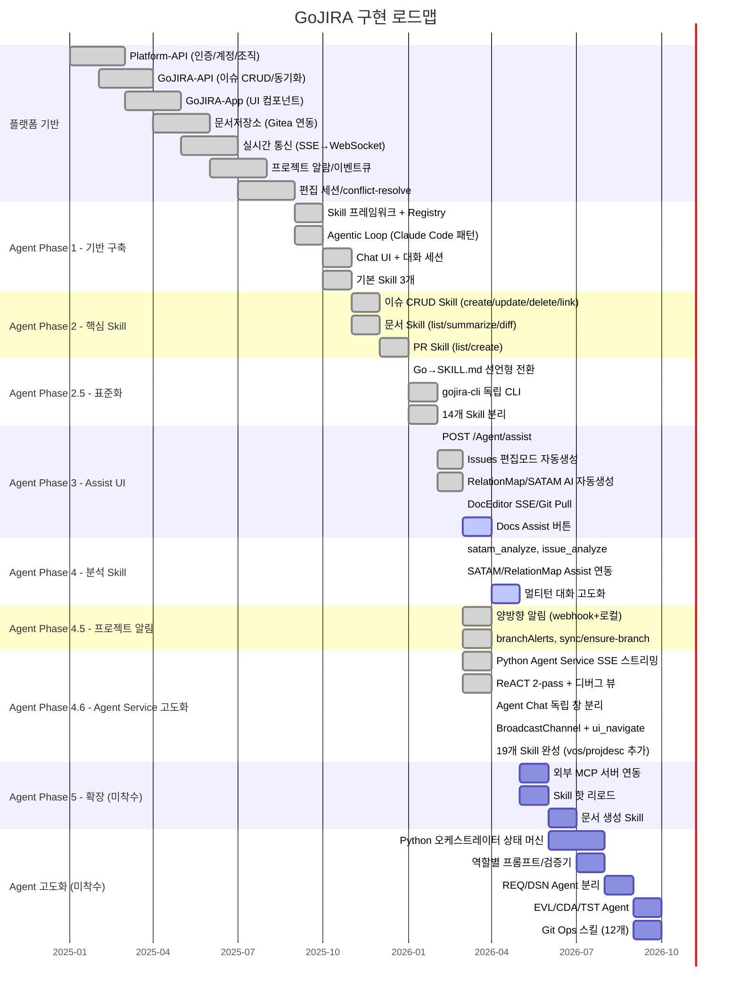
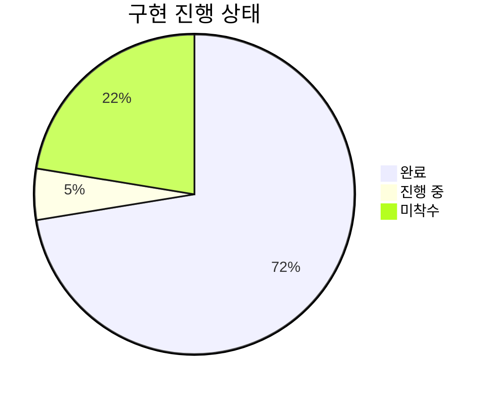
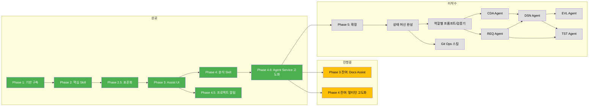

# GoJIRA 구현 계획서

> 최종 갱신: 2026-04-10

## 1. 개요

GoJIRA는 JIRA Datacenter 호환 프로젝트 관리 플랫폼으로, AI 기반 Agent를 통해 자연어 대화로 이슈 관리, 설계문서 작성, 일정 분석 등을 자동화하는 시스템이다.

### 시스템 구성

| 서비스 | 기술 | 포트 | 역할 |
|--------|------|------|------|
| Platform-API | Go | :9000 | 인증, 계정, 조직, 문서저장소, WebSocket |
| GoJIRA-API | Go | :9001 | 이슈 CRUD, JIRA DC 동기화, Agent 라우팅 |
| Agent Service | Python | :9002 | ReACT 오케스트레이터, Skill 실행, SSE 스트리밍 |
| Platform-App | React | :3000 | 프론트엔드 (ProjectMap, IssueList, DocEditor 등) |
| GoJIRA-App | React | - | GoJIRA 전용 UI 컴포넌트 |

### 핵심 목표

- 자연어 기반 프로젝트 관리 자동화
- Skill/SKILL.md 선언형 확장 아키텍처
- JIRA Datacenter v2 REST API 호환
- 멀티 에이전트 시스템으로의 점진적 확장

---

## 2. 전체 구현 로드맵



### 현재 완료 상태



---

## 3. 완료된 작업 상세

### 3.1 플랫폼 기반

- [x] **Platform-API**: 인증(SSO), 계정/권한(비트마스크), 조직, 공지
- [x] **GoJIRA-API**: 이슈 CRUD, JIRA DC v2 양방향 동기화
- [x] **GoJIRA-App**: ProjectMap, IssueList, RelationMap, SATAM, DocEditor
- [x] **문서 저장소**: Gitea 연동, PR/Merge, 브랜치 보호
- [x] **실시간 통신**: SSE → WebSocket 전환, sseManager
- [x] **프로젝트 알람**: webhook + WebSocket, branchAlerts
- [x] **편집 세션**: git worktree 기반, TTL 30분
- [x] **CommonBar**: Pull/Export 아이콘화, 네비게이션 탭
- [x] **이벤트 큐**: eventQueue FIFO 순차 처리
- [x] **conflict-resolve**: 변경 보관 + sync + 재반영

### 3.2 Agent Phase 1: 기반 구축

- [x] Agentic Loop (Claude Code 패턴, 최대 10턴)
- [x] Chat UI (타이틀바 GoJIRA 클릭 → 채팅 패널)
- [x] `POST /Agent/chat`, `GET /Agent/tools`
- [x] 대화 세션 관리 (MongoDB, TTL)
- [x] 시스템 프롬프트 외부화 (`prompts/agent-system.txt`)
- [x] Skill 프레임워크: SKILL.md 기반 선언형 로더
- [x] 기본 Skill: project_query, issue_query, schedule_analyze

### 3.3 Agent Phase 2: 핵심 Skill

- [x] CRUD 개별 분리: issue_create / issue_update / issue_delete / issue_link
- [x] doc_list / doc_summarize / doc_diff
- [x] pr_list / pr_create
- [x] 멀티턴 + 멀티 tool_call 지원
- [x] issue_query reqType 필터 (NFR/FR/CNST)

### 3.4 Agent Phase 2.5: 표준화

- [x] Go 코드 하드코딩 → SKILL.md 선언형 전환
- [x] gojira-cli 독립 CLI 바이너리
- [x] CRUD 개별 분리: 12개 → 14개 Skill

### 3.5 Agent Phase 3: Agent Assist UI

- [x] `POST /Agent/assist` 핸들러
- [x] Issues 편집모드 자동생성 버튼
- [x] Assist 결과 미리보기
- [x] RelationMap AI 자동생성 + 승인 모달
- [x] SATAM 분석 버튼
- [x] CommonBar 정리 (Pull/Export 아이콘화)
- [x] 대화 이력 + 세션 검색 (TTL 7일)
- [x] DocEditor SSE 구독 (main 변경 실시간 갱신)
- [x] DocEditor mainOnly 파일 표시
- [x] DocEditor Git Pull (sync-branch)

### 3.6 Agent Phase 4: 분석 Skill

- [x] satam_analyze Skill — SATAM 매트릭스 자동 분석
- [x] issue_analyze Skill — 이슈 관계 분석, 고아 이슈 감지
- [x] SATAM/RelationMap Assist 버튼 연동

### 3.7 Agent Phase 4.5: 프로젝트 알림

- [x] 양방향 알림: webhook (Gitea → GoJIRA-API) + 로컬 이벤트
- [x] branchAlerts, sync-branch, ensure-branch, init-files

### 3.8 Agent Phase 4.6: Agent Service 고도화

- [x] Python Agent Service SSE 스트리밍
- [x] ReACT 2-pass (추론 → 도구 호출 분리)
- [x] Master 디버그 뷰 (추론/CALL/OK 스텝 접기 블록)
- [x] ChatRequest Optional[str] 수정 (422 에러 해결)
- [x] Agent Chat 독립 창 분리 (`window.open`, 480x720)
- [x] BroadcastChannel(`gojira-navigate`) 크로스 윈도우 네비게이션
- [x] ui_navigate Skill
- [x] pr_list 기본 state=all
- [x] 총 25개 Skill 완성 (issue_create_* 4종 분리 + 워크플로우 스킬 추가)
- [x] 스킬 구조 통합: GoJIRA-API/skills/ → Agent-Service/skills/ (SKILL.md + executor.py 동일 폴더)
- [x] 이슈 subkey 자동 부여 (VOS_001/UC_001/FR_001/QA_001/CNST_001/ADSN_001/DDSN_001) — `helpers.next_subkey()`
- [x] JIRA DC v2 표준 link 포맷: `type:{name:"Contains(WBSGantt)"}, outwardIssue/inwardIssue:{key}`, 전역 숫자 link id (10001~)
- [x] 워크플로우 자동 위임: requirement_refine → usecase_analyze → vos_collect 연쇄 (스킬이 부족한 선행을 직접 호출, suggestSkill 반환만 하던 구조 폐기)
- [x] 진행 스트리밍: `core/progress.py` contextvar 큐 + SSE `progress` 이벤트
- [x] LLM 인터뷰 가드: 사용자 질문 형태 추론 시 도구 호출 단계 건너뛰기
- [x] DocEditor의 use-cases.md/requirements.md AI생성 → 채팅 창 + autoMessage 워크플로우 트리거 (REST 직접 호출 폐지)
- [x] projdesc_generate가 `docs/{user}` 브랜치에 자동 파일 저장

**현재 Skill 목록 (25개):**

| 분류 | Skill | 안전 등급 |
|------|-------|----------|
| 조회 | project_query | 자동 |
| 조회 | issue_query | 자동 |
| 조회 | doc_list | 자동 |
| 조회 | doc_history | 자동 |
| 조회 | pr_list | 자동 |
| 분석 | doc_summarize | 자동 |
| 분석 | doc_diff | 자동 |
| 분석 | schedule_analyze | 자동 |
| 분석 | satam_analyze | 자동 |
| 분석 | issue_analyze | 자동 |
| 워크플로우 | vos_collect | 확인 요청 (이슈 생성 동반) |
| 워크플로우 | usecase_analyze | 확인 요청 (Feature 생성 + 파일 저장 + 자동 위임) |
| 워크플로우 | requirement_refine | 확인 요청 (Requirement 생성 + 파일 저장 + 자동 위임) |
| 워크플로우 | projdesc_interview | 자동 (멀티턴 질문 수집) |
| 워크플로우 | projdesc_generate | 확인 요청 (문서 생성 + docs/{user} 자동 저장) |
| 변경 | issue_create_vos | 확인 요청 |
| 변경 | issue_create_feature | 확인 요청 |
| 변경 | issue_create_requirement | 확인 요청 |
| 변경 | issue_create_design | 확인 요청 |
| 변경 | issue_update | 확인 요청 |
| 변경 | issue_delete | 확인 요청 |
| 변경 | issue_link | 확인 요청 |
| 변경 | pr_create | 확인 요청 |
| 개발용 | reset_project | 명시 지시 필수 |
| UI | ui_navigate | 자동 |

---

## 4. 진행 중인 작업

### 4.1 Agent Phase 3 잔여

- [ ] **Docs Agent Assist 버튼 (요약/리뷰)**
  - DocEditor 편집 툴바에 Agent Assist 버튼 추가
  - 클릭 시 액션 선택: 섹션 생성 / 리뷰 / 요약 / 템플릿
  - 결과를 에디터에 미리보기 후 삽입/대체

- [ ] **Assist 결과 확인 후 적용 흐름 개선**
  - 현재: Assist 결과 표시 후 수동 반영
  - 개선: 미리보기 → 확인 → 자동 적용 파이프라인

### 4.2 Agent Phase 4 잔여

- [ ] **멀티턴 대화 고도화**
  - 대화 컨텍스트 요약 (긴 대화 → 요약 후 이어가기)
  - 후속 질문 자동 생성 (suggestions 개선)
  - 컨텍스트 전환 감지 ("다른 프로젝트로 바꿔줘")

---

## 5. 미착수 작업

### 5.0 Storage Phase 1: 이슈 YAML 저장소 전환 (진행 예정, 2026 Q2)

> 목표: 이슈 원천을 MongoDB → Git(YAML) 로 이전. Mongo `issues` 는 파생 캐시로 재정의. 프로젝트 메타/세션/잡/사용자는 Mongo 유지.

**근거**
- 이슈는 이력/diff/PR 리뷰 가치가 큼. 과제당 100~3000건 규모는 git 처리에 부담 없음.
- 기존 docs repo 재활용 — `data/issues/<subkey>.yaml`.
- `docs/issue-yaml-schema.md` 참조.

**Epic 5.0 체크리스트**

- [ ] 이슈 YAML 스키마 확정 (`docs/issue-yaml-schema.md`) — pydantic 모델
- [ ] Export 스크립트: Mongo `issues` → git `data/issues/*.yaml` (과제별 일괄). 전수 검증
- [ ] Agent-Service `core/issuestore.py`: YAML read/write 어댑터 (pymongo 인터페이스 호환 shim)
- [ ] Platform-API(Go) 대응 모듈: 이슈 CRUD 경로에서 Gitea commit 추가
- [ ] Dual-write 단계: YAML + Mongo 동시 쓰기, 파리티 검증 로그 수집 (1~2주 관측)
- [ ] Read 전환: `issuestore.find/count` 가 Mongo 캐시를 우선 사용. YAML 은 cold path & 리빌드용
- [ ] Mongo `issues` 를 "캐시" 로 재정의: 직접 쓰기 금지 규칙 추가, sync 훅만 쓰기
- [ ] 머지 훅: user 브랜치 → main 머지 시 변경된 YAML 재파싱해 Mongo 캐시 갱신
- [ ] 충돌 UI: DocEditor 에 이슈 YAML 충돌 배너 + 수동 해결 흐름
- [ ] 리빌드 커맨드: `python -m core.issuestore rebuild <projectCode>` — git 에서 Mongo 전체 재구성
- [ ] JIRA DC 동기화 경로 조정: JIRA → YAML → 캐시 순으로 upsert
- [ ] 문서 개정 완료 표시: design-platform §6, requirements §CNST-03, design-agent §10 (완료)

### 5.1 Agent Phase 5: 확장

| 항목 | 설명 | 예상 기간 |
|------|------|----------|
| 외부 MCP 서버 연동 | `config/mcp-servers.json`으로 외부 MCP 서버 등록, Agent Router에서 외부 Tool 제공 | 3~4주 |
| Skill 핫 리로드 | 서버 재시작 없이 SKILL.md 추가/수정 반영 | 1~2주 |
| 문서 생성 Skill | `doc_generate_srs` (SRS 자동 생성), `doc_generate_design` (설계서 자동 생성) | 2~3주 |

### 5.2 Agent 고도화: 멀티 에이전트 시스템

> `req-agent-gojira.md` 기반. 현재 단일 ReACT 루프를 **상태 머신 기반 멀티 에이전트**로 확장.

#### 5.2.1 Python 오케스트레이터 상태 머신

- [ ] Job State Store 완성 (MongoDB `agent_jobs`)
  - jobId, stage, inputs, artifacts, toolResults, nextAction
- [ ] Stage Machine: 단계 정의, 전이 조건 (entry/exit condition)
- [ ] 실패 복구 경로: 재시도(2회) → 롤백 → 계획 재수립

#### 5.2.2 역할별 프롬프트 및 검증기

- [ ] 역할별 프롬프트 (Jinja2 템플릿)
  - Planner: 작업 분해 및 계획 수립
  - Researcher: 필요한 자료 수집
  - Author: 문서/산출물 작성
  - Reviewer: 결과 검증 및 평가
- [ ] 단계별 검증기
  - 형식 검증: Pydantic 스키마
  - 내용 검증: LLM 기반 (논리 흐름, 누락, 모순 탐지)

#### 5.2.3 전문 에이전트 분리

| 에이전트 | 역할 | 주요 Skill | 의존성 |
|----------|------|-----------|--------|
| **REQ Agent** | 요구사항 수집, 구조화, 분류, 누락 분석 | issue_query, issue_create, doc_summarize | - |
| **DSN Agent** | 아키텍처 설계, 설계문서 작성 | doc_list, doc_summarize, doc_diff, pr_create | REQ Agent |
| **EVL Agent** | 산출물 품질 평가, 일관성 검증 | satam_analyze, issue_analyze, schedule_analyze | REQ/DSN Agent |
| **CDA Agent** | 코드 리버스 엔지니어링, 구조 추론, 설계 준수 분석 | 코드 파싱, AST 분석, Git 히스토리 | - |
| **TST Agent** | 테스트 전략, 케이스 생성, 커버리지 분석 | issue_create(Test), 코드 분석 | REQ/DSN Agent |

#### 5.2.4 Git Ops 스킬 (12개)

- [ ] git_status, git_sync, git_repair
- [ ] git_branch_create, git_branch_delete
- [ ] git_commit, git_push, git_pull
- [ ] git_diff, git_log, git_merge
- [ ] git_worktree_manage

#### 5.2.5 에이전트 협업 패턴

```
패턴 1: 순차 파이프라인
  REQ → DSN → EVL → 승인 → 등록

패턴 2: 병렬 수집 → 합류
  REQ ──┐
        ├─→ DSN → EVL
  CDA ──┘

패턴 3: 피드백 루프
  DSN → EVL → [실패] → DSN(수정) → EVL(재평가)

패턴 4: 교차 검증
  CDA(코드 구조) ←비교→ DSN(설계 구조) → EVL(준수율)
```

---

## 6. 우선순위 및 의존성

### 6.1 단기 우선순위 (2026 Q2)

```
1. Docs Agent Assist 버튼 ─────────── Phase 3 완결
2. Assist 적용 흐름 개선 ─────────── Phase 3 완결
3. 멀티턴 대화 고도화 ────────────── Phase 4 완결
4. 문서 생성 Skill ───────────────── Phase 5 시작
```

### 6.2 중기 우선순위 (2026 Q3)

```
5. 외부 MCP 서버 연동 ────────────── Phase 5
6. Skill 핫 리로드 ───────────────── Phase 5
7. Python 오케스트레이터 상태 머신 ── Agent 고도화 시작
8. 역할별 프롬프트 + 검증기 ──────── Agent 고도화
```

### 6.3 장기 우선순위 (2026 Q4)

```
9. REQ Agent + DSN Agent 분리 ────── 멀티 에이전트
10. EVL Agent + CDA Agent ─────────── 멀티 에이전트
11. TST Agent ─────────────────────── 멀티 에이전트
12. Git Ops 스킬 (12개) ──────────── 멀티 에이전트
```

### 6.4 의존성 다이어그램



---

## 부록: 기술 스택 요약

| 계층 | 기술 |
|------|------|
| 프론트엔드 | React, ReactMarkdown, BroadcastChannel |
| 백엔드 (데이터) | Go, Gin, MongoDB |
| 백엔드 (에이전트) | Python, FastAPI, pymongo |
| LLM | Claude API (tool_use, SSE 스트리밍) |
| 문서 저장소 | Gitea (Git, PR, webhook) |
| 실시간 통신 | WebSocket (sseManager) |
| CLI | gojira-cli (Go 단일 바이너리) |
| Skill 정의 | SKILL.md (YAML frontmatter + markdown) |
| 컨테이너 | Docker |
