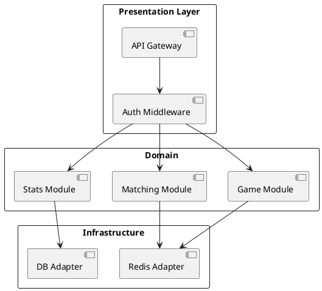
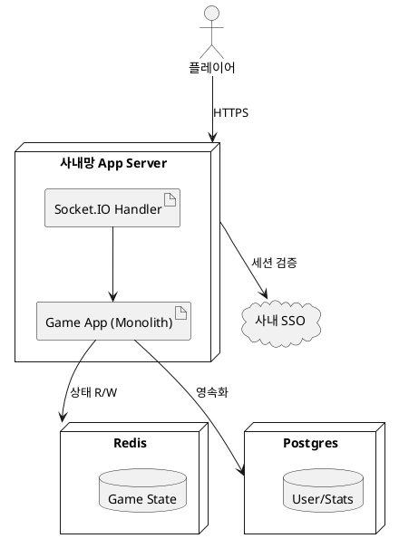
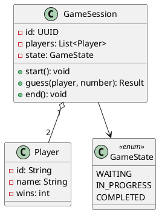
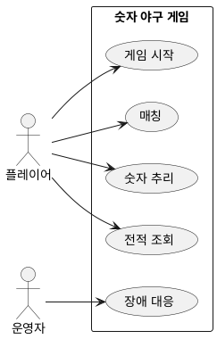
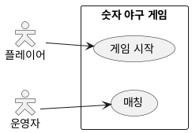
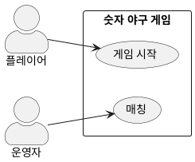
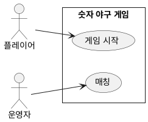
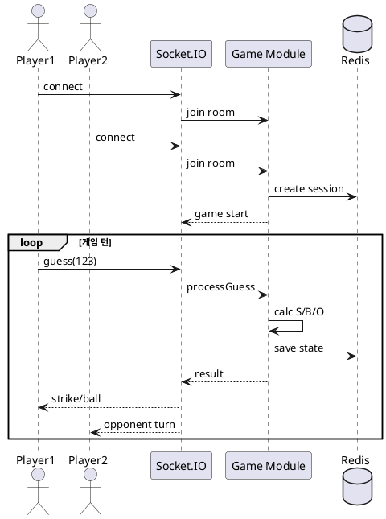

# PlantUML 로컬 렌더 테스트

Markdown Preview Enhanced + 로컬 PlantUML Server (localhost:8080) 연동 확인용.

## 1. 패키지 다이어그램

## 2. 배포 다이어그램 (한국어 테스트)

## 3. 클래스 다이어그램 (UML 엄격)

## 4. Use Case 다이어그램 — actor 스타일 비교

### 4.1 기본 (PlantUML 2026 기본 스타일)

### 4.2 전통적 stick figure (skinparam actorStyle stick)

가장 표준적인 UML stick figure — 단순 원 + 막대기.

### 4.3 Hollow (사각 박스 + 사람 아이콘)

UML 2.x 에서도 정식 — 박스 안에 작은 stick figure.

### 4.4 Awesome (사람형 아이콘, 가장 예쁜)

### 4.5 strictuml 모드 (UML 엄격)

## 5. 시퀀스 다이어그램 (Mermaid 와 비교용)

---

## 사용 방법

1. VS Code 에서 이 파일 열기
2. `Cmd+Shift+V` (또는 우클릭 → Markdown Preview Enhanced: Open Preview)
3. 각 PlantUML 블록이 SVG 로 렌더되는지 확인

## 설정 위치

`.vscode/settings.json` 의 `markdown-preview-enhanced.plantumlServer` 가 `http://localhost:8080/svg/` 로 지정됨.

## 트러블슈팅

| 증상 | 원인 | 조치 |
|---|---|---|
| "Rendering..." 이 계속 보임 | 서버 미기동 | `docker ps` 로 `plantuml-server` 상태 확인 |
| 한글이 박스로 나옴 | 폰트 fallback 문제 | SVG 는 브라우저 폰트 사용 — 실제 preview 에서는 정상 |
| 빈 다이어그램 | PlantUML 문법 오류 | VS Code Output → MPE 로그 확인 |
| HTTP 400 | UTF-8 encoding 실패 | MPE 최신 버전인지 확인 |
