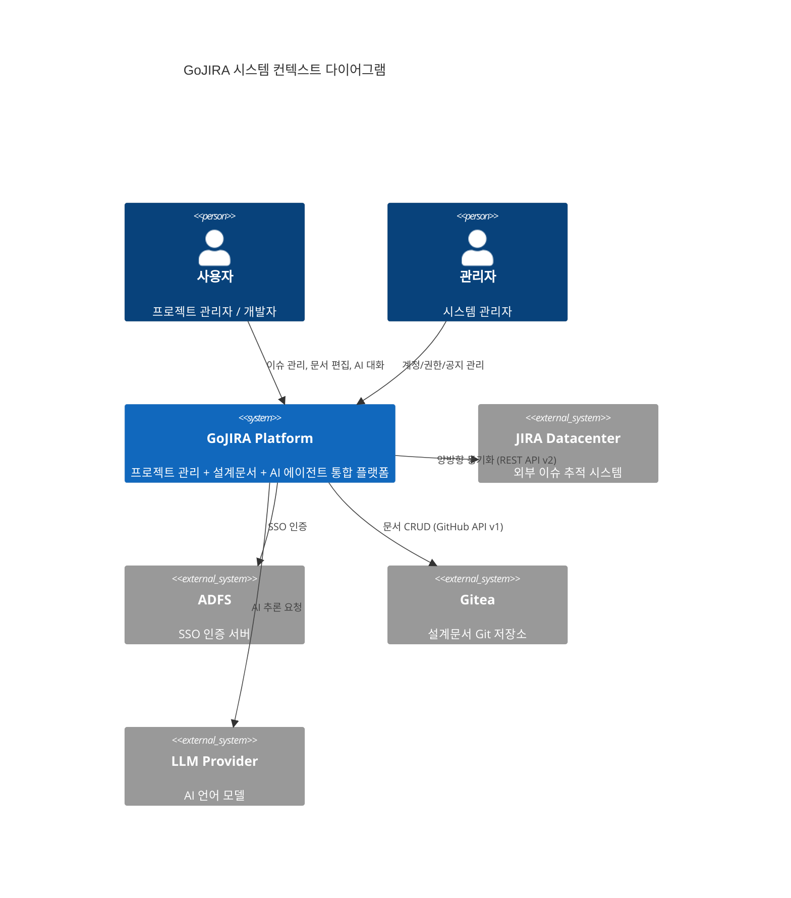
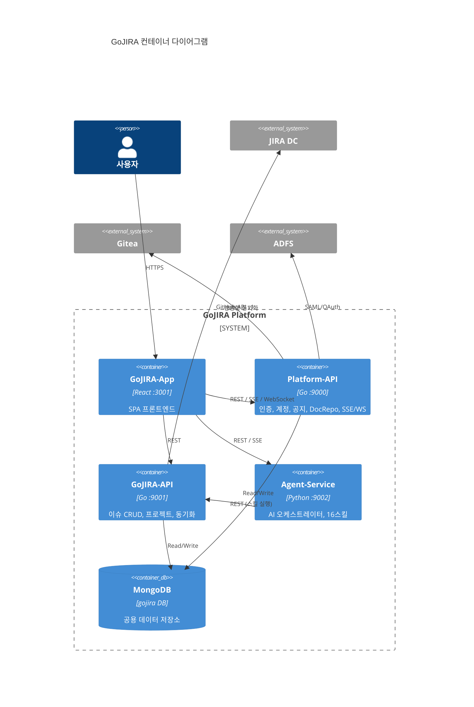
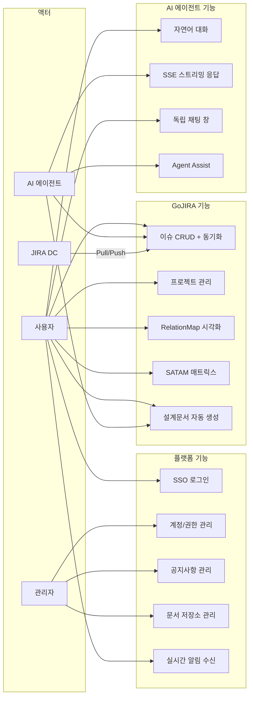
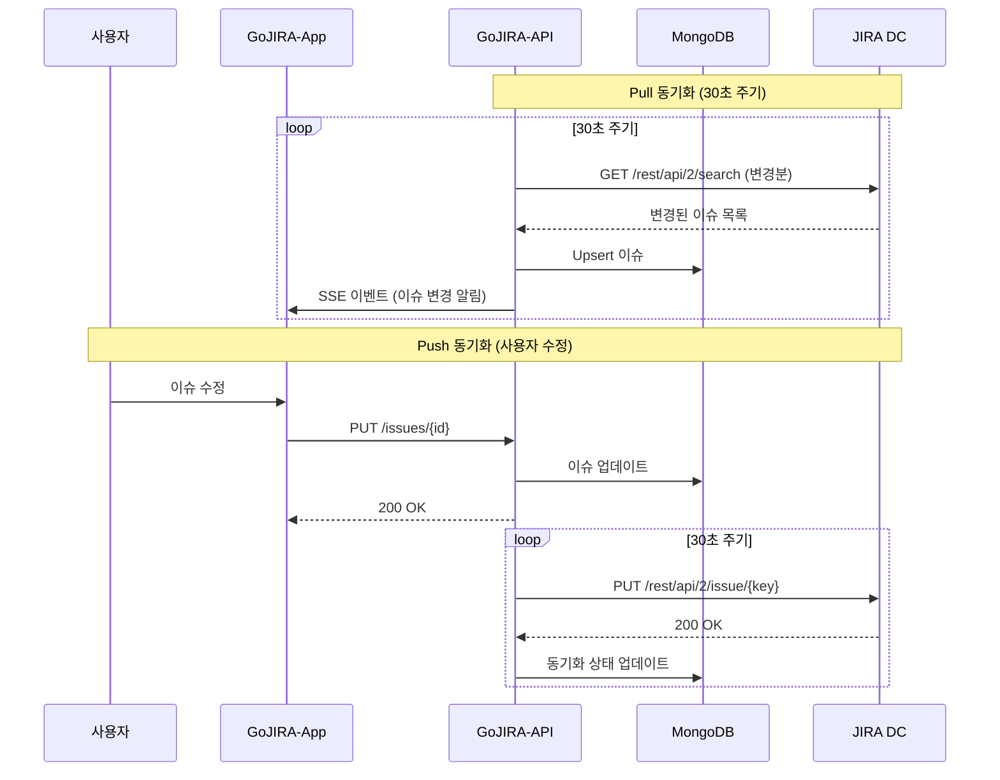
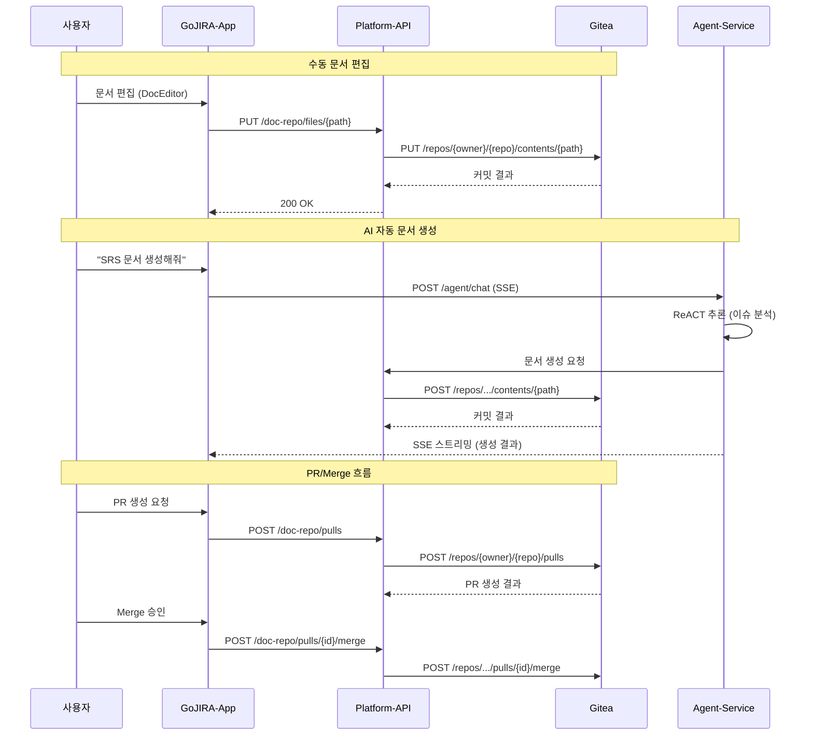
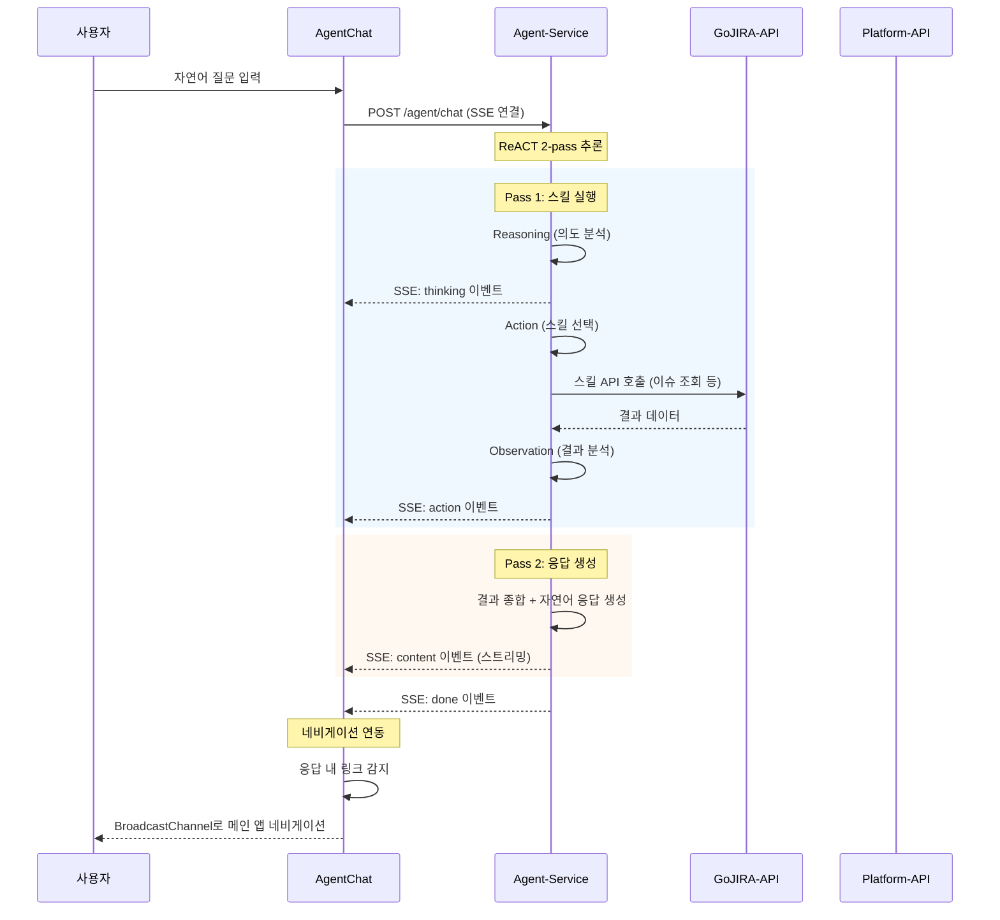
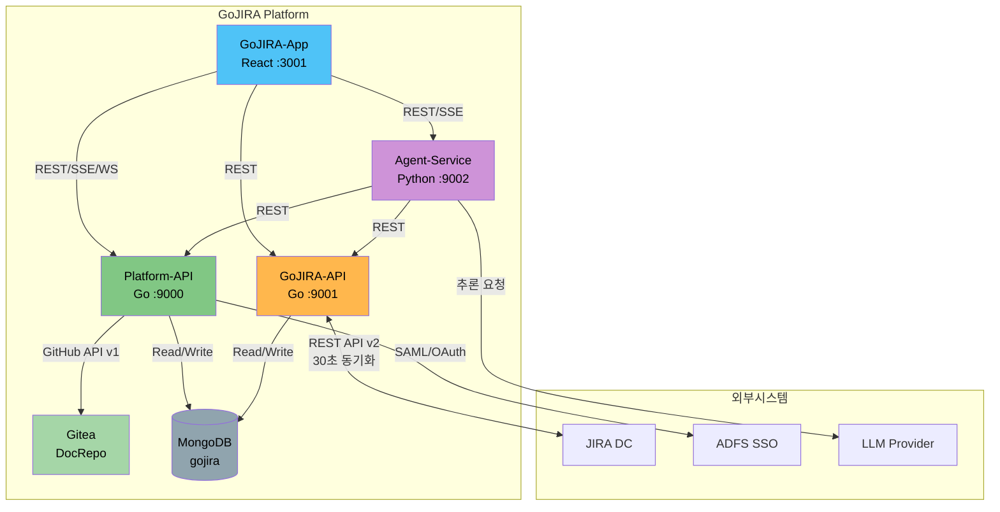

# GoJIRA 시스템 요구사항 정의서

| 항목 | 내용 |
|------|------|
| 문서명 | GoJIRA 시스템 요구사항 정의서 (SRS) |
| 버전 | 1.0 |
| 작성일 | 2026-04-10 |
| 상태 | Draft |

---

## 1. 개요

GoJIRA는 JIRA Datacenter 기반 프로젝트 관리, 설계문서 형상관리, AI 에이전트를 통합한 엔터프라이즈 플랫폼이다.

### 1.1 목적

- JIRA DC와 양방향 동기화되는 이슈 관리 환경 제공
- Gitea 기반 설계문서 형상관리 통합
- AI 에이전트를 통한 자연어 기반 프로젝트 관리 지원
- ProjectMap, RelationMap, SATAM 등 시각화 도구 제공

### 1.2 서비스 구성

| 서비스 | 기술 스택 | 포트 | 역할 |
|--------|----------|------|------|
| Platform-API | Go | :9000 | 인증(SSO), 계정/권한, 공지, DocRepo(Gitea), SSE/WebSocket |
| GoJIRA-API | Go | :9001 | 이슈 CRUD, 프로젝트, JIRA DC 양방향 동기화 |
| Agent-Service | Python | :9002 | AI 에이전트 오케스트레이터, 19개 스킬, SSE 스트리밍 |
| Platform-App | React | :3000 | 통합 컨테이너 (Host) — Account, Notice, Repository |
| GoJIRA-App | React | :3001 | 프로젝트 관리 SPA (Remote) — Module Federation |
| Gitea | Go | - | 설계문서 형상관리 (GitHub API 호환) |
| MongoDB | - | - | 공용 데이터 저장소 |
| JIRA DC | Java | - | 외부 이슈 추적 시스템 |

---

## 2. 시스템 컨텍스트

### 2.1 시스템 컨텍스트 다이어그램 (C4 Level 1)

### 2.2 컨테이너 다이어그램 (C4 Level 2)

---

## 3. 유즈케이스

### 3.1 주요 액터별 유즈케이스 다이어그램

### 3.2 유즈케이스 요약

| ID | 유즈케이스 | 주요 액터 | 설명 |
|----|-----------|----------|------|
| UC-01 | SSO 로그인 | 사용자 | ADFS 기반 SSO 인증으로 시스템 접근 |
| UC-02 | 계정/권한 관리 | 관리자 | 비트마스크 기반 조직/역할/권한 관리 |
| UC-03 | 공지사항 관리 | 관리자 | 공지 CRUD 및 비상공지 SSE 푸시 |
| UC-04 | 문서 저장소 관리 | 관리자 | Gitea 저장소 생성, PR/Merge/Branch |
| UC-05 | 실시간 알림 수신 | 사용자 | WebSocket 기반 프로젝트 알람 수신 |
| UC-06 | 이슈 관리 | 사용자, AI | 이슈 CRUD 및 JIRA DC 양방향 동기화 |
| UC-07 | 프로젝트 관리 | 사용자 | 일정, 마일스톤, 간트차트 관리 |
| UC-08 | RelationMap | 사용자 | 이슈 관계 시각화 (contains/relates) |
| UC-09 | SATAM 매트릭스 | 사용자 | Risk/Sensitivity/Mitigation 평가 |
| UC-10 | 설계문서 생성 | 사용자, AI | 이슈 기반 Markdown 문서 자동 생성 |
| UC-11 | 자연어 대화 | 사용자 | 멀티턴 AI 대화 (16개 스킬) |
| UC-12 | SSE 스트리밍 | AI 에이전트 | ReACT 2-pass 추론 + 실시간 스트리밍 |
| UC-13 | 독립 채팅 창 | 사용자 | BroadcastChannel 기반 네비게이션 |
| UC-14 | Agent Assist | AI 에이전트 | 각 메뉴별 보조 기능 제공 |

---

## 4. 기능 요구사항 (FR)

### 4.1 플랫폼 수준

#### FR-01: SSO 기반 인증

| 항목 | 내용 |
|------|------|
| ID | FR-01 |
| 우선순위 | 필수 |
| 담당 서비스 | Platform-API |
| 설명 | ADFS 기반 SSO 인증을 통한 사용자 로그인 |

- ADFS SAML/OAuth 프로토콜을 통한 통합 인증
- 인증 성공 시 쿠키 기반 세션 발급
- 세션 만료 시 자동 재인증 리다이렉트

#### FR-02: 계정/조직/권한 관리

| 항목 | 내용 |
|------|------|
| ID | FR-02 |
| 우선순위 | 필수 |
| 담당 서비스 | Platform-API |
| 설명 | 비트마스크 기반 계정, 조직, 권한 CRUD |

- 사용자 계정 생성/수정/삭제/조회
- 조직 단위 그룹 관리
- 비트마스크 기반 세분화된 권한 제어 (읽기/쓰기/관리 등)

#### FR-03: 공지사항 CRUD + 비상공지 SSE 푸시

| 항목 | 내용 |
|------|------|
| ID | FR-03 |
| 우선순위 | 필수 |
| 담당 서비스 | Platform-API |
| 설명 | 공지사항 관리 및 비상공지 실시간 푸시 |

- 공지사항 생성/수정/삭제/조회
- 비상공지 등록 시 SSE를 통한 전체 사용자 실시간 푸시
- 공지 유형 분류 (일반, 비상, 점검 등)

#### FR-04: 문서 저장소 관리

| 항목 | 내용 |
|------|------|
| ID | FR-04 |
| 우선순위 | 필수 |
| 담당 서비스 | Platform-API |
| 설명 | Gitea 기반 설계문서 형상관리 |

- Gitea 저장소 생성/삭제
- Branch 생성/관리
- Pull Request 생성, 리뷰, Merge
- 파일 CRUD (GitHub REST API v1 호환)

#### FR-05: 실시간 알림

| 항목 | 내용 |
|------|------|
| ID | FR-05 |
| 우선순위 | 필수 |
| 담당 서비스 | Platform-API |
| 설명 | WebSocket 기반 프로젝트 실시간 알림 |

- WebSocket 연결을 통한 실시간 알림 수신
- 프로젝트 단위 알람 구독/해제
- 이슈 변경, 문서 업데이트, 동기화 완료 등 이벤트 알림

---

### 4.2 GoJIRA 수준

#### FR-06: 이슈 CRUD + JIRA DC 양방향 동기화

| 항목 | 내용 |
|------|------|
| ID | FR-06 |
| 우선순위 | 필수 |
| 담당 서비스 | GoJIRA-API |
| 설명 | 이슈 생성/수정/삭제/조회 및 JIRA DC와 30초 주기 양방향 동기화 |

- 이슈 CRUD (타입: Epic, Story, Task, Bug, Requirement 등)
- JIRA DC Pull: 30초 주기로 JIRA DC 변경사항 로컬 반영
- JIRA DC Push: 로컬 변경사항 30초 주기로 JIRA DC 반영
- 충돌 해결 정책 (최신 타임스탬프 우선)

#### FR-07: 프로젝트 관리

| 항목 | 내용 |
|------|------|
| ID | FR-07 |
| 우선순위 | 필수 |
| 담당 서비스 | GoJIRA-API |
| 설명 | 프로젝트 일정, 마일스톤, 간트차트 관리 |

- 프로젝트 생성/수정/삭제/조회
- 마일스톤 설정 및 진척률 추적
- 간트차트 기반 일정 시각화

#### FR-08: RelationMap (이슈 관계 시각화)

| 항목 | 내용 |
|------|------|
| ID | FR-08 |
| 우선순위 | 필수 |
| 담당 서비스 | GoJIRA-App |
| 설명 | 이슈 간 관계를 시각적으로 표현 |

- contains (상위-하위) 관계 표현
- relates (연관) 관계 표현
- 인터랙티브 그래프 탐색 (확대/축소, 드래그)

#### FR-09: SATAM 매트릭스

| 항목 | 내용 |
|------|------|
| ID | FR-09 |
| 우선순위 | 필수 |
| 담당 서비스 | GoJIRA-App |
| 설명 | Risk/Sensitivity/Mitigation 매트릭스 관리 |

- 이슈별 Risk 레벨 평가
- Sensitivity 분류
- Mitigation 전략 매핑
- 매트릭스 시각화 및 필터링

#### FR-10: 설계문서 자동 생성

| 항목 | 내용 |
|------|------|
| ID | FR-10 |
| 우선순위 | 높음 |
| 담당 서비스 | Agent-Service, GoJIRA-API |
| 설명 | 이슈 데이터 기반 Markdown 설계문서 자동 생성 |

- 이슈 정보를 기반으로 Markdown 문서 자동 생성
- Gitea 저장소에 자동 커밋
- 템플릿 기반 문서 구조화

---

### 4.3 AI 에이전트

#### FR-11: 자연어 대화형 에이전트

| 항목 | 내용 |
|------|------|
| ID | FR-11 |
| 우선순위 | 필수 |
| 담당 서비스 | Agent-Service |
| 설명 | 멀티턴 자연어 대화 및 19개 스킬 실행 |

- 멀티턴 대화 컨텍스트 유지
- 19개 스킬 자동 선택 및 실행
  - 이슈 조회/생성/수정/삭제/링크, 프로젝트 조회, 문서 관리(목록/요약/비교/이력)
  - PR 목록/생성, 관계 분석, 일정 분석, SATAM 분석, UI 네비게이션
  - VOS 수집(vos_collect), 프로젝트 설명 인터뷰/생성(projdesc_interview/generate)
- 스킬 실행 결과를 자연어로 요약 응답

#### FR-12: SSE 스트리밍 + ReACT 2-pass 추론

| 항목 | 내용 |
|------|------|
| ID | FR-12 |
| 우선순위 | 필수 |
| 담당 서비스 | Agent-Service |
| 설명 | 실시간 SSE 스트리밍 및 ReACT 2-pass 추론 |

- SSE를 통한 실시간 응답 스트리밍
- ReACT 패턴: Reasoning → Action → Observation → Response
- 2-pass 추론: 1차 스킬 실행 → 2차 결과 종합 응답
- 디버그 뷰를 통한 추론 과정 시각화

#### FR-13: 독립 채팅 창 + BroadcastChannel 네비게이션

| 항목 | 내용 |
|------|------|
| ID | FR-13 |
| 우선순위 | 높음 |
| 담당 서비스 | GoJIRA-App |
| 설명 | 독립 팝업 채팅 창 및 메인 앱과의 네비게이션 연동 |

- 독립 브라우저 창으로 채팅 UI 제공
- BroadcastChannel API를 통한 메인 앱과의 네비게이션 명령 교환
- AI 응답 내 링크 클릭 시 메인 앱 화면 자동 전환

#### FR-14: Agent Assist

| 항목 | 내용 |
|------|------|
| ID | FR-14 |
| 우선순위 | 보통 |
| 담당 서비스 | Agent-Service, GoJIRA-App |
| 설명 | 각 메뉴(화면)별 AI 보조 기능 |

- 현재 화면 컨텍스트에 따른 AI 보조 기능 제공
- 이슈 목록: 요약, 분류 제안
- RelationMap: 누락 관계 제안
- SATAM: 리스크 평가 보조

---

## 5. 비기능 요구사항 (NFR)

| ID | 분류 | 요구사항 | 목표치 |
|----|------|---------|--------|
| NFR-01 | 성능 | API 응답 시간 | < 200ms (p95) |
| NFR-02 | 성능 | SSE/WebSocket 푸시 지연 | < 100ms |
| NFR-03 | 확장성 | 서비스 분리 (수평 확장) | 서비스별 독립 스케일링 가능 |
| NFR-04 | 보안 | 인증 및 암호화 | SSO + 쿠키 인증, AES-256-GCM 암호화 |
| NFR-05 | 감사 | 데이터 보존 및 추적 | Soft Delete, 감사 로그 기록 |
| NFR-06 | 가용성 | 외부 시스템 장애 대응 | 외부 시스템 장애 시 로컬 캐시 사용 |
| NFR-07 | 안정성 | WebSocket 자동 재연결 | 연결 끊김 시 3초 내 자동 재연결 |

### NFR 상세

#### NFR-01: API 응답 성능

- 모든 REST API의 p95 응답 시간이 200ms 이내
- 목록 조회 시 페이지네이션 적용 (기본 50건)

#### NFR-04: 보안

- ADFS SSO 기반 중앙 인증
- 쿠키 기반 세션 관리 (HttpOnly, Secure, SameSite)
- 민감 데이터 AES-256-GCM 암호화 저장
- API 간 통신 HTTPS 필수

#### NFR-05: 감사

- 모든 데이터 삭제는 Soft Delete (논리 삭제)
- 사용자 행위 감사 로그 기록 (누가, 언제, 무엇을)

#### NFR-06: 가용성

- JIRA DC 연결 실패 시 로컬 MongoDB 캐시 데이터로 서비스 지속
- Gitea 연결 실패 시 캐시된 문서 데이터 제공
- 외부 시스템 복구 시 자동 동기화 재개

---

## 6. 제약사항 (CNST)

| ID | 제약사항 | 설명 |
|----|---------|------|
| CNST-01 | JIRA DC REST API v2 호환 | GoJIRA-API는 JIRA Datacenter REST API v2 스펙을 준수해야 한다 |
| CNST-02 | Gitea API v1 (GitHub REST API 호환) | Platform-API의 DocRepo는 Gitea API v1을 사용하며, GitHub REST API와 호환된다 |
| CNST-03 | MongoDB 단일 DB | 모든 서비스는 `gojira` 단일 데이터베이스를 공유한다 |
| CNST-04 | 브라우저 지원 | Chrome 및 Edge 최신 버전만 지원한다 |

---

## 7. 데이터 흐름 다이어그램

### 7.1 이슈 동기화 흐름

### 7.2 설계문서 관리 흐름

### 7.3 AI 에이전트 흐름

### 7.4 전체 데이터 흐름 개요

---

## 부록: 요구사항 추적 매트릭스

| 요구사항 ID | 담당 서비스 | 우선순위 | 관련 유즈케이스 |
|------------|-----------|---------|----------------|
| FR-01 | Platform-API | 필수 | UC-01 |
| FR-02 | Platform-API | 필수 | UC-02 |
| FR-03 | Platform-API | 필수 | UC-03 |
| FR-04 | Platform-API | 필수 | UC-04 |
| FR-05 | Platform-API | 필수 | UC-05 |
| FR-06 | GoJIRA-API | 필수 | UC-06 |
| FR-07 | GoJIRA-API | 필수 | UC-07 |
| FR-08 | GoJIRA-App | 필수 | UC-08 |
| FR-09 | GoJIRA-App | 필수 | UC-09 |
| FR-10 | Agent-Service | 높음 | UC-10 |
| FR-11 | Agent-Service | 필수 | UC-11 |
| FR-12 | Agent-Service | 필수 | UC-12 |
| FR-13 | GoJIRA-App | 높음 | UC-13 |
| FR-14 | Agent-Service | 보통 | UC-14 |
| NFR-01 | 전체 | 필수 | - |
| NFR-02 | Platform-API | 필수 | - |
| NFR-03 | 전체 | 필수 | - |
| NFR-04 | Platform-API | 필수 | - |
| NFR-05 | 전체 | 필수 | - |
| NFR-06 | GoJIRA-API | 필수 | - |
| NFR-07 | Platform-API | 필수 | - |
| CNST-01 | GoJIRA-API | 필수 | - |
| CNST-02 | Platform-API | 필수 | - |
| CNST-03 | 전체 | 필수 | - |
| CNST-04 | GoJIRA-App | 필수 | - |
