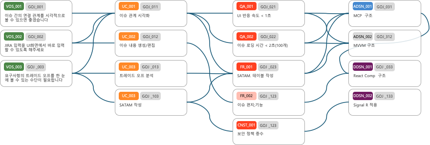
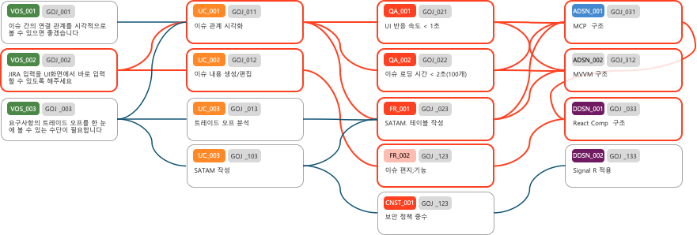

아래 그림은 구현하고자 하는 Relation Map의 UI 예시이다.

1. 이슈 타입에 따라 4개의 컬럼을 가진다 
   VOS, Feature(UC), Requirement(FR/QA/CNST), Design(ADSN/DDSN) 
2. 각 이슈는 SubKey, Key, Summary 의 내용으로 카드모양으로 구성된다
3. SubKey는 이슈의 타입에 따라 고유의 색상을 가진다 (고유 색상은 그림 참조)
4. 각 이슈는 연결된 이슈(linked issue)가 있는 경우 선(배지어곡선)으로 연결한다
5. 이슈 카드를 클릭하면 아래 그림과 같이 부모, 자식 방향으로 연결된 이슈카드를 하일라이트 한다

6. 이슈 카드이외 의 이슈를 클릭하면 이전 하일라이트를 제거한다
7. 하일라이트 상태에서 다른 이슈 카드를 클릭하면 이전 하일라이트를 제거하고 새로운 이슈 카드를 하일라이트 한다
8. 좌상단에 편집모드 버튼을 두고 클릭하면 아래와 같이 편집 모드로 진입
](image-3.png)
    8.1 각 컬럼의 하단에는 해당 컬럼 타입의 이슈를 추가로 생성하기 위한 버튼이 있다
        8.1.1 FR, QA, CNST는 하나의 컬럼에 표시되며, 해당 컬럼의 하단에는 FR, QA, CNST를 추가하기 위한 버튼이 있다
        8.1.2 ADSN, DDSN는 하나의 컬럼에 표시되며, 해당 컬럼의 하단에는 ADSN, DDSN를 추가하기 위한 버튼이 있다
        8.1.3 VOS, UC, FR, QA, CNST, ADSN, DDSN는 각각의 고유 색상을 가진다
    8.2 편집모드에서 이슈 카드의 Key 부분은 A,R,X 버튼이 생성된다 (A버튼은 Requirement의 경우에만 생성)
        8.2.1 A버튼은 해당 이슈의 labels에 "ASR"이 있을 경우 그림과 같은 활성상태로 표시 된다. 클릭하는 경우 "ASR"이 label 있으면 제거, 없으면 추가 한다 (DB에 저장)
        8.2.2 R버튼은 해당 이슈의 labels에 "Reserved"이 있을 경우 그림과 같은 활성상태로 표시 된다. 클릭하는 경우 "Reserved"이 label 있으면 제거, 없으면 추가 한다 (DB에 저장)
        8.2.3 X버튼은 해당 이슈를 삭제한다. 삭제 여부르 확인하는 팝업을 띄운다 (DB에 저장)
        8.2.4 이 항목의 동작은 DB 뿐만 아니라 JIRA API를 통해서도 동기화 되어야 한다.
    8.3 편집모드에서 이슈 카드의 연결점 부분에는 Dot이 표시되고 Dot을 클릭하면 Mouse Pointer가 십자가 모양으로 변경되고, Pointer가 이동하는 위치로 하이라이트 색상의 선이 그려진다.
        이 상태에서 다른 이슈 카드의 왼쪽 Dot을 클릭하면 연결이 생성된다. 연결이 생성되면 선이 그려지고, DB에 저장된다. 
        ESC를 누르면 연결선 그리기가 취소된다.
        8.3.1 이 항목의 동작은 DB 뿐만 아니라 JIRA API를 통해서도 동기화 되어야 한다.   
    8.4 편집모드에서 연결선 위에 마우스가 올라가면 하이라이트 되고, 이때 클릭하면 연결선을 제거할 것인지 뭇는 팝업을 띄운다. 팝업에서 "예"를 클릭하면 연결선이 제거되고, DB에 저장된다. 
        8.4.1 이 항목의 동작은 DB 뿐만 아니라 JIRA API를 통해서도 동기화 되어야 한다.   
    8.5 이슈 카드의 내용 부분을 클릭하면 아래와 같이 편집 모드로 진입하여 수정 가능하다. 수정 내용은 DB에 저장되고, JIRA API를 통해서도 동기화 되어야 한다. 
    8.5 이슈 카드의 서브키 부분을 클릭하면, 이슈의 상세 수정 다이얼로그를 띄운다. 여기서 수정된 내용은 DB에 저장되고, JIRA API를 통해서도 동기화 되어야 한다.     
    
        
    
        
    
