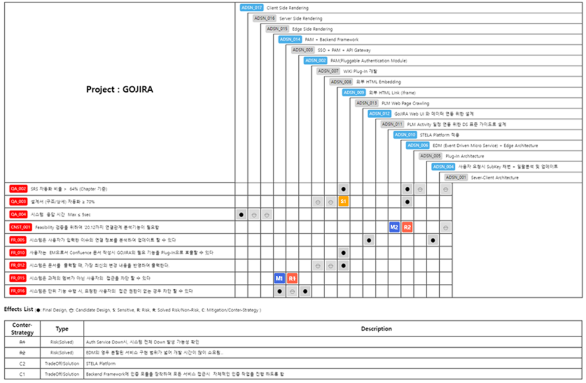
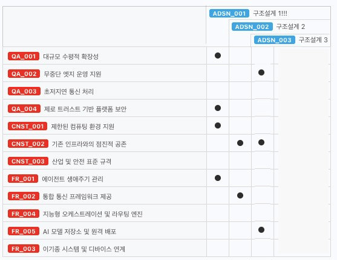
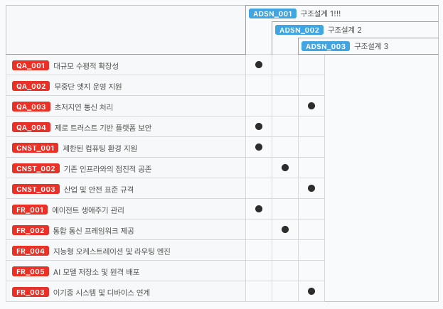

위 이미지는 SATAM 테이블의 예제로 이를 참조하여 아래 기능을 구현 해보자.
relation map과 공통된 기능들이 있으니 참조하자. (공통기능을 분리하여 재사용 가능하도록 구현할 것)

* ADSN 의 risk, sensitivity, trade-off 의 내용은 yaml 양식으로 기록된다
  아래의 내용을 읽어서 Risks, Sensitivities, Trade-offs 를 생성한다

  예시:

  Risks // 이 부분은 생성해야 하는 부분, 아래 부분은 이슈의 risk 필드를 읽어들인 내용
    - ID : ...  //  risk 의 ID (R1, R2, ...)
      QA : [...] //  risk로 영향을 받는 QA의 이슈 key (예: [GOJIRA-001, GOJIRA-002])
      Description : ... //  risk의 상세 내용

  Sensitivities // 이 부분은 생성해야 하는 부분, 아래 부분은 이슈의 sensitivity 필드를 읽어들인 내용
    - ID : ...  //  sensitivity 의 ID (S1, S2, ...)
      QA : [...] //  sensitivity로 영향을 받는 QA의 이슈 key (예: [GOJIRA-001, GOJIRA-002])
      Description : ... //  sensitivity의 상세 내용

  Trade-offs // 이 부분은 생성해야 하는 부분, 아래 부분은 이슈의 trade-off 필드를 읽어들인 내용
    - ID : ...  //  trade-off(Mitigation) 의 ID (M1, M2, ...)
      QA : [...] //  trade-off(Mitigation)로 영향을 받는 QA의 이슈 key (예: [GOJIRA-001, GOJIRA-002])
      Counter Risk : [...] //  trade-off(Mitigation)로 Mitigation 되는 가능한 Risk의 ID와 이슈 key의 조합(예: ["R1:GOJIRA-001", "R2:GOJIRA-002", ...])
      Description : ... //  trade-off(Mitigation)의 상세 내용


## 구현 사양

### 1. 테이블 축 구성
- 가로축(컬럼): Design 이슈 (Architectueral Design = ADSN)
- 세로축(행): Requirement 이슈 (QA, FR, CNST)

### 2. 정렬
- relation map과 동일한 방식으로 소팅 (서브타입 순서 QA>CNST>FR, ASR 라벨 우선, 서브키 오름차순)

### 3. 교차 셀 표시 규칙
- 셀 내부에 라운드 사각형(border-radius: 3px)으로 마크 표시
    3.1. 디자인의 risk에 해당 행의 requirement key가 등록된 경우, 해당 risk의 ID를 빨강(#e83a1e)으로 표시
    3.2. 디자인의 sensitivity에 해당 행의 requirement key가 등록된 경우, 해당 sensitivity의 ID를 파랑(#4cafe8)으로 표시
    3.3. 디자인의 trade-off에 해당 행의 requirement key가 등록된 경우, 해당 trade-off의 ID를 주황(#ff9a1e)으로 표시
    3.4. 둘 이상 중복 시 Risk > Sensitivity > Trade-off 우선순위로 위에서 아래로 세로 나열한다 (각 타입별 개별 마크)
    3.5. requirement의 issueLink에 해당 design이 contains로 연결된 경우:
         - R/S/M이 없으면 검은색 원(10px)을 표시
         - R/S/M이 있으면 해당 마크에 3px 두께의 검은 테두리를 그린다
    3.6. 위의 모든 경우에 해당되지 않으면 빈칸으로 둔다
- Counter Risk에서 체크된(mitigate된) risk의 ID는 전체 테이블에서 취소선(line-through)으로 표시한다
  (셀 마크 + 하단 Effects 테이블 ID 컬럼 모두 적용)

### 4. CommonBar
- relation map과 동일한 방식으로 배치
- 옵션 버튼: A(ASR 필터), R(Reserved 필터)
- Pull, 편집모드 토글

### 5. 편집모드

편집모드가 되면 모든 교차 셀을 기본 버튼 형식(lightgray 배경, 흰색 안쪽 경계선)으로 배치한다.
3.4에 해당하는 경우(중복 타입) 각각의 타입을 별도 버튼으로 표시한다.

#### 5.1 수정 팝업
셀의 마크 버튼을 왼쪽 클릭하면 컨텍스트 메뉴(5.4)가 뜨고, "수정"을 선택하면 아래 팝업이 열린다.

```
--[디자인 서브키]-----------------------------------
| 디자인 summary                                   |
-------------------------------------------------
Is
    () Sensitivity   <- 해당 requirement에 대한 sensitivity가 등록된 경우 언더바 표시
    () Risk          <- 해당 requirement에 대한 risk가 등록된 경우 언더바 표시
    () Mitigation    <- 해당 requirement에 대한 trade-off가 등록된 경우 언더바 표시
Of
--[Requirement 서브키]-----------------------------
| Requirement summary                             |
-------------------------------------------------

*Mitigation인 경우에만 아래 표시:
Counter-Risk:
[] R1  [v] R2 ...   <- 해당 requirement를 대상으로 하는 전체 risk 목록
                       체크된 risk에 대해 mitigation이라는 의미

Description
-------------------------------------------------
| risk, sensitivity, trade-off의 내용              |
-------------------------------------------------
```

#### 5.2 라디오 버튼 활성화 규칙
- mitigate 되지 않은 risk를 클릭한 경우: Sensitivity로만 변경 가능 (Risk, Sensitivity 활성 / Mitigation 비활성)
- Sensitivity를 클릭한 경우: Risk로만 변경 가능 (Risk, Sensitivity 활성 / Mitigation 비활성)
- 이외의 경우(mitigate된 risk, mitigation 등): 라디오 전체 비활성, description만 수정 가능
- 추가 모드(5.4 "추가"에서 진입)에서는 모든 라디오 활성화

#### 5.3 저장
- 저장 클릭 시 해당 ID의 내용을 수정 저장한다
- 타입이 변경된 경우(예: Risk→Sensitivity) 기존 항목에서 해당 requirement를 제거하고 새 타입에 추가한다
- 추가 모드에서는 새 항목을 생성한다

#### 5.4 셀 컨텍스트 메뉴
셀의 마크 라벨을 왼쪽 클릭하면 팝업 메뉴가 뜨고 아래 기능을 제공한다.
빈 셀을 클릭해도 동일한 메뉴가 뜬다 (단, "수정"/"삭제"는 마크가 있을 때만 표시).

- **수정**: 해당 항목의 수정 팝업을 연다 (5.1 참조)
- **삭제**: 해당 R/S/M 항목에서 이 requirement를 제거한다
- **추가**: 새로운 R/S/M 정보를 추가한다. 수정 팝업을 띄우되 Is~Of 라디오 버튼을 모두 활성화한다.
  ID는 전체 디자인 이슈의 R/S/M ID를 대상으로 최대값+1로 순차 산출한다
- **Link as Solution**: 해당 requirement와 design을 contains로 연결한다
- **Remove from Solution**: 해당 requirement와 design의 contains 연결을 해제한다

### 6. 가로축 헤더 (계단식)
- 디자인 이슈를 계단식(staircase) 구조로 표시
- 각 디자인 행이 해당 컬럼 위치부터 오른쪽 끝까지 colSpan으로 병합하여 [SubKey] Summary를 가로로 표시
- 테두리: 각 라벨 셀에 ┌ 형태(border-left + border-top), 빈 셀에 세로선(border-right)만 표시
- 디자인 컬럼 우측에 라벨 확장용 여분 컬럼 1개 배치

### 7. 하단 표시
- Effects Legend: Contains(검은 원), Sensitivity(파랑), Risk(빨강), Mitigation(주황) 범례
- Effects Table: 전체 디자인의 R/S/M 항목을 Counter Strategy / Type / Description 컬럼으로 표시
  mitigate된 Risk 행의 ID에 취소선 적용

### 8. 데이터 구조
- 디자인 이슈별 사전: `dicts.byDesign[designKey]` → { risks, sensitivities, mitigations }
- QA별 사전: `dicts.byQA[reqKey]` → { risks, sensitivities, mitigations } (전체 디자인 대상)
- 전역 resolved Risk ID: 모든 디자인의 mitigation counterRisk에서 수집
- 모두 `useMemo`로 캐싱하여 성능 최적화

### 9. 라우팅
- App.js에서 `page === 'satam'` 시 SATAM 컴포넌트 렌더링
- ProjectMap의 컨텍스트 메뉴 "SATAM" 클릭으로 진입
- `onSATAM` prop을 통해 프로젝트 정보 전달



